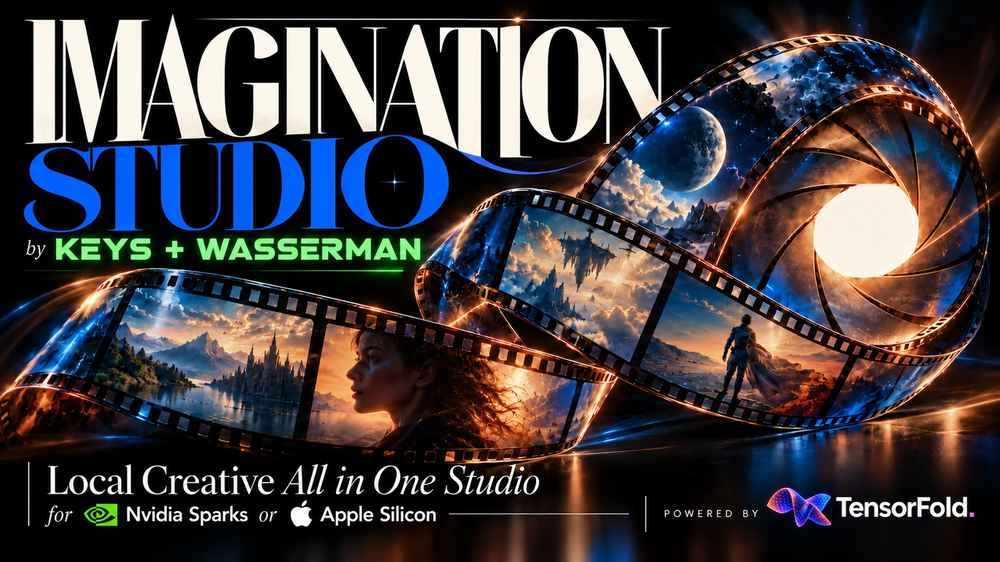
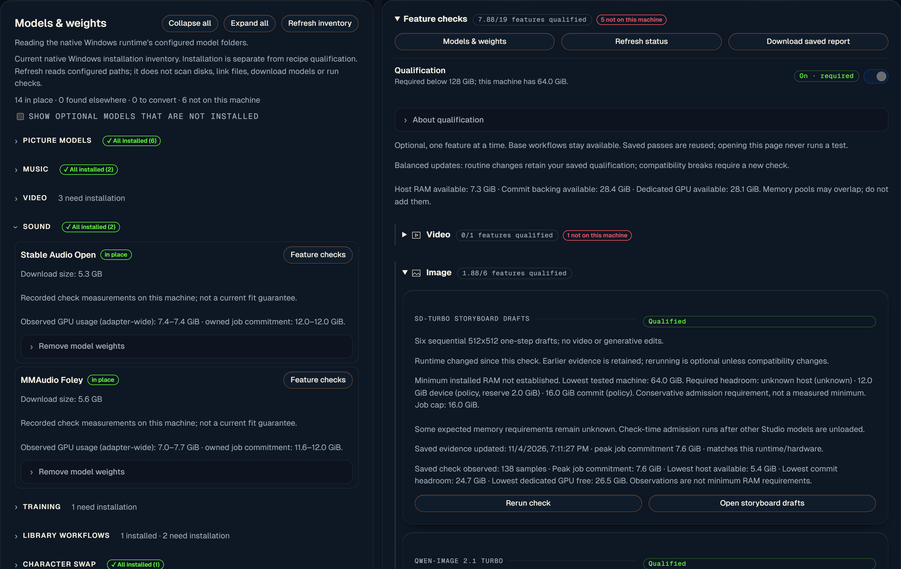

# Imagination Studio by keys+Wasserman, powered by TensorFold

A local film studio: plan a film, generate pictures, video, voices and music, then edit and export it.
Use Windows (natively, no WSL), an Apple-silicon Mac, or a supported NVIDIA Linux machine.
Available models and settings depend on the machine, installed components and runtime memory.



**Start here:** [Windows](#windows) · [Mac](#mac) · [NVIDIA Linux](#nvidia-linux) ·
[Using Studio](#using-studio) · [Documentation](#documentation)

## Windows

**Studio runs natively on Windows; there is no WSL version.** The native GPU setup targets **Windows 11 on Arm with an
NVIDIA RTX Spark**, with 128 GB configurations intended for the full feature set. Smaller machines can use
features that fit their GPU/runtime memory requirements and pass local validation.
Planning, imports, settings and media browsing do not require large model downloads.

Run the Windows installer in an administrator PowerShell:

```powershell
Invoke-WebRequest https://raw.githubusercontent.com/drowzeys/Imagination-Studio-by-keys-Wasserman/main/oneshot-setup-rtx-spark-n1x.ps1 -OutFile "$env:TEMP\studio-setup.ps1"
powershell -ExecutionPolicy Bypass -File "$env:TEMP\studio-setup.ps1"
```

The installer clones Studio, sets up the selected components, and registers Desktop/Start shortcuts and a
notification-area tray icon. Review the model licences, download sizes and runtime-fit plan before proceeding.
It is a component/model installation, not just a download-free UI launcher.

Open **Imagination Studio** from Desktop or Start, then use **http://127.0.0.1:7870**.
The tray starts Studio and stops it after an idle, confirmed stop.
[Component selection, UI-only setup and tray details](docs/windows.md).

Already have a local checkout? Register its tray and shortcuts without installing models:

```powershell
powershell -ExecutionPolicy Bypass -File scripts\setup-windows-desktop.ps1 -Backend native
```

**Add models from Settings → Models & weights:** see download sizes, measured memory usage and setup commands.
Below 128 GiB RAM, setup helps avoid huge downloads unlikely to run; an explicit flag lets you proceed anyway.
See [Windows setup](docs/windows.md) for the details.

**Verify features in Machine → Feature checks.** Checks are opt-in renders on this machine, not background
startup tests. Each passed recipe enables its tested settings; groups run recipes sequentially and retain
individual passes. Failed larger checks do not remove smaller passes.



Actual Windows UI: installation, successful checks and failed/unchecked recipes are shown separately.

| Installed physical RAM | Qualification gating and badges |
|---|---|
| Below 128 GiB, or capacity unknown | Required; unverified recipes stay gated |
| **128 GiB or more** | **Off by default and optional**; no qualification run is required just to use an installed feature |

At 128 GiB+, you can turn qualification on if wanted. Diagnostics and individual checks remain available either
way. **Prerequisites, supported settings, backend policy and live memory guards always apply.** The threshold
is a verification-policy default, not a guarantee that every model fits.

GPU memory, Windows commit backing and available system RAM are separate limits; download size is not a RAM
requirement. Adaptive setup currently uses known admission policies, not a complete predictive model for every
recipe. For example, a 64 GB RTX Spark's GPU carve-out may not meet Voice's current requirement even though other
image and sound recipes work. On a 128 GB RTX Spark the firmware gives the GPU about 98 GB and Windows about 30 GB;
the models load straight into the GPU's share ([how](docs/rtx-spark-n1x.md#memory)).

[Native setup, components and qualification](docs/windows.md) ·
[Measured Windows results and troubleshooting](docs/windows-rtx-spark-testing.md) ·
[RTX Spark hardware, memory pools and measurements](docs/rtx-spark-n1x.md)

## Mac

Use Apple silicon and macOS 26+; the fast native video path needs an M5-family chip.
The installer requires **48 GB for pictures only**, **96 GB for the standard video install**, and **128 GB for
Turbo/Ref2VA**. Allow about **185 GB free disk** for the standard setup; optional models need more.
Requirements derive from measurements on an M5 Ultra; smaller Macs and M1–M4 video paths are not equivalent
hardware measurements and may be much slower.

```bash
brew install python@3.11 uv ffmpeg
git clone https://github.com/drowzeys/Imagination-Studio-by-keys-Wasserman.git
cd Imagination-Studio-by-keys-Wasserman
bash oneshot-setup.sh --app
```

Open **Wasserman Slate AI Studio** in Applications. The app is a local launcher around this clone; rebuild it
if you move the clone. Use `--image-only` for pictures without the video installation.

[Mac installation and hardware details](docs/installation.md#install-and-the-one-click-app) ·
[Install flags](docs/installation.md#install-flags)

## NVIDIA Linux

**DGX Spark:** GB10, 128 GB unified memory, DGX OS and Docker for the prebuilt engines.
Allow about **125 GB free disk** for the core install, or about **400 GB** with the optional models.

```bash
git clone https://github.com/drowzeys/Imagination-Studio-by-keys-Wasserman.git
cd Imagination-Studio-by-keys-Wasserman
sudo apt install -y git ffmpeg
bash oneshot-setup.sh
bash scripts/app.sh
```

The app opens at **http://127.0.0.1:7870**. Review the installer checklist; `--all` requests the optional models.
Without Docker, building the CUDA engines requires the supported toolkit and compiler setup.

For other GPUs, use the machine-specific instructions rather than assuming Spark's unified-memory budget:

- [RTX Pro 6000 and local GPU workers](docs/rtx-pro-6000.md)
- [RTX 5090](docs/rtx-5090.md)
- [Two-GPU rendering](docs/two-gpus.md)
- [Multiple Spark machines](docs/multi-spark.md)

[Linux setup, memory guard and upgrades](docs/installation.md#dgx-spark-cuda-build)

## Using Studio

- **Story & Production:** import scripts, plan shots, maintain a film bible and build storyboards.
- **Image & Video:** choose a model, make candidates, edit pictures and generate clips with sound.
- **Sound:** Fish Audio Drama 3 voices, MiniMax-Music3/YuE2 songs, effects and Foley where supported.
- **Edit & Finish:** organize takes, grade, mix, create motion graphics and export to an editor.
- **Machine & Settings:** see runtime memory, model installation, qualifications and connected tools.

On Windows, start with the on-page controls and their PowerShell setup commands. Mac/Linux shell recipes live
in the [command-line guide](docs/cli.md); they are not native Windows commands.

Projects, renders and uploads are kept under **`~/ImaginationStudio`**, or `STUDIO_HOME`.
Native Windows environments and models normally live under **`%LOCALAPPDATA%\ImaginationStudio`**.
Back up projects and media before changing installations; model files and Python environments are separate.

### Updates

Save work and stop through the tray/app launcher before updating. In a clean Git clone, pull the branch you
follow. Mac/Linux installs can then run `bash oneshot-setup.sh --upgrade`; restart afterward.
Native Windows components use their PowerShell setup/verification scripts—do not run the Linux upgrade command
there. The supported Mac/Linux launcher also offers [in-app source updates](docs/installation.md#updating-studio);
source updates and model/runtime installation are separate operations.

### The access key

Studio binds to localhost by default; this computer does not need a browser access key.
Other devices require the Studio access key. Use **Settings → Access key** for the QR code and remote-device
sign-in. Never post keys, tokens or private addresses in issues, logs or screenshots.

[Phone/remote access](docs/user-guide.md#using-it-on-your-phone)

## Documentation

| Guide | Contents |
|---|---|
| [Windows](docs/windows.md) | Native setup, components, qualification and tray |
| [Mac & Linux installation](docs/installation.md) | Hardware, install flags, upgrades, memory guards and workers |
| [Moving an install](docs/moving-an-install.md) | Reusing models and compiled Python packages, similar-machine copies and cross-platform limits |
| [User guide](docs/user-guide.md) | Screenshots, phone access, image/video tools, Slate and the Library |
| [Voice, music and brains](docs/audio-guide.md) | Audio backends, song engines, references and local brains |
| [Production workflows](docs/production-guide.md) | Beat edits, Finish, motion graphics and Motion Previs |
| [LoRAs](docs/lora-guide.md) | Hub, licences, essential adapters and training |
| [Command-line recipes](docs/cli.md) | Mac/Linux image, video and reference commands |
| [Engine notes](docs/engine-notes.md) | Rendering architecture, native engines and audio processing |
| [Performance evidence](docs/performance.md) | Dated measurements and picture-model comparisons |
| [Updating model measurements](docs/model-measurements.md) | Changed-only/forced qualification sweeps and shared JSON |
| [Release history](docs/changelog.md) | Earlier release notes, retained as historical context |

[Tutorial](TUTORIAL.md) · [Licences and attribution](docs/licensing.md) · [Brand guide](docs/BRAND.md)

## Licence, credits and support

Studio code is **Apache-2.0**: [LICENSE](LICENSE), [NOTICE](NOTICE), [citation](CITATION.cff).
Models and bundled tools retain their own licences. **Qwen-Image-2.1 and MMAudio weights are non-commercial;
MiniMax H3 has territory limits; Fish Audio hosted services need separate licensing.** Check each model's
terms before commercial use. Weights are not redistributed by this repository.

**Keys (drowzeys)** built Studio and its engine integrations with **Sam Wasserman and Wasserman Productions**,
who shaped the filmmaking workflow and Wasserman's Filmmaker Suite. Powered by **TensorFold**; built with
**Qwen**, **Fish Audio** and **MiniMax-Music3**, with contributions from the makers of all the models and tools.
Retain the required attribution in forks and redistributions.

Full credits and notices: [CREDITS.md](CREDITS.md), [THIRD_PARTY_NOTICES.md](THIRD_PARTY_NOTICES.md),
and [licensing details](docs/licensing.md).
*Named at the request of the TensorFold project: this is an app built on TensorFold, not a TensorFold product.*

Use GitHub **Issues** for bugs/install trouble and **Discussions** for questions and ideas.
Report vulnerabilities privately through GitHub: [SECURITY.md](SECURITY.md).
