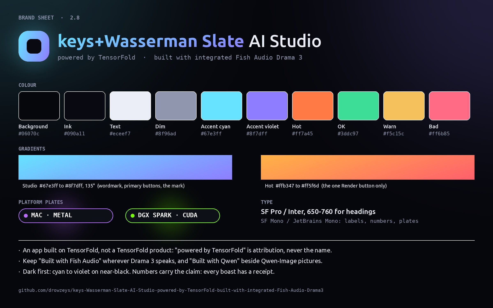

# Brand guide: keys+Wasserman Slate AI Studio

This guide covers how the Studio is named, how it looks and how it speaks: in the app, on GitHub, in posts and in
videos. The colours are the app's own (`:root` in `app/static/index.html`). The naming rules are the ones agreed with
the TensorFold project and the model makers.

## 1. The name

| Use | Form |
|---|---|
| Full name, first mention | **keys+Wasserman Slate AI Studio, powered by TensorFold, built with integrated Fish Audio Drama 3** |
| Title, in the app and on cards | **Wasserman Slate AI Studio** · powered by TensorFold · built with integrated Fish Audio Drama 3 |
| Short name, after the first mention | **the Studio**, or **Wasserman Slate AI Studio** |
| The film-workflow tab | **Wasserman Slate AI Studio** (Sam Wasserman's Slate, ported) |
| Hashtags and handles | #WassermanSlate #AIStudio #DGXSpark #AppleSilicon |

**Rules:**
- **The Studio is an app built on TensorFold, not a TensorFold product.**
  - "Powered by TensorFold" is attribution. Never make it the name: not "TensorFold Studio" and not "TF Studio".
  - Keep the README's line: *Named at the request of the TensorFold project: this is an app built on TensorFold, not a
    TensorFold product.*
- **Never put the TensorFold name next to abliterated or uncensored models,** in any post, picture, repo or video.
  - The Studio's README, repo description and marketing never mention them.
- **"keys+Wasserman"** is written that way: lower-case keys, a plus with no spaces, and Wasserman with a capital.
- **Sam Wasserman** (wassermanproductions.com) is credited by name wherever the film workflow is shown: Slate, the
  Sharp Spec, Motion Previs and the 80s Horror LoRA.

## 2. Model and partner credits (required)

| Where it appears | The line to carry |
|---|---|
| Anything Drama 3 speaks: Voice tab, voice-over, demo audio | **Built with Fish Audio**, and name the model as Fish Audio Drama 3 |
| Qwen-Image pictures | **Built with Qwen**; the model is Qwen-Image-2.1 (Qwen 2.1 Turbo / Qwen 2.1 Full in the UI) |
| FLUX pictures | **FLUX3-K** in the UI. In prose: FLUX 3 Image Klein by Black Forest Labs |
| Video with sound | MiniMax H3 / FastH3. With an H3 LoRA: *Powered by MiniMax H3* |
| Songs from the Music tab: in the app, in soundtracks, in demo audio | **MiniMax-Music3** (required in a commercial UI by its licence); in prose: MiniMax Music 3 by MiniMax |
| Long-form credits | The README's thank-you list and [CREDITS.md](../CREDITS.md): authors first, no credit hyperlinks except Motion Previs Studio |

**Licence reminders, for anything public:**
- **Qwen-Image-2.1** is non-commercial (Qwen Research License).
- **FLUX 3 Image Klein** is under the FLUX Kommunity License.
- **MiniMax H3** limits territories.
- **Fish Audio Drama 3** is under the Fish Audio Community License: a hosted text-to-speech or voice-cloning service
  needs Fish's own licence.
- **MiniMax-Music3** (the Music tab) allows commercial use, but a commercial UI must display "MiniMax-Music3"; above
  US$20M yearly revenue MiniMax's written authorisation is needed; a hosted service keeps misuse safeguards.
- **Never redistribute weights.** When someone asks about selling outputs, point them to the licences.
- **Never call Fish Audio's cloud.** The Studio is local.

## 3. Positioning

**One line:** an AI film studio on your own machine.

**Elevator pitch:** plan a film the way a crew does, then render it on your own hardware.
- **Plan:** Sam Wasserman's Slate gives you scenes, shots, a bible and a cast.
- **Render:** pictures from FLUX3-K and Qwen-Image, video with sound from MiniMax H3, and voices from Fish Audio
  Drama 3.
- **Where:** on an Apple-silicon Mac or on one or more NVIDIA DGX Sparks.
- **No cloud.**

**Three pillars:**
1. **The crew's workflow, not a prompt box.** Slate's scenes, shots and bible, Motion Previs, and the Sharp Spec QA
   gate.
2. **Your hardware.** Metal on a Mac, CUDA on DGX Spark, and one pass split across several Sparks. Nothing leaves the
   machine.
3. **Measured, not promised.** Every claim has a receipt: times, memory, and a test anyone can rerun.

**Proof points** (from the README; quote them with the machine and the size):
- A 5 s clip with sound in **81 s** on a Mac Studio M5 Ultra, at 864x480 with 29 GB peak.
- A FastH3 clip in **43.5 s** on three DGX Sparks over RoCE, at 864x480.
- Fish Audio Drama 3 on Metal at **84 frames/s**, with first audio in 0.15 s.
- A picture in **4.7 s** (Qwen 2.1 Turbo, Mac) and about **10 s** (FLUX3-K Fast, either machine), from the
  [picture shootout](picture-shootout.md).

## 4. Voice and tone

- **Plain and measured.** Write as the README does: short sentences, active voice, numbers with their units and
  machine.
- **Receipts over adjectives.** Write "81 s on an M5 Ultra", not "blazing fast". Write "8 of 8 right on the layout
  prompt", not "amazing prompt following".
- **Say the limits.** Name what is untested and what is slow. Credibility is the brand.
- **Credit generously, and first.** Almost everything here is someone else's work, ported, pinned and measured.
- **Avoid** "revolutionary", "game-changing", "the first ever" (unless measured and sourced), "unlimited", "free" (the
  licences have terms), and any comparison that names a competitor without a same-machine measurement.

## 5. Visual identity

**The mark:** a rounded square in the Studio gradient, with a smaller ink square inside. It is the app header's dot,
which reads as a slate or a lens.
- Corner radius about 32 % of its size.
- Keep a glow of cyan at about 45 % opacity on dark backgrounds.

**The lockup:**
- The mark on the left.
- "keys+Wasserman Slate" in the gradient.
- "AI Studio" in Text white.
- The attribution line below it in mono, in Dim.

**Colour:**

| Token | Hex | Use |
|---|---|---|
| Background | `#06070c` | Every surface: dark first |
| Ink | `#090a11` | Inside the mark, text on gradient buttons |
| Text | `#eceef7` | Body and headings |
| Dim | `#8f96ad` | Secondary text, labels, attribution |
| Accent cyan | `#67e3ff` | Gradient start, focus, links |
| Accent violet | `#8f7dff` | Gradient end |
| Hot | `#ff7a45`; gradient `#ffb347` to `#ff5f6d` | The Render button only: one hot action per screen |
| OK / Warn / Bad | `#3ddc97` / `#f5c15c` / `#ff6b85` | Status only, never decoration |

**Background:**
- The page's two soft glows: cyan at the top left, violet at the top right.
- Each glow is 13-15 % opacity, on Background.

**Platform plates:** neon pills in mono capitals.
- **Mac:** violet `#b96bff` to `#7d5cff`.
- **DGX Spark:** green `#76ff03` to `#00e676`.
- Use them wherever a screenshot, clip or number needs its machine named.

**Type:**
- **Headings and body:** SF Pro, Inter or Segoe UI, with headings at 650-760 weight.
- **Labels, numbers, plates and code:** SF Mono, JetBrains Mono or Menlo, in small capitals with wide tracking.

**Pictures and video:**
- Show real output from the Studio, and caption it with the model, machine, size and time.
- The banner and demo stills are made in the Studio. Say so: *made with this studio's own Qwen-Image-2.1 step*.
- End cards:
  - Background, with the lockup centred.
  - Then the credit line: *Built with Fish Audio · Built with Qwen · FLUX 3 Klein by Black Forest Labs · MiniMax H3 · MiniMax-Music3* (the last only where a song plays).
- No third-party logos (Apple, NVIDIA, Fish Audio, BFL, Qwen, MiniMax) unless their brand rules allow it. Name them in
  text.

## 6. Do and don't

| Do | Don't |
|---|---|
| "keys+Wasserman Slate AI Studio, powered by TensorFold" | "TensorFold Studio", "the TensorFold app" |
| Name the machine and size with every number | Quote a time with no machine, size or step count |
| Show Studio-made pictures and clips | Use stock or other generators' output as if it were the Studio's |
| Carry "Built with Fish Audio" on any Drama 3 audio | Clone a real person's voice for a promo |
| Credit Sam Wasserman for the film workflow | Present Slate, the Sharp Spec or Motion Previs as our invention |
| Say what is untested | Promise a 30-minute film's look, or voice cloning |
| Dark backgrounds, cyan to violet | Hot orange anywhere but the one Render action |

## 7. Assets

- `docs/screenshots/imagination-studio.webp`: the GitHub banner since 3.0 (the poster); `samples/banner.jpg` was the one before, made in the Studio.
- `docs/brand/brand-sheet.jpg`: this page's sheet.
- `samples/demo_mac_280.jpg` and the [60 s demo](https://github.com/drowzeys/keys-Wasserman-Slate-AI-Studio-powered-by-TensorFold-built-with-integrated-Fish-Audio-Drama3/releases/download/v2.8.0/wasserman-studio-mac-demo.mp4).
- `samples/ui_*.png`: app screenshots.
