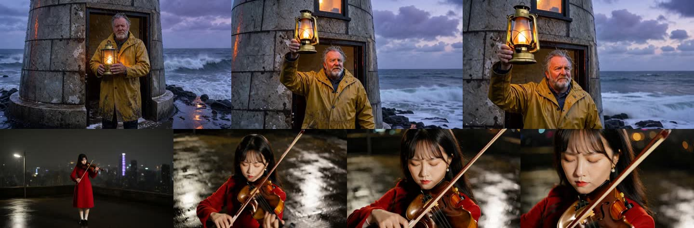
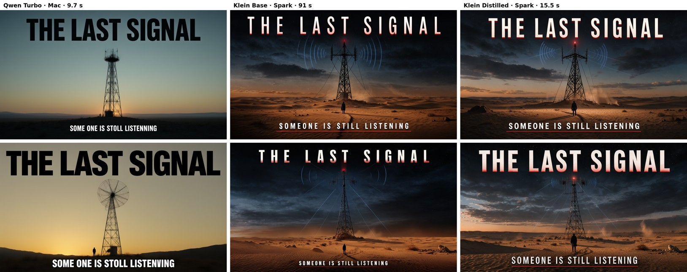
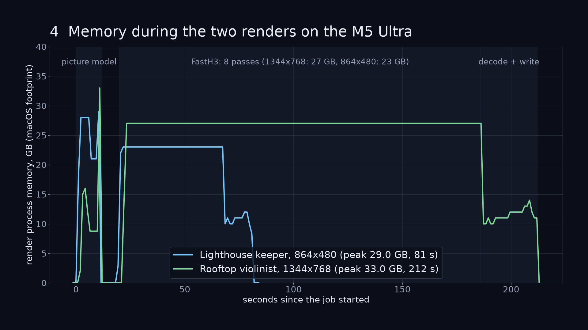

# Release history

[Back to the README](../README.md)

Historical release notes, retained as written for provenance. Old install commands, requirements and limitations describe their releases, not current support. Start with the [README](../README.md) or [Windows guide](windows.md).

## New in 4.3.1 (2026-10-30)

**One to four local NVIDIA GPUs** on one Linux machine, and a **96 GB** minimum for a Mac's default install. The
engines are the same as 4.2.1's.

- **Local GPU workers** (#177, akol1's #168 carried onto 4.3.0): on a workstation with up to four NVIDIA cards,
  the Studio runs on one card and starts a worker on each other compute card. Workers are pinned by card UUID,
  so a card whose order changed is caught. **Machine → Sparks** shows each card's VRAM, utilization and job. Jobs
  wait their turn for the machine's RAM, and are refused at once, with the reason, when they can never fit. With
  two or more compute cards, set `STUDIO_GPU` to the Studio's own card; the launch script asks for it. See
  [Local GPUs](rtx-pro-6000.md#one-to-four-local-gpus).
- **A Mac needs 96 GB for the default install** (video, voice, music, Bolt), up from 64 GB (#178). Pictures only
  (`--image-only`) still need 48 GB. On a 64 to 95 GB Mac that already has the Studio, `--upgrade` keeps and
  updates what is installed and says the new minimum; the Voice and Music tabs say they need 96 GB.

## New in 4.3.0 (2026-10-29)

**Apps**, a new room at the top of the sidebar: every tool of the Studio as a one-click app. The engines are the
same as 4.2.1's; to update, `git pull` and reload the page.

- **Nine kinds:** Cinema, Characters, Camera, Effects, Styles, Sound, Finish, Filmmaker Suite and Studio, with a
  search box. Each app opens the Studio's own form with its model, LoRA or start already chosen. See
  [Apps](user-guide.md#apps).
- **Nothing to set up:** a LoRA app that is not installed yet opens Looks on that LoRA; a Library action (Character
  Swap, Restyle, Fix, Extend, Remove a person, Upscale, Captions, Turnaround) asks for the clip or picture first,
  from your newest takes; what this machine cannot run says why on its card. Every app is also in ⌘K.
- **Character Swap · Openjutsu:** the swap is named for what it is, Comfy Org's Openjutsu made inside the studio and
  fully local, and is found by searching Openjutsu or Genjutsu.
- **Wasserman's Filmmaker Suite** gets a card for each of its apps, with its own icon and what it does.
- **YuE2's own mark** sits beside its name in Music and in Apps, as the other models' marks do.
- New key art for Captions, Titles, Restyle, Fix and Extend.

## New in 4.2.1 (2026-10-29)

No build machine's folders or user name ship in a prebuilt engine any more. Three CUDA binaries in the carrier, built
before 3.3.0 and copied unchanged since, held their build folders in their debug sections: the H3 engine
(`libtf_h3.so`) and Drama 3's `drama3-generate` and `libtensorfold_drama3.so`. So did the symbol table of the Mac's Bolt
binary in the 4.2.0 release archive. Only those parts change: the debug sections and symbol tables are dropped. Every
loaded segment (code, data, CUDA kernels) is byte for byte the same; only the file headers that point at the removed
sections differ. To update, `git pull` and restart the app. An installed engine has the same commit and is kept; a new
install takes the stripped one.

- **Same output, checked on a DGX Spark, in the order old, new, new, old:**
  - H3: a 5 s clip at 864x480 (FastH3, 8 steps, seed 7). The video stream, the decoded frames and the audio are identical
    in all four runs; 117.6–118.4 s new against 118.1–124.6 s old.
  - Drama 3: three lines in the default voice at seed 7. The WAV files are byte-identical in all four runs; median first
    audio 256 ms new against 249 ms old, within run-to-run noise.
- **The same on the Mac:** Bolt on Metal gives 7 of 7 identical greedy replies, with first tokens and tokens a second
  within noise.
- **Where they come from:**
  - On a DGX Spark, H3 and Drama 3 now come from the carrier `ghcr.io/drowzeys/keys-tensorfold-studio:4.2.1`.
  - The Mac's Bolt comes from this release's `bolt-metal-772da34b-macos-arm64.tar.gz` (a new SHA-256, pinned in
    `scripts/setup-bolt.sh`).
  - Everything else stays on 4.2.0's parts.
- **It stays fixed:**
  - `scripts/build-carrier.sh` drops the debug sections of every CUDA engine it copies.
  - It refuses to build a carrier whose payload still names the building machine's home folder or user.
- **Scan:** no file in the 4.2.1 carrier, nor in either Bolt archive, contains a home folder or a user name.

## New in 4.2.0 (2026-10-29)

The engines built on TensorFold move from **1.1.5** to **1.1.8**, the latest release, with the same output: Nemotron
3.5 Bolt on a DGX Spark and on a Mac, and MiniMax Music 3 on both. New prebuilt parts come with it: the carrier
`ghcr.io/drowzeys/keys-tensorfold-studio:4.2.0` and the release's Bolt archives for CUDA and Metal. To update, run
`git pull`, then `bash oneshot-setup-spark.sh --upgrade` (or `oneshot-setup-rtx-6000.sh --upgrade`) on Linux or
`bash oneshot-setup.sh --upgrade` on a Mac, and restart the app. The engine each one replaces stays beside it
(`bolt.previous`).

- **Bolt on a DGX Spark** (drowzeys/TensorFold `bolt-lilicorr-118`): our LiLiCorr drafter patch on TensorFold 1.1.8.
  The only conflict was the CUDA family list, where 1.1.6 added Spark-X2.6.
  - Replies are identical, 7 of 7 greedy prompts in three alternating runs.
  - Median first token 0.062–0.084 s against 0.064–0.102 s on 1.1.5; 74–82 tokens a second against 73–76.
  - Memory is the same: 0.27 GiB a stream at 16k tokens.
  - 1.1.8 also brings `--spill-gib` for Nemotron on CUDA and admission from the shard headers.
- **Bolt on a Mac** (`bolt-metal-118`): identical replies on 7 of 7 in two passes. The first token came in 0.119 s
  against 0.126 s, at 134 tokens a second on both, with the same memory. The patch that fixed one Drama 3 seed for
  every request is dropped: TensorFold 1.1.6 takes a seed with each request instead.
- **MiniMax Music 3** (`music3-cuda-118`, `music3-metal-118`): the song's bytes are identical on 1.1.5 and 1.1.8 for
  the same seed.
  - DGX Spark: 57–58 s for a 20 s int8 song on both, with the same 16.6 GB peak.
  - Mac: 23.2 s on both.
- **Kept on their pins:**
  - **YuE2's decode engine stays on 1.1.5** (`music3-cuda-115`). The engine's GPU test passes on 1.1.8, but a whole
    song was not timed against it.
  - **Drama 3 on the DGX Spark stays on its engine** (plotarmordev's NVFP4 lineage, 96 commits on 1.0.7), which
    is not rebased.
  - **The H3 engines are unchanged.** The carrier holds the same H3 and Drama 3 builds as 3.3.0.
- **Zig is checked before it is unpacked, in every build:**
  - The CUDA builds of Bolt, H3, Music 3 and Drama 3 fetched Zig without a check. They now share `spark/zig.sh`,
    which checks the archive against the SHA-256 ziglang.org publishes and refuses a mismatch.
  - The Mac's Music 3 build had an empty checksum and unpacked Zig unverified; it now has the published sum.
- **No machine paths in the engines.** The CUDA Bolt and Music 3 builds are made under neutral paths: `strings`
  finds no home folder in any binary, and the archives are packed owner 0/0.

## New in 4.1.2 (2026-10-28)

Fixes for machines with two or more NVIDIA cards, and for a Spark without Qwen. Update the clone, run
`--upgrade` on Linux and restart the app; a Mac only needs the pull and a restart.

- **Two or more NVIDIA cards and no `STUDIO_GPU`:** every installer entry (`oneshot-setup.sh`,
  `oneshot-setup-cuda.sh`, the Spark and RTX scripts) now chooses the card the way the app's start script does. A
  single compute card is used even at index 0 beside a display card, so a workstation with a small display card first
  no longer installs against it (or refuses video because "this one has 8 GB"). With two compute cards the installer
  stops and asks for `STUDIO_GPU`. The memory guard reads the same card when the server is started on its own.
- **A script that says why it stopped is reported in its own words**, without " (status 1)" after it; the status is
  kept only when the script printed nothing ("the script stopped (status N)"). Swap refusals read as written.
- **Qwen is optional where FLUX3-K is installed:** `--verify` and `--upgrade` say "Qwen-Image-2.1-Turbo is not
  installed (optional: pictures use FLUX3-K …)" instead of stopping at "✗ missing", and no longer print a ✓ for files
  they just called missing. studio-check marks the Qwen edit and angle checks as not applicable on such a machine.

## New in 4.1.1 (2026-10-28)

Fixes to 3.4.0 and 4.1.0 on all four machines: the DGX Spark, the RTX Pro 6000, a 32 GB RTX 5090 and the Mac. Update
the clone and restart the app; `--swap` installs fetch the int8 Ref2VA they run on (below).

- **Character Swap checks memory before it is queued**, like a clip, a song or a sound, from peaks measured on a DGX
  Spark and on a Spark capped to 96 GB and to 32 GB: 55.4 / 60.6 GB of a Spark at Fast / High, 49.4 / 52.7 GB on a
  96 GB card, and with `STUDIO_ROOM_MB` on a 32 GB card the machine gave 37.8 / 39.5 GB (docs/rtx-pro-6000.md,
  docs/rtx-5090.md). An RTX 5090 without `STUDIO_ROOM_MB` is refused with
  the card's name and what to set; with it, ComfyUI keeps the models in RAM and the swap runs. A Mac is told it has no
  swap before anything about its clip.
- **Nobody in the part is refused in words.** SAM 3.1 must be at least 75% sure of a person (people scored 0.93 to 0.99
  on synthetic frames, empty rooms, a coat on a rack, gradients and a Mandelbrot 0.31 to 0.67). A flat colour no longer
  fails with *index 0 is out of bounds*.
- **A cancelled or failed swap leaves nothing behind**: no mask preview, no anchor.
- **`--swap` fetches MiniMax H3 Ref2VA in int8 (21 GB)**, the weights it runs on, instead of requiring the 40 GB bf16
  file; the Library's actions run on either. The disk check counts it on each machine.
- **The Director** says why the QA gate failed a take and keeps the gate's report on the take; a run with nothing to
  cut still ends with its counts; the cast's and places' stills use a picture model this machine has (FLUX3-K Fast on
  a Spark without Qwen), only for who and where the shots show; a written age is not followed by "years old", and a
  brain's None or N/A never reaches a prompt.
- **YuE2**: its refusals (when it loads and when it is queued) give the figures to a tenth of a gigabyte, and on a
  card name the card and `STUDIO_ROOM_MB`; a song cancelled while Whisper listens leaves no take behind, a failed song leaves no score folder and its
  server gives back PyTorch's cache, the Music tab says why YuE2 is not offered where it is not (a Mac), and an RTX
  machine is told its own installer. Its engine build checks Zig's SHA-256 and tests on the GPU only when it is idle.
- **The Library** lists failed takes however a project file is shaped (a hand-edited one gave a 500).
- **Repo**: no machine's paths or job owners in the receipts; tiktoken, the Qwen team's `qwen.tiktoken` and Openjutsu
  credited in CREDITS.md and Settings; tests that read the machine they ran on stand in for it, and none of them
  starts a real render or ComfyUI, or mistakes a studio already running beside them for their own.

## New in 4.1.0 (2026-10-27)

The Director tells you what really happened, and shows you what did not work. Nothing to install: update the clone
and restart the app (`git pull`, then quit and reopen the Mac app, or `bash scripts/app.sh`).

- **An honest run report.** The run's last line counts what passed the check, what was not checked, and by name what
  the queue refused, what failed to render and what failed its check, then says what the cut is missing
  (*5 of 11 shots passed the check, 3 refused by the queue: Gull Strike, Pier Fall, Night Ferry, ..., cut
  without 6 shots*). A shot the memory guard refused is never counted as rendered, and the refusal says what the
  Studio had loaded beside the queue at the time. When the run is done the panel lists each shot left out of the cut
  with its reason.
- **A failed take stays where you can see it, out of the cut.** A take that fails its check is rated *no good* and
  kept among the shot's takes and in the **Library**, marked *failed check* (type "failed" in the Library's search to
  list them). So are the takes the QA gate and the shot check keep when they render a clip again. The Director cuts in
  only takes that passed, or not checked, unless you circle a failed one in Slate. With no retakes the choice reads
  *No retake* (it said *Keep it*).
- **Shots keep their people.** The shot check sends the brain's shots back when a character is named in the prompt
  and the shot's cast is empty, or when someone speaks inside the prompt and the shot has no lines: their pictures and
  voices would never reach the clip. Slate's preflight says so too when a character is named in a prompt but not cast.
- **A new angle opens on the cast.** A new size or angle is a cut, opening on the cast's stills (same pictures, same
  order, no first frame) where Ref2VA is installed; only a beat carried on in the same size and angle opens on the
  shot before. "The shots of a scene follow each other without a cut" is gone from what the brain is asked.
- **Costumes in the reference stills.** When a character's clothing names a hat, a coat or a uniform, the reference
  portrait is from the knees up with all of it in frame, instead of a head-and-shoulders with "no props".
- **A brain reply with a stray think tag still reads.** When a reply carries `</think>`, the answer after it is read;
  when the first JSON in a reply is broken, the longest whole one is.
- **One render in the queue for each machine.** The Director keeps one clip in the queue for each machine that renders
  (this one and its Sparks, at most three), so on one Spark a retake no longer waits behind the next shots. A render
  the machine's workload limits stopped (heat, memory pressure) is not a take: it is queued once more, at the same
  seed, after the queue's own cool-down gate, and left out after a second stop. The limits themselves are unchanged.
- **Setup.** `scripts/setup-voice.sh` stops at once, before the engine, when the folder for Fish's checkpoint is not
  yours to write (a root-owned `~/models`), and says how to fix it. An app that is already running picks up the Bolt
  engine within a minute of `oneshot-setup-spark.sh --bolt`, with no restart (before, it stayed *external* until one).

## New in 3.4.0 (2026-10-27)

Two new things to make, both on this machine with no account and no cloud: songs by **YuE2**, now the Music tab's
default on Linux with an NVIDIA GPU, and **Character Swap**, a Library action that puts the character in one picture in
place of the person in a part of a clip. Add them to a DGX Spark (both are ticked in the installer's checklist and part
of `--all`), then restart the app; after that, `--upgrade` keeps them up to date:

```bash
git pull && bash oneshot-setup-spark.sh --yue2 --swap --no-render
```

A Mac has nothing new to install: neither runs on a Mac, and its Music tab stays on MiniMax Music 3.

- **YuE2 songs.** m-a-p's YuE2-3B and its YuE2-Vae decoder write the song's score first (melody and chords), then the
  song: sung vocals and accompaniment, 48 kHz stereo, up to five minutes. It runs as a resident server in an
  environment of its own (`$PREFIX/yue2`); on a DGX Spark the song's tokens run on TensorFold's CUDA engine (int8).
  Measured on one DGX Spark: a 60 s song in about **38 s**, a 2-minute song in about **64 s**, the model loaded in
  6 to 9 s, and Whisper heard **94 to 97 %** of the words sung. MiniMax Music 3 stays one click away: the **engine picker**
  above the Music tab's form (YuE2 · MiniMax Music 3) chooses for each song, and Settings → Presets → *Song engine* sets
  the default (*Best here*: YuE2 where it is installed, MiniMax Music 3 on a Mac). Each take keeps its score
  (*Download score*). `--yue2` is about 14 GB. [YuE2 songs](audio-guide.md#yue2-songs).
- **Character Swap.** *Swap the character* under a clip in the Library: choose a picture of the character and a part
  of the clip (5 to 15 seconds), and the person in it is drawn again as that character, with the clip's own scene,
  performance and sound kept. **Fast** (480p, the default) or **High** (768p); the picture model first puts the
  character into the part's first frame and the swap starts from it (*Put the character in the first frame first*).
  It runs on the studio's own MiniMax H3 Ref2VA (int8), with LightX2V's 8-step Turbo LoRA, Akatz Labs' Character Swap
  LoRA v1.5 and SAM 3.1 to find and follow the person. Measured on a DGX Spark with the GPU to itself: a 5 s part in
  about **6 minutes** at Fast and about **12 minutes** at High. A part with a hard cut, or with nobody in its first
  frame, is refused before anything is drawn. DGX Spark and CUDA only. `--swap` is 23 GB: the int8 Ref2VA it runs on
  (21 GB, without `--ref2va`'s 40 GB bf16 file) and 2.1 GB beside it. [Character Swap](user-guide.md#character-swap).

Licences, also in Settings → About and beside each choice in the app:

- **YuE2:** the code is Apache 2.0; the weights are CC BY-NC 4.0 with the YuE2 authors' additional permission for
  creators: personal users, content creators and musicians may publish, sell and license the songs they make, free and
  with no royalties; a company needs a commercial licence from the authors. Do not redistribute the weights.
- **Character Swap:** MiniMax H3 and Akatz Labs' Character Swap LoRA are under the MiniMax H3 Community License, which
  does not cover use in the EU, the UK, South Korea or the US; LightX2V's Turbo LoRA is Apache 2.0; SAM 3.1 is under
  Meta's SAM License. The idea and its settings come from Comfy Org's Openjutsu and Akatz Labs' workflow (MIT).

The TUTORIAL and the app's **Learn** tab have a lesson for each: *A song with YuE2 or MiniMax-Music3* and
*Character Swap*.

## New in 3.3.3 (2026-10-26)

The DGX Spark's brain engine, **NVIDIA Nemotron 3.5 Bolt**, moves from Mia's 1.0.12 recipe (6f61d772 on TensorFold
46a08c18) to the same recipe at 89e1c8a (with ChriZzn's speed work) rebased onto **TensorFold 1.1.5**, drowzeys/TensorFold
branch `bolt-lilicorr-115`. NVIDIA's LiLiCorr drafter still runs inside it, and structured output (`libtfgrammar`),
pictures and video (`libtfvideo`) are in the build. Two changes over the recipe, neither touching the arithmetic: the
first token goes out before the drafter's first proposal, and a chat turn's last prompt-cache mark is kept at the
prompt's end, so a turn's new rows run in one pass instead of two.

Measured on a DGX Spark (GB10) with the Studio's own settings (4 streams, 65,536 tokens, 2 GiB of prompt cache,
pictures on), the same weights, one engine at a time, through a throwaway Studio (`/api/bolt/load`), greedy:

| | 3.3.2 engine (1.0.12) | 3.3.3 engine (1.1.5) |
|---|---|---|
| chat, 120 tokens | 57.0 tok/s, first token 128 ms | **65.8 tok/s**, 77 ms |
| 600-token plan | 67.6 tok/s, 156 ms | **76.1 tok/s**, 106 ms |
| edit (rewrite a paragraph) | 117.6 tok/s, 209 ms | **137.5 tok/s**, 143 ms |
| four plans at once | 140 tok/s | **204 tok/s** |
| held while loaded | 28.1 GB | 30.7 GB |

Both pass the same checks: a Slate plan through `/api/slate/brain` (JSON, four shots), tool calls (offered, forced and
named), `response_format` json_object and json_schema (the grammar holds; greedy, Bolt can run a schema's integer to
the token limit on both engines), a picture and a short video, an edit.

`spark/build-bolt.sh` now takes the engine from this release's archive (`bolt-cuda-ecdc7892-linux-aarch64.tar.gz`, sha256
pinned), then the carrier, then a build from source (nvcc, Zig 0.17.0, FFmpeg, libjpeg-turbo, xgrammar; about 15
minutes), and keeps the engine it replaces in `$PREFIX/bolt.previous` (move it back to `bolt` to roll back). Update a
Spark with `git pull && bash oneshot-setup.sh --upgrade`, then restart the app. The Mac keeps its Metal Bolt engine.

## New in 3.3.2 (2026-10-25)

The Mac release assets were repacked without a local username: the archives' file owner is now 0/0, and two old
engine binaries (`bolt-metal-b4edaea5`, `zig-engine-4741fd0a`) lost their symbol tables, which held a build folder's
path. Their code and data are byte for byte the same. The FastH3 engine `zig-engine-b19753ab-macos-arm64.tar.gz`
therefore has a new checksum, which `oneshot-setup.sh` now pins. An install from 3.3.1 or earlier that downloads it fails
the old checksum and falls back to the carrier or a source build, so update to 3.3.2 (`git pull`).

## New in 3.3.1 (2026-10-25)

3.3.1 moves the Mac's two TensorFold Metal engines onto **TensorFold 1.1.5**, each checked against the engine it
replaces on a Mac Studio M5 Ultra (same weights, one engine at a time, spare ports, a memory guard). Update with
`git pull && bash oneshot-setup.sh --upgrade`, then restart the app: on a Mac that has them, `--upgrade` now also
rebuilds the Metal music engine at the new commit (a few minutes) and downloads the new Metal Bolt engine (5 MB,
checksummed); it fetches no weights. A DGX Spark has nothing new to install.

- **Music on a Mac (M5 or later) runs on TensorFold 1.1.5.** The music3 Metal family (`music3-metal-115`, 91877e79)
  is the same code on the 1.1.5 runtime. A 12 s song, seed 7, two rounds each: **the same song, byte for byte**
  (identical WAV), made in 13.1 s on both.
- **Bolt (the brain) on a Mac runs on TensorFold 1.1.5.** The Metal Bolt engine (`bolt-metal-115`, be300c4d,
  `libbolt.dylib` behind TensorFold's Bolt lane backend) with the studio's own settings (four streams, 65,536-token
  window, 2 GiB prompt cache, LiLiCorr drafts), against `nemotron-bolt-metal` b4edaea5 (TensorFold 1.0.12): **the same
  replies** (7 of 7 greedy answers identical), first token 66 to 72 ms against 68 to 71 ms, 113 tokens/s on both
  (109 on a 400-token plan), 27.4 GB resident on both, ready in 7 to 8 s.

## New in 3.3.0 (2026-10-25)

3.3.0 moves the studio's engines onto **TensorFold 1.1.5** where that is a safe, measured step, and says why the rest
stay where they are. Every engine was put side by side with the one it would replace on the same machine and weights
(one engine at a time, spare ports, a memory guard). Update with `git pull && bash oneshot-setup.sh --upgrade`, then
restart the app; a DGX Spark takes the new music engine from the carrier `keys-tensorfold-studio:3.3.0` (checksummed).

- **Music on a DGX Spark runs on TensorFold 1.1.5.** The music3 family (`music3-cuda-115`, 5505dbfa) is the same code
  on the 1.1.5 runtime, build and loaders. Measured on one GB10, a 30 s int8 song, seed 7, two rounds each: **the same
  song, byte for byte** (identical WAV), the same making time (61.0 to 62.5 s against 60.9 to 63.6 s) and the same peak
  (16.46 GB), and the engine is ready **2.6x sooner** (12.5 to 16.2 s against 32.6 to 69.8 s), so the first song after
  an idle unload starts sooner.
- **Kept, with the measurements** (DGX Spark, same weights, alternating rounds):
  - **Bolt (the brain) on CUDA** stays on MiaAI-Lab's recipe (TensorFold 1.0.12 base with `libbolt.so` and the LiLiCorr
    drafter inside it). TensorFold 1.1.5's own Bolt, which drafts with its MTP head (it refuses a separate drafter),
    decodes 36.5 / 36.9 / 50.2 tokens/s (chat, a 600-token plan, an edit) and 115 with four streams, against the
    studio engine's **56.1 / 68.8 / 118.9 and 153**. 1.1.5 is first to the first token (75 to 135 ms against 130 to
    230 ms), not enough to trade for half the speed.
  - **Drama 3 (Voice) on CUDA** stays on the studio's `drama3-cuda` engine: 33.9 frames/s, a long line in 14.8 s.
    TensorFold 1.1.5's Drama serve is 0.77 real-time factor at best (128-row prefill and the silence guard; 15.5 s for
    the long line, though it streams the first audio in 0.2 s), and in its default setting the long line runs on into
    non-speech (32.7 s of audio for a 23 s line). 1.1.5 changes Drama only on Metal.
  - **The native FastH3 engine** (Metal and CUDA, int8) stays on its TensorFold 1.0.4 base: TensorFold 1.1.5's H3 family
    is a bf16 rewrite of the same files, so the studio's int8 kernels would be a port, not a rebase, for no change in
    what 1.1.5 offers H3.
  - **The Mac's MLX engines** (H3, Qwen-Image, the Drama 3 and Music 3 MLX ports) stay on TensorFold 0.6.5: 1.1.5 has no
    Python or MLX package.

## New in 3.2.0 (2026-10-22)

3.2.0 is the studio's code: its engines are the 3.1.0 builds (the carrier `keys-tensorfold-studio:3.2.0` and the
v3.2.0 release hold the same ones, checksummed as before), so an update from 3.1.0 downloads no weights and no engines. Because 3.2.0 adds install
parts, the app's own updater asks for the installer first: `git pull && bash oneshot-setup.sh --upgrade` on a Mac or a
DGX Spark, then restart the app. `--upgrade` from 3.1 adds motion graphics and Finish (about 550 MB); training a LoRA
is added with `--train` on a DGX Spark.

Every new part has its place in the sidebar, and **Creative Engines** are in the order a film is made: Video, Image,
Sound, Story, Cast & Places, Director, Previs, Motion graphics, Edit and Night shift (⌥1 to ⌥6 follow it). Under
**Creative Engines**: **Cast & Places** (the characters' and
locations' sheets, with the bible and dialogue choices on top), **Director**, **Motion graphics** and **Night shift**,
each with a film picker that starts on the film open in Production, else the newest. **Edit** gains a **Finish** tab,
Production (Slate) a **Rough cut** tab beside Deliver, and **Looks** a **Train a LoRA** tab beside its looks. Each is
also one ⌘K away. On a phone the bar keeps the main engines; the new rooms are under **More**.

Making the film, in the order you would use it:

- **The bible and dialogue.** Slate's bible keeps faces, places and voices the same in every shot, and a film's lines can
  be spoken by the video model or by Drama 3 and matched.
  [Faces, places and voices](user-guide.md#the-bible-keeps-faces-places-and-voices-consistent),
  [Dialogue](user-guide.md#dialogue-by-the-video-model-or-by-drama-3).
- **The Director.** Give it a logline and it writes, casts, renders, checks and cuts a whole film while you watch.
  [The Director](user-guide.md#the-director-from-a-logline-to-a-checked-cut).
- **The night shift.** Plan a batch before bed and wake up to a reel, a dailies package and a notification on your phone.
  [The night shift](production-guide.md#the-night-shift).
- **A rough cut on the beat.** Cut a film's best takes to a song and open the result in DaVinci Resolve.
  [A rough cut on the beat](production-guide.md#a-rough-cut-on-the-beat-straight-to-resolve).
- **Motion graphics.** Titles, lower thirds, kinetic type, captions, slideshows and music videos, rendered on this
  machine with HyperFrames. [Motion graphics](production-guide.md#motion-graphics-titles-captions-slideshows-and-music-videos).
- **Finish.** The final cut and mix through Tesseract, to Resolve, Premiere or After Effects.
  [Finish](production-guide.md#finish-the-final-cut-and-mix-to-resolve-premiere-or-after-effects).
- **Work on a clip you already have.** *Restyle*, *Extend* and *Fix*, under every clip in the Library.
  [Restyle, Extend, Fix](user-guide.md#work-on-a-clip-you-already-have-restyle-extend-fix).
- **Train your own LoRA.** A look or a character from your own clips, on the CUDA build (a DGX Spark or a GPU).
  [Train your own LoRA](lora-guide.md#train-your-own-lora).
- **Captions and search in the Library.** The studio describes every clip and picture, so you can search by what is in
  them. [Search your library](user-guide.md#search-your-library-by-what-is-in-it).
- **Previs and prompts into a film.** What the filmmaker suite made goes straight into a film's shots.
  [Bring previs and prompts into a film](#bring-previs-and-prompts-into-a-film).

Also new:

- **The installer asks what to install.** Run in a terminal, the one-click install first shows a checklist of every part
  this machine can run, each with its download size and the free space, everything ticked. Untick what you do not want
  and press Enter; `--yes` skips the list and installs the usual set. Parts behind a licence on Hugging Face (FLUX3-K,
  Stable Audio Open) are checked before anything downloads: one you have not accepted yet is left out with the page to
  accept it, and the rest installs. [Install](installation.md#install).
- **Bolt is always one of your agents** when the studio's own engine is installed, beside a local brain on another
  server (a GLM, a DeepSeek) and your subscriptions: nothing to add by hand.
- **Looks:** **Realism People** by fal (trigger `r34l1sm`) for faces that hold up in close-up, and Keys' newer LoRA pack
  (r4: 22 LoRAs from one hosted copy); an install with an older pack is brought up to it. Any LoRA, one you trained
  included, can show a cover picture kept beside it (`loras/<id>.webp` in the studio folder). **3D Animation Style is no
  longer offered**: on the DGX Spark's FastH3 it barely changed a clip, even at full strength.
- **Library search** gives each match its own tick box, and *Select all* takes the matches while you search, so a
  trailer, a finish or a delete can use just the clips you found.
- **Restyle and Fix keep a clip's motion and change its look**: the first frame is redrawn (in the new style, or with the
  fix), Motion Previs reads the clip's depth, and the clip is rendered again from both.
- **Motion graphics run only on a Node.js with the latest security fixes** (the 2026-10-21 release: 22.23.4, 24.22.1,
  26.12.1); an older one, the system's or the studio's own, is replaced.
- **Your phone and other devices, with an access key.** On the computer running the studio nothing is asked. A phone,
  a tablet or another computer signs in once: **Settings → Access key** shows a QR code that signs a phone in with one
  scan, the key itself to copy, and *Make a new key* for a lost phone. Step by step: TUTORIAL.md section 15, and
  **Learn → Your phone and other devices** in the app. Details: [The access key](user-guide.md#using-it-on-your-phone).
- **Automatic updates are on by default**, so an install stays on the latest version: checked every six hours,
  installed when the queue is idle (Settings → Updates turns it off). Worker Sparks follow their head.
- **NVIDIA RTX Pro 6000 Blackwell (96 GB)** uses the same one-shot recipe: engines built for sm_120, the card's own
  memory read for every job, Bolt through llama.cpp ([docs/rtx-pro-6000.md](rtx-pro-6000.md)).
- **Every credit, in the app and in the repo.** Settings → About → *Every credit* shows CREDITS.md and the third-party
  notices; about 25 more libraries, conversions and tools are credited, and a test keeps the two in step.
- **No personal information in the repo**, enforced by a test and by CI; contact goes through GitHub only (Issues,
  Discussions, private vulnerability reporting: [SECURITY.md](../SECURITY.md)).
- **The repository is now `drowzeys/Imagination-Studio-by-keys-Wasserman`**, matching the name. The old address
  redirects, so installs that follow it keep updating.

### Bring previs and prompts into a film

What the filmmaker suite made goes straight into your work, not only into a new film.

- **Into a film you already have.** On the **Suite** page, open anything you brought in (a Blockout export, a Motion
  Previs pack, a board, a screenplay) and use **Send into a film**. Pick the film, say which of its shots each imported
  shot goes to (or *A new shot*, in a scene you choose), and press **Attach**. The still becomes the shot's first
  frame, a previs clip becomes its motion reference when the shot is rendered, and the shot's words fill its prompt
  when that is empty (a prompt you wrote is never replaced). A previs reference clip is sent to the Ref2VA model, so it
  needs `oneshot-setup.sh --ref2va`; it does not combine with a first frame, and the shot's check says so.
- **Into the Home composer.** **From the suite**, beside *Ask your agent instead*, lists what you brought in and its
  shots. Pick one and the box fills with its words, the length is set to the nearest the model makes, and its still is
  the clip's first frame (remove it with the small button if you only want the words).
- **Recent imports on the Suite page** show their app's icon with *Send into a film* and *Use in the composer*.
- **Your agent can do it too.** `suite_imports` lists what was brought in and its shots; `suite_attach` sends shots into
  a film.

It runs on this computer and needs no account.

## New in 3.1.0 (2026-10-20)

- **One-shot installs with everything, on both machines.** `bash oneshot-setup.sh --all` installs every feature the
  machine runs, from prebuilt engines: the GHCR carrier `keys-tensorfold-studio:3.1.0` (the DGX Spark's H3, Music 3,
  Drama 3 and Bolt engines) and the v3.1.0 release (the Mac's native engine and Bolt on Metal), each checksummed. The
  minimum hardware now opens this README. Proven on a fresh DGX Spark and a fresh Mac.
- **NVIDIA Nemotron 3.5 Bolt is the studio's own brain**, loaded and unloaded by the Studio around renders (TensorFold's
  CUDA engine on a DGX Spark, Metal on a Mac), for the First AD, the agents and the local harness.
- **A Mac can lead worker DGX Sparks**, and a DGX Spark head leaves clips to its idle workers.
- **Voice on a DGX Spark in one shot** (Drama 3's CUDA engine from the carrier), and sound effects and foley measured
  and guarded there.
- **A LoRA on the Mac's native FastH3 engine**, merged into the int8 weights at load; sound effects on Metal twice as
  fast.
- **The Mac's memory read correctly** (free, file-backed and purgeable pages), so a large job no longer pushes the Mac
  into a memory panic, and every ComfyUI job's peak is checked first.
- Upscale, Find and Remove a person and MOSS-Image on a Mac (below), updates that refresh the renderers' copies, and
  Sam Wasserman's CI, host-independent tests and fixes.

### Upscale, Find and Remove a person on a Mac

- **Upscale, Find a person and Remove a person now run on a Mac** (Mac Studio M5 Ultra), with the DGX Spark's own graphs
  and the authors' node packs at the Spark's pins, on a ComfyUI of the Mac's own on PyTorch's Metal device
  (`oneshot-setup.sh --upscale` and `--remove`; `scripts/setup-comfy.sh`). MiniMax H3 is read from the Mac's own Ref2VA
  files (`--ref2va`), not downloaded again: 2.4 GB of models and a 1.6 GB environment. Measured against the DGX Spark on
  the same clip and seeds: see [On a Mac](user-guide.md#on-a-mac-the-same-graphs-on-pytorchs-metal-device).
- **MOSS-Image on a Mac** (`oneshot-setup.sh --moss`, 28 GB) on the same ComfyUI: 59 s a 1344x768 picture with the
  model loaded (44 s on a DGX Spark), the lettering as exact as on a Spark.


## New in 3.0.1

- **MOSS-Image**, a fifth picture model, on a DGX Spark or a GPU: OpenMOSS's 5B model (Apache 2.0, commercial use allowed),
  through ComfyUI's own support. It is the best of the picture models at lettering: posters, title cards, signs and
  menus came out exactly as written, in English and Japanese. About 45 s for 1344x768. Install it with
  `oneshot-setup-spark.sh --moss` on a DGX Spark, or `oneshot-setup-rtx-6000.sh --moss` on a GPU (30 GB; `--moss` is in the CUDA setup both doors run); see [MOSS-Image on a DGX Spark](performance.md#moss-image-on-a-dgx-spark).
- **ComfyUI moves to v0.42.0** (`b9b290e4`) on a DGX Spark, for MOSS-Image: `oneshot-setup-spark.sh --upgrade` moves
  an existing install. FLUX3-K, Qwen and FastH3 clips render as before on it.
- **Credits:** OpenMOSS in the README, CREDITS.md, NOTICE and the app's About.
- Nothing changes on a Mac: MOSS-Image has no Mac build yet.

## New in 3.0 (since 2.9.3)

**A new studio around the same engines**
- **Imagination Studio**: a new look (the poster's serif, blue, green and amber; Geist and Instrument Serif), Sam's
  art on every engine, card and look, and a sidebar of **Creative Engines** and **Studio Vaults** with Home on top.
- **Six engines, one page each**: Story, Image, Video, Previs, Sound and Edit, each opening on its own cards.
- **Home**: one composer makes a clip, a picture, a voice line or a song straight away; start cards, recent takes,
  the machine in one line.
- **Settings**: the look, which rooms show, what a new take starts from, every connection, and Models & weights,
  Sparks, Brains & tools and Updates in one place.
- **Made for phones too**: the whole studio works from a phone's browser. The six engines sit along a bottom bar,
  a **More** sheet holds the Agent, the vaults, Settings, search and updates, the queue folds into one line above it,
  and *Add to Home Screen* opens it full screen like an app. See [Using it on your phone](user-guide.md#using-it-on-your-phone).

**Agents and your own sign-ins**
- **The Agent room**: pick Claude Code, Codex, GitHub Copilot CLI, Hermes, Gemini, Grok or a local model and talk it through; it keeps
  its own session, asks when a choice matters and drives the studio's tools (stills, clips, voice, songs, the
  timeline), Blender and Blockout.
- **One-click Connect** for every agent, from any page that needs one: finds it or installs it, runs its own
  sign-in (the page opens by itself, with the code, a QR code and Copy link), checks it answers, makes it the default.
- **Link another computer**: a DGX Spark, or a GPU, uses the agents signed in on your Mac over SSH, and the studio sets up both
  directions itself. Claude Code's Mac Keychain over SSH is solved with **Allow over SSH** (`BRAINS.md`).
- The ChatGPT app's own Codex is used when the one on PATH is older, here or over SSH.

**Models, looks and installs**
- **Models & weights** finds every model the studio needs anywhere on the machine and links it instead of
  downloading it again (**Use everything found here**), and **Install** runs the right installer for what is missing.
- **Gated weights** (Keyframe Animation, Stable Audio Open): Install signs you in to Hugging Face
  once, opens the licence page, and downloads by itself once access is granted.
- **Looks**: the LoRA hub as a style library, one card a look.

**Sound, previs and the library**
- **Sound effects and foley**: MMAudio makes a clip's own sound from its picture, Stable Audio Open makes a sound from
  words (Mac; on a DGX Spark through ComfyUI once its memory is measured).
- **Motion Previs from a link**: paste a video page or a video file's address and its depth, pose and camera are read.
- **The Library** lists voice lines, songs and sound effects beside clips and stills, each with its own filter.
- **Nodes**: a ComfyUI-style canvas over the studio's own jobs, run in order.
- **Wasserman's Filmmaker Suite** built in: bring work in from Sam's apps, send the cut to Resolve as a ZIP with media.

**Machine, updates and safety**
- **Machine**: live GPU, memory, temperature, power and storage; Sparks; an optional workload governor for a shared Spark.
- **Updates** in the app: follows the installed branch, waits for idle, shows the latest release.
- Everything is kept in **`~/ImaginationStudio`** (an older `~/TensorFoldStudio` is moved there once, with a link left behind).
- Tighter safety: this computer or its Tailscale name only, same-origin writes, size limits, no hidden files served.
## New in 2.9.3

- **FLUX3-K installs again on a DGX Spark.** On 2026-10-17 Black Forest Labs renamed the Klein checkpoints on Hugging
  Face (`flux3-image-klein-bf16.safetensors`, `flux3-image-klein-base-bf16.safetensors`) and removed the old
  underscore names, so `oneshot-setup-spark.sh --flux3` could not download them. The setup now fetches the new names
  and renames an older install's files in place instead of fetching 22 GB again: they are the same files (the same
  SHA-256 on Hugging Face). The app reads either name, so a Spark updated from the Sparks tab keeps FLUX3-K before
  the setup runs. Nothing changes on a Mac.

## New in 2.9.2

- **Mac: Music runs on TensorFold's native Metal engine.** On an M5 or later the Music tab now runs MiniMax Music 3
  on `music3-generate` built for Metal (Zig and Metal, no Python or MLX; TensorFold pull request #987, commit
  8c9559da), when `oneshot-setup.sh --music` has built it (`scripts/build-music3-metal.sh`). On the Mac Studio M5
  Ultra, against the MLX port int8, 60 s hip-hop, seed 7, three runs each: the autoregressive model 69 frames/s
  against 65, the whole song 59.5 to 63.0 s against 62.3 to 63.9 s, peak 17.8 GB against 28.1 GB. Through the app a
  song the model ended at 33.4 s took 35.2 s, load included, at 16.1 GB. Limits: it does not stream yet, so *Play
  while it's made* is MLX-only (`MUSIC3_BACKEND=mlx`); an M1 to M4 keeps the MLX port; measured on an M5 Ultra only.
  See [Music](audio-guide.md#music-minimax-music-3).

## Imagination Studio 3.0: the studio

The web app is **Imagination Studio by keys+Wasserman**, powered by TensorFold and built with Fish Audio Drama 3.
Everything it did before is still here, arranged to be quicker to find and calmer to use.

- **Creative Engines.** Video (clips with sound, long takes, references), Image (stills, scouts, edit a picture), Sound
  (Voice, Music, Foley), Story (the film board, Wasserman Slate, the First AD), Cast & Places, Director, Previs (Motion
  Previs, Ask your agent), Motion graphics, Edit (the Timeline, Graphics, Finish and its exports) and Night shift. Each opens on a page of picture cards; a card opens the view that does it,
  already set up. In Create a small switch at the top says where the prompt goes: video with sound, an image, or an
  edit of a picture.
- **Studio Vaults.** Library (every take), Looks (the LoRA hub as a library of styles, one card each), Suite (bring work
  in from the filmmaker suite, send the cut to Resolve and dailies to Circle Take), Machine (telemetry, Sparks, brains
  and tools, updates) and Learn.
- **Home**, under the wordmark, starts the common jobs in one click and shows recent takes and the machine.
- **Updates.** Machine → Updates shows the installed version and commit, the branch it follows, the newest GitHub
  release (for information) and one *Update and restart* button. Installing is always a fast-forward of the followed
  branch, and waits until jobs and the render engine are idle.
- **Render bay and ⌘K.** The queue is docked along the bottom of every room. ⌘K (or `/`) searches and runs anything;
  ⌥1 to ⌥9 and ⌥0 jump between rooms. Below 1100 px the sidebar is an icon rail; on a phone the rooms sit along the
  bottom.
- **Pictures.** The cards' key art fills from `app/static/art`: each slot is listed in `art/ART-MANIFEST.json` and
  shows a plain panel until its picture is there. Model and tool marks in `app/static/brand` identify what the Studio
  runs and belong to their owners (`brand/THIRD-PARTY-MARKS.md`).

The typefaces (Geist, Geist Mono, Instrument Serif) ship in `app/static/fonts` under the SIL Open Font License.

## New in 2.9.1

Three changes to Music (MiniMax-Music3), one for each machine and one for the Mac's player. Every figure is one run
unless it says otherwise.

- **Mac: int8 weights by default.** The Studio starts the MLX engine (`music3-mlx`, now pinned at 6844b413) with
  `--quant int8`: the autoregressive model, its code-0 head and the depth decoder at 8 bits. On the Mac Studio M5
  Ultra the autoregressive model went from 40 to 65 frames a second and the peak from 27.6 to 20.5 GB; a 60 s song
  took about 63 s through the app (75.8 s in 2.9.0). Against ComfyUI's reference the code-0 logits keep cosine
  0.99994 (bf16 0.99997), 98.0 % greedy agreement, and Whisper's lyric scores over six same-seed songs stayed within
  their noise. `MUSIC3_QUANT=none` runs the bf16 weights. Limits: measured on an M5 Ultra only; other
  M-series chips are not measured.
- **Mac: play while it's made.** With the box ticked (the default where the engine streams) the song plays in the tab
  while it is made, from `GET /api/music/takes/{id}/live`, one stereo 44.1 kHz WAV. The sound is held back until
  playing will not run dry (the engine's measured no-stall start plus 3 s). Through the app, 60 s songs: first sound
  at about 7 s (7.6 and 6.4 s), playing from about 13 s (13.4 s both), no stall (the least buffer 4.0 s), made in
  63.4 and 61.0 s; a 30 s song played from 8.1 s. The kept take is the engine's finished WAV, the same samples that
  were played. Limits: a Mac only (no route on a Spark streams); only 30 s and 60 s were measured through the app, and
  the wait grows with the length (about 56 s for a 300 s song, from the engine's own figure); nobody has listened for
  seams. Details in [Music](audio-guide.md#music-minimax-music-3).
- **Music on a DGX Spark: TensorFold's CUDA engine for MiniMax Music 3 (MiniMax-Music3).** The Music tab on a Spark now
  runs `music3-generate`, TensorFold's native CUDA port (branch `music3-cuda`, 6b714531: Zig + CUDA, no Python at run
  time; since 3.3.0 the same family on TensorFold 1.1.5, branch `music3-cuda-115`, 5505dbfa), wherever it is built and the weights are there; otherwise it falls back to ComfyUI's nodes as in 2.9.0.
  `MUSIC3_BACKEND=cuda|comfy` chooses; the tab's state says which route runs and, after a fall-back, why.
  - **int8 weights by default**, made on the GPU as the engine loads (no cache file): the autoregressive model, its
    head and the depth decoder at 8 bits. `MUSIC3_WEIGHTS=bf16` runs the checkpoint's own weights. It reads
    Comfy-Org's three files as they are (`~/spark-studio-models/MiniMax-Music3-Comfy`, `MUSIC3_MODEL` names another).
  - **Same lifecycle as the Mac engine:** a persistent server, loaded on the first song, holding
    `~/studio-gpu.lock.d` while loaded, unloaded after five idle minutes and before any other job, under the
    memory kill-guard; a studio ComfyUI that holds models is stopped before it loads. Never beside H3, Drama 3 or
    ComfyUI's models.
  - **Installed by** `bash oneshot-setup-spark.sh --music` (and `--upgrade` where the weights are): `spark/build-music3.sh`
    takes the prebuilt binary from the carrier image, or builds it with nvcc 12.9+ and Zig 0.17 (50 s on a GB10).
  - **Measured on one GB10** (int8, hip-hop lyrics, seed 7, 30 steps; one run each; memory is MemTotal - MemAvailable
    above the idle machine):

    | Song | TensorFold CUDA (int8) | ComfyUI's nodes (2.9.0) |
    |---|---|---|
    | 30 s, engine | 60.3 s | 131.0 s |
    | 60 s, engine | **123.9 s** (AR 73.9 s at 20.4 frames/s, DiT 46.4 s, DAV 3.6 s) | 260.6 s |
    | 120 s, engine | 252.0 s | 527.6 s |
    | 60 s through the app | **149.2 s** for the song (load 37.3 s, AR 68.2 s, DiT 40.4 s, DAV 3.3 s; the model ended it at 55.2 s), 171.4 s with Whisper's check (97 %, 164 of 169 words) | 270.6 s for the song (ComfyUI started for it; AR 166.5 s, DiT 94.3 s, DAV 4.0 s; 59.99 s made), 297.0 s with Whisper (96 %, 162 of 169), 29.4 GB at the peak: the same run of the 2.9.1 app with `MUSIC3_BACKEND=comfy` |
    | Peak memory, 60 s | 17.9 GB (18.7 GB through the app) | 29.3 GB |

    bf16 weights: a 60 s song in 194.3 s and 25.5 GB. Parity against ComfyUI's nodes and Whisper's lyric count
    passed on the engine branch (docs/recipes/minimax-music3-cuda.md there).
  - **Honest limits.** No streaming on the Spark: a song is heard when it is done. Built and measured on a GB10
    only (the build refuses another GPU unless `MUSIC3_ANY_GPU=1`; elsewhere use `MUSIC3_BACKEND=comfy`). Loading
    takes about 37 s each time the engine starts (int8 is made at load), so the first song after five idle minutes
    pays it again. Songs over 120 s are not measured on this engine; the memory estimate goes on at the measured slope.
- **Carrier image** `ghcr.io/drowzeys/keys-tensorfold-studio:2.9.1` adds the prebuilt Spark `music3-generate`
  (`spark-music3/`) beside the H3 engine.

## New in 2.9.0

- **Music: MiniMax Music 3 (MiniMax-Music3).** A new **Music** tab beside Voice makes a whole song with sung vocals
  from your lyrics and a style, on this machine: up to five minutes, 44.1 kHz stereo. See
  [Music (MiniMax Music 3)](audio-guide.md#music-minimax-music-3).
  - **Lyrics** take section tags (`[Intro]`, `[Verse]`, `[Pre-Chorus]`, `[Chorus]`, `[Bridge]`, `[Instrumental]`,
    `[Outro]` ...) on lines of their own; the tab has a button for each and says when a tag looks wrong.
  - **Style** is a caption: genre, tempo, key, mood, vocals, instruments. A helper writes one from those six boxes.
  - **Use as soundtrack:** a song can be laid under a long video, the Editor's export or any clip of the Library. It
    sits under the clip's own sound, is lowered up to 12 dB while someone speaks, and no peak passes -1 dBFS.
  - **Mac:** TensorFold's MLX port (`music3-mlx`, pinned at 6844b413), installed by `bash oneshot-setup.sh --music`
    into its own environment, with the 22 GB of weights. **DGX Spark:** ComfyUI's own MiniMax Music 3 nodes,
    `bash oneshot-setup-spark.sh --music`.
  - **Measured through the app, one 60 s song on each machine** (the same pop lyrics and style, seed 7, 30 steps; one run
    each):

    | 60 s song | Mac Studio M5 Ultra (MLX) | DGX Spark (ComfyUI, CUDA) |
    |---|---|---|
    | Whole job, song made | **75.8 s** (59.99 s of song), files in the page cache | **289.0 s** (59.99 s of song), ComfyUI started and the files read from an empty page cache |
    | Words and melody (autoregressive model) | 37.8 s | 176.3 s |
    | Sound (DiT, 30 steps) | 34.6 s | 96.3 s |
    | Decoder | 2.0 s | 4.1 s |
    | Model load | 0.9 s (first song) | inside the stages above (ComfyUI loads as it goes); about 12 s more than with the files cached |
    | Peak memory | 27.6 GB (MLX's own peak); the machine's in use rose 32.9 GB | 29.3 GB taken from the machine (MemTotal - MemAvailable, 5.1 GB before) |
    | Whisper on the take | 96 % of the words sung (128 of 134); the song reached 43 % of the lyrics at 60 s | 1 %: on this take Whisper heard only "We'll be right back" twice. A second take through the app (hip-hop lyrics, seed 11, 273.2 s): 98 % (166 of 169), all the lyrics reached |

  - **Honest limits** (as of 2.9.0; 2.9.1 plays a song while it is made on a Mac and adds TensorFold's CUDA engine on
    a Spark, above). A song is not played while it is made (no streaming yet). Whisper's count on sung words is
    rough, and one Spark take in three was barely heard by it (above). Lengths measured: on the Spark 30, 60, 120 and
    300 s asked (one run each; the 300 s one ended itself at 189.8 s, so no song over 120 s was made to its full length
    there); on the Mac songs of 10, 30 and 60 s. Other lengths are untested, and so is anything but the default
    settings. On the Spark the autoregressive stage runs in ComfyUI's Python loop at about 9 frames a
    second, so a song takes about 4.4 times its length there against 1.25 on the Mac.
- **Upgrade** with `git pull`, then `bash oneshot-setup.sh --upgrade --music` (on either machine) to add the Music tab's
  engine and weights; restart the app.
- **Licence:** MiniMax-Music3 Community License. Commercial use is allowed, but a commercial product must show
  "MiniMax-Music3" in its interface (the tab does). Above US$20 million of yearly revenue you need MiniMax's written
  authorisation, and a hosted service must keep safeguards against misuse.

## New in 2.8.0 and 2.8.1

- **2.8.1: Qwen 2.1 Full.** The picker now offers Qwen-Image-2.1 in two versions, as it does FLUX3-K: **Qwen 2.1
  Turbo** (8 steps, the quickest) and **Qwen 2.1 Full**.
  - **What Full is:** the 40-step base model with true guidance (CFG 4 with an empty negative prompt, as Qwen's own
    pipeline runs it). It gives more detail than Turbo.
  - **Where it is offered:** wherever the base weights are installed, which is the same files Edit a picture's 40-step
    choice uses (`oneshot-setup.sh --image-edit`).
  - **Mac:** the Mac's generator gained `--cfg` for it.
  - **DGX Spark:** it runs ComfyUI's 40-step CFG-4 workflow.
  - **Times on an M5 Ultra at 1344x768:** Turbo 12 s, Full 47 s, both peaking at 15.3 GiB. Full run without guidance
    took 24 s and was barely better than Turbo, so guidance stays on.
- **A shootout of all four picture models, Mac against DGX Spark**, with 128 pictures, says which to use for what:
  see [Which picture model to use: the evidence](performance.md#which-picture-model-to-use-the-evidence).


**[▶ Watch the 60 s demo](https://github.com/drowzeys/Imagination-Studio-by-keys-Wasserman/releases/download/v2.8.0/wasserman-studio-mac-demo.mp4)**:
the Studio on one Mac Studio M5 Ultra, recorded live on 2026-10-16. It shows the app at work, two clips with sound,
and the times and memory measured during those renders.



- **Pick the picture model.** Wherever the Studio makes a picture you can choose **Qwen 2.1 Turbo** (the quickest),
  **FLUX3-K Fast** (the distilled checkpoint, 16 steps) or **FLUX3-K Full** (the base checkpoint, 50 steps at CFG 3.5).
  That covers *Image only*, scouts, the first frame of a clip and a last frame. Install them with
  `bash oneshot-setup.sh --flux3` (41 GB); first accept the FLUX Kommunity License on Hugging Face.
  - **How each prompt is handled:** BFL's prompt upsampler writes a full scene caption from your prompt first.
  - **On a DGX Spark:** FLUX3-K runs on ComfyUI's own FLUX 3 nodes, with ComfyUI moving to `5a665890`.
  - **On a Mac:** it runs on flux3-mlx in an environment of its own.
- **Edit a picture with FLUX3-K.** It also takes up to nine further reference pictures, for example a person from one
  picture put into the place of another. The LoRAs, the camera ring and the 40-step base model stay Qwen's.
- **Better text and whole figures.** On the same prompts and seeds, FLUX3-K:
  - spelled a poster's title and tagline where Qwen wrote "SOME ONE IS STOLL LISTENNING";
  - drew whole figures for character sheets where Qwen cut them at the waist;
  - kept two characters recognisable in a two-reference shot.
- **New carrier image.** `ghcr.io/drowzeys/keys-tensorfold-studio:2.8.0` now holds the DGX Spark's LoRA engine
  (`h3-cuda-lora` `1f7ecc75`), so a Spark install no longer builds it from source.
- **Upgrade** with `git pull`, then `bash oneshot-setup.sh --upgrade`. Add `--flux3` for the FLUX3-K weights.



*The poster prompt, two seeds. Left: Qwen 2.1 Turbo, on the Mac. Middle and right: FLUX3-K Full ("Base") and FLUX3-K
Fast ("Distilled"), here run through diffusers on a Spark, so the times are diffusers' (91 s and 15.5 s). In the
Studio, through ComfyUI, they take 57.5 s and 10.5 s.*

**Picture times**, 1344x768, model loaded, bf16:

| | DGX Spark | Mac Studio M5 Ultra |
|---|---|---|
| Qwen 2.1 Turbo, 8 steps | 9.5 s | 9.7 s |
| Qwen 2.1 Full, 40 steps at CFG 4 (2.8.1) | | 47 s (whole run, model load included) |
| FLUX3-K Fast, 16 steps | 10.3 to 10.7 s | 14.9 s |
| FLUX3-K Full, 50 steps | 57.5 s | 53.6 s |
| FLUX3-K prompt upsampler, once per prompt | about 18 s | 5 s |
| Edit a picture: Qwen / FLUX3-K Fast / FLUX3-K Full | 24 / 37 / 139 s | 10 / 37 / 240 s |
| Two-picture edit: Qwen / Fast / Full | 23 / 44 / 188 s | 13 / 42 / 427 s |

FLUX3-K Full is slow for edits on a Mac, so Fast is the FLUX3-K to use there.

**A whole clip, text to picture to 5 s of video with sound**, measured through the app. On the Mac these are the demo
renders; on the Spark, the 2.8.0 tests.

| | Picture | Video (FastH3, 8 passes) | Total | Peak memory of the render |
|---|---|---|---|---|
| Mac, 864x480, FLUX3-K Fast | 11 s | 70 s (5.93 s a pass) | **81 s** | 29.0 GB |
| Mac, 1344x768, Qwen 2.1 Turbo | 11 s | 201 s (20.1 s a pass) | **212 s** | 33.0 GB |
| DGX Spark, 864x480, FLUX3-K Fast | about 32 s (upsampler included) | 70 to 96 s | **102 to 128 s** | |
| DGX Spark, 864x480, FLUX3-K Full | 53 s | 96 s | **149 s** | |

Peak memory is the render process's macOS footprint, GPU memory included, sampled every second. The peak comes at the
handover from the picture model. FastH3 itself holds 23 GB at 864x480 and 27 GB at 1344x768.



**The Studio's TensorFold work, submitted upstream.** At the TensorFold project's invitation, the engines behind
this Studio are open as pull requests to [ashhart/TensorFold](https://github.com/ashhart/TensorFold/pulls?q=author%3Adrowzeys).
Each lists what was tested and what was not:

| Pull request | What |
|---|---|
| #949 #950 #959 #960 #961 | MiniMax H3 / FastH3 on Metal in bf16 (10.2 s a pass against 27.9 s for MLX bf16), from an image, any step count, re-voicing, Ref2VA |
| #947 #958 #946 | MiniMax H3 / FastH3 on CUDA, one GPU or one pass split over several DGX Sparks (3 Sparks: 3.0 s a pass in int8, 5.0 s in bf16), and the runtime hook it uses |
| #939 #956 | Fish Audio Drama 3 on CUDA (34 frames/s) and on Metal (84 frames/s, first audio 0.15 s, 9.5 GB) |
| #948 | Qwen-Image 2.1 on Metal (0.74 s a step, 43 dB PSNR against mflux) |
| #941 to #944 | This Studio: Slate, Motion Previs, FLUX3-K and Voice |

These are proposals: this repository's install still pins the engines on the `drowzeys/TensorFold` fork.
## What changed

> **2.9.3 (2026-10-17): FLUX3-K's new file names.** BFL renamed the Klein checkpoints; the Spark setup fetches the
> new names and renames old ones. Details: [New in 2.9.3](#new-in-293).

> **2.9.2 (2026-10-17): Music on TensorFold's native Metal engine on an M5 Mac.** No live playback there yet; an M1 to
> M4, or `MUSIC3_BACKEND=mlx`, keeps the MLX port and its live playback. Details: [New in 2.9.2](#new-in-292).

> **2.9.1 (2026-10-16): Music on both machines.** int8 weights and play while it's made on a Mac; TensorFold's CUDA
> engine for MiniMax-Music3 on a DGX Spark. Details: [New in 2.9.1](#new-in-291).

> **2.9.0 (2026-10-16): Music, MiniMax Music 3.** A Music tab: a song from lyrics and a style, laid under a video if
> you like. Details: [New in 2.9.0](#new-in-290).

> **2.8.1 (2026-10-16): Qwen 2.1 Full.** The picture-model choice adds Qwen-Image-2.1's 40-step base model as
> **Qwen 2.1 Full**, beside **Qwen 2.1 Turbo**, as FLUX3-K has Fast and Full.
> - **Guidance:** it runs with true classifier-free guidance at 4 and an empty negative prompt, as Qwen's own pipeline
>   does: ComfyUI's CFG-4 workflow on a DGX Spark, and `qwen_image_generate.py --cfg 4` on a Mac. The Mac's
>   generator had no guidance before.
> - **Where it is offered:** where the base weights are installed (`--image-edit`).
> - **Measured on an M5 Ultra at 1344x768:** Turbo 12 s, Full 47 s, both peaking at 15.3 GiB. Full without guidance
>   took 24 s and looked barely better than Turbo.
> - **Docs:** the README opens with what is new, the 2.8.0 demo and a new banner.

> **2.8.0 (2026-10-15): pick the picture model: Qwen 2.1 Turbo, FLUX3-K Fast or FLUX3-K Full.** Black Forest Labs'
> FLUX 3 Image Klein ("FLUX3-K") joins Qwen-Image-2.1-Turbo wherever the Studio makes a picture from a prompt: *Image
> only*, the scouts a clip starts from, and a last frame. **FLUX3-K Fast** is the distilled checkpoint (16 steps),
> **FLUX3-K Full** the base one (50 steps at CFG 3.5); both get a full scene caption from BFL's prompt upsampler first.
> On a DGX Spark they run on ComfyUI's own FLUX 3 nodes (ComfyUI moves to `5a665890`, v0.41.0 and later), upsampler
> included, so the render stays under the memory guard; on a Mac on flux3-mlx (Apache-2.0, a port of BFL's reference
> code) in an environment of its own. `oneshot-setup.sh --flux3` installs them (41 GB; the Hugging Face repos are gated:
> accept the FLUX Kommunity License first). Measured at 1344x768 with the model loaded, bf16: Qwen Turbo 9.7 s on an
> M5 Ultra; FLUX3-K Fast 10.3 to 10.7 s on a Spark (ComfyUI; diffusers took 15.5 s for the same picture) and 14.9 s on
> an M5 Ultra; FLUX3-K Full 57.5 s on a Spark and 53.6 s on an M5 Ultra; the upsampler, once per prompt, about 18 s on
> a Spark and 5 s on an M5 Ultra. Against Qwen on the same six prompts and two seeds, FLUX3-K spelled a poster's title and tagline
> right where Qwen wrote "SOME ONE IS STOLL LISTENNING", drew whole figures for character sheets where Qwen cut them at
> the waist, and kept two characters recognisable in a two-reference shot; Fast looked as good as Full. The same seed
> draws a different picture on the two machines (the runtimes draw their noise differently). **Edit a picture** offers
> the same choice: FLUX3-K takes the picture, and up to nine more beside it, as reference latents (BFL's edit layout:
> every picture on the prompt and on the negative, the result at the first picture's size), and the upsampler sees the
> pictures before it writes the caption of the result (its i2i system prompt). Image LoRAs, the camera ring and the
> 40-step base model stay Qwen's. Measured with the job's own scripts, seed 7, 1344x768, upsampler included: an edit
> took 24 s with Qwen, 37 s with FLUX3-K Fast and 139 s with Full on a DGX Spark, 10, 37 and 240 s on an M5 Ultra; two
> pictures (a person from one put in the place of another) 23, 44 and 188 s on a Spark, 13, 42 and 427 s on the Mac.
> The reference rows lengthen every step, so Full is slow for edits on a Mac (about four times its text-to-image
> time): Fast is the FLUX3-K for edits. FLUX3-K follows "switch the neon off" where Qwen left the signs lit on the
> Spark. FLUX 3 Image Klein is under the FLUX Kommunity License: non-commercial use, and commercial use of the
> outputs only for Qualifying Users (under US$5M revenue). The carrier image moves to
> `ghcr.io/drowzeys/keys-tensorfold-studio:2.8.0`: the same Mac payload, and the DGX Spark's prebuilt engine is now the
> LoRA build of 2.7.1 (`h3-cuda-lora` `1f7ecc75`), so a Spark install takes it instead of building it from source.

> **2.7.8 (2026-10-15): no dropped lines on the Spark, a cloned voice at once on the Mac.** On a DGX Spark the app
> now gives every take the Mac engine's end-of-text check (`app/wordcheck.py`, its rules copied from TensorFold's
> `drama3-mlx`): Whisper hears the take, and when words are missing (under 85 % heard, three in a row, or the ending)
> the take is made again with another seed, not played, twice at most, the best kept and the first one's check kept
> beside it. The two-speaker example on seeds 1 to 8 through the head app: before, seed 2 lost its last line (15 of
> 20 words) and the other seven were whole; after, all eight whole, seed 2 drawn again once (42.7 s for the take
> against 18 to 25 s for the others). On the Mac a voice to clone left without its words is heard by the engine's own
> Whisper on the GPU (TensorFold `drama3-mlx` 8f3d4b33), not by the app's on the CPU first: the first sound of a
> cloned take reaches the page **0.56 to 0.63 s** after the request, against 10.6 to 10.8 s in 2.7.7.
> **Built with Fish Audio.**

> **2.7.7 (2026-10-15): Voice answers at once on the Mac, and dialogue keeps its lines.** The Mac's Drama 3 now runs
> as a persistent server, like the Spark's (TensorFold `drama3-mlx` 92c09a8e, `--serve`): the first take loads it
> (5.2 s, about 50 GB with its word check), later takes start at once, and it is unloaded after five idle minutes and
> before any video or picture job, holding the studio's GPU lock while loaded. **Once loaded, a take's first sound
> reaches the page 0.23 to 0.30 s after it is asked for** (5.4 s on the first take, 2.7.6's every take). A two-speaker
> line is now sent a turn a line on both machines (on one line Drama 3 dropped later turns; Fish's own prompt format),
> and the tab's example is written so: on the M5 Ultra the two-speaker example came back whole on seeds 1 to 4, three
> of them while playing and one made again without playing. The Mac engine also redraws a part whose last word is
> missing. Measured through the Mac app: a 46 s read in 16.8 s, a Slate cast line in 1.5 s, every take's words all
> heard. **Built with Fish Audio.**

> **2.7.6 (2026-10-15): the Mac's Voice tab catches up with the Spark's.** On a Mac a take now **plays while it is
> made** (the engine's `--stream`, through the same `/api/voice/takes/{id}/live` as on a Spark) and the engine
> **checks its own words** as it goes (TensorFold `drama3-mlx` 4a8a982f: Whisper on MLX after each part, a runaway tail
> cut, a part with missing words drawn again, and a stop rule on the model's own end signal). The check's word count
> is the take's score, so the take is no longer transcribed a second time, and the tab shows it part by part, with
> the time to the first sound. A part cannot be drawn again once it has been heard: a take that comes out short while
> playing is made once more without playing (*Play while it is made* off does that from the start). Measured on the
> M5 Ultra through the app: 8 s of speech in 8.7 s from the click, the first sound 5.3 s after it (start-up and the
> 3.7 s load, then 0.22 s), a 46 s read in 21.9 s. **Both engines are now public** on
> [drowzeys/TensorFold](https://github.com/drowzeys/TensorFold) (`drama3-mlx` for the Mac, `drama3-cuda` for the
> Spark), and `oneshot-setup.sh --voice` installs the Mac one (`scripts/setup-voice.sh`); on a Spark it checks the
> hand-built engine and prints the steps. **Built with Fish Audio.**

> **2.7.5 (2026-10-15): Voice on the DGX Spark.** The Voice tab now works on a DGX Spark as on the Mac, through
> TensorFold's native CUDA port of Fish Audio Drama 3 (`drama3-generate`, Zig + CUDA, no Python at run time; nothing is
> sent to Fish Audio). The engine is a persistent server: the first take loads it (about 18 s, 41.6 GB at the peak),
> later takes start at once, and it is unloaded, its memory given back, after five idle minutes and at once before any
> video or picture job of the queue starts, so it never stands beside MiniMax H3. It holds the studio's GPU lock for as
> long as it is loaded and stands under its own memory guard. A take **plays while it is made** (the first sound
> about 0.3 s after the take starts on a loaded engine). Long text goes in parts and keeps one voice. Measured on a
> GB10 through the app: 28 to 31 frames a second (a take made in 0.7 to 0.8 times its length), Whisper 92 to 100 %
> on a plain line, a cloned voice, two speakers, a Slate cast voice and a 56 s read. See
> [Voice on a DGX Spark](audio-guide.md#voice-on-a-dgx-spark-cuda). **Built with Fish Audio.**

> **2.7.4 (2026-10-15): Voice, with Fish Audio Drama 3.** A new **Voice** tab speaks text with Fish Audio Drama 3 on
> the Mac itself, through TensorFold's MLX port (nothing is sent to Fish Audio): up to 16 speakers in one take
> (`<|speaker:0|>` ... `<|speaker:15|>`), `[directions]` for the delivery (`[whispering]`, `[sighs]`, or a description of
> the voice), and a voice cloned from a clip, with a consent box that must be ticked. Each take runs in the render
> queue, one at a time and never beside a video (Drama 3 peaks at about 50 GB), under the studio's GPU lock; Whisper
> then checks its words. *Use as Ref2VA voice reference* puts a take into the create wizard as reference audio
> (`<Audio N>`; a take over 15 s is cut to its first 15). In Slate's **Sound** tab a voice sheet has **Cast voice**: its
> sample line spoken in the voice the sheet describes, kept on the sheet, and sent as that speaker's reference audio in
> shots that open on cast stills. On a DGX Spark the tab is there and says the CUDA port is not available yet. Measured
> on the M5 Ultra: 63 frames a second (about 2.9 times real time), 3 to 4.5 s of engine time for a 7 to 11 s line, 16 to
> 18 s a take through the app with the word check. See [Voice (Fish Audio Drama 3)](audio-guide.md#voice-fish-audio-drama-3).
> **Built with Fish Audio.**

> **2.7.3 (2026-10-15): the new name.** The studio is now *Wasserman Slate AI Studio, powered by TensorFold, built
> with integrated Fish Audio Drama 3*, and the repository moved to
> `drowzeys/Imagination-Studio-by-keys-Wasserman` (the old
> address redirects). Fish Audio Drama 3, a 35B text-to-speech model with up to 16 voices per scene, voice cloning and
> direction tags, is being ported to run locally on TensorFold: natively on CUDA for the DGX Spark and on MLX for the
> Mac. **The voice step is not in this release yet**; it arrives when both ports pass their parity checks against
> Fish's reference. No Fish Audio cloud API is used, and the pack ships no Drama 3 weights.

> **2.7.2 (2026-10-14): typing a custom size.** The Width and Height boxes of a custom resolution, and the box of
> a custom number of passes, took one digit at a time: every key redrew the form and the box under the cursor with it.
> The value still changes with every key; the form is redrawn once the box is finished (Enter, Tab or a click elsewhere).
> The seed was checked at the same time, on both machines: two seeds give two different clips on a Mac (Zig engine), on a
> DGX Spark (TensorFold int8 engine) and on a Spark with a LoRA merged into that engine. The Create tab, each Production
> segment and each Slate shot keep a seed of their own, and the Sharp Spec sets every segment or shot to 42.

> **2.7.1 (2026-10-14): a LoRA on a DGX Spark renders on TensorFold's int8 engine again.**
> - **LoRA clips are merged into the engine** (`TensorFoldH3Blocks`): the node takes the LoRA's patches for the block
>   projections off ComfyUI, merges them into the bfloat16 weights as ComfyUI does, and the engine quantizes them
>   (`tf_h3_set_weight`, engine `1f7ecc75`). The memory and the speed are the engine's own: 1376x768 at 124 frames
>   took 62.3 GB against 62.2 without a LoRA, and 864x480 at 124 frames 114 s against 140 s on ComfyUI's blocks.
> - **The memory guard takes LoRA clips up to 1376x768 at 243 frames**, measured from below on a worker Spark (a route
>   of its own, `int8-lora`); the Sharp Spec size and 1344x768 take a LoRA again. A Spark whose engine is older
>   renders a LoRA on ComfyUI's bfloat16 blocks with the old limit (1280x736, 124 frames), and the app says which.
> - Same seed, the engine's LoRA clip and ComfyUI's bfloat16 one show the same shot (*LoRAs* in the hub section).
>   Reference clips (Ref2VA), MiniMax H3's own transformer (`--base h3`) and the Turbo path keep ComfyUI's blocks.

> **2.7.0 (2026-10-13): the Sparks setting, one to eight DGX Sparks for a job.**
> - **A Sparks tab**: add a worker DGX Spark by the address you would give `ssh`, check it, update its Studio code and
>   start its app, stop it. Each row shows its version, memory guard, memory and disk, and what it renders.
> - **A Sparks chooser, 1 to 8**, at the top of the Queue, in Create, on the Production board and on a Slate shot
>   (`sparks: N` in the API). The app uses as many as are up and able to do the job and says so ("5 of 8 available").
> - **Several clips go one per Spark, in parallel**, and land in the head's Library and project as if rendered there,
>   with seed, settings and Spark on each take. One clip stays on one Spark; a long video stays on the head (each
>   piece opens on the last frame of the one before); a clip with a LoRA or reference pictures goes only to a worker
>   that has them and whose memory guard accepts it.
> - **Measured**, the same eight clips (56 frames, 864x480, FastH3 8 passes) through the app: 263.2 s on one Spark,
>   129.8 s on two (2.03x), 97.5 s on three (2.70x), 69.0 s on four (3.81x), 65.0 s on five (4.05x). Five is little
>   better than four for eight clips: they go in two rounds either way.
> - **How it connects**: each worker's app listens on its own 127.0.0.1 and the head opens one ssh tunnel to it. A
>   worker silent for 60 s during a job is marked down and its clip rendered elsewhere.
> - **Not built**: one clip split across several Sparks (measured at 72.2 s on one against 40.9 s on four, but the
>   installer does not build that engine and the app does not run its ranks; see `docs/multi-spark.md`). **Not
>   tested**: six to eight Sparks (five exist here), LoRA and reference clips on real workers, Production and Slate
>   clicked through with real workers. If the head app restarts during a job, a worker's finished clip is not fetched.
>
> **2.6.6 (2026-10-13): what two music-video productions found.**
> Two three-minute videos were made through the app on up to five DGX Sparks; this release fixes what they ran into.
> - **A memory guard on a DGX Spark.** A clip with a LoRA, at 1376x768, took a Spark down. A job is now checked
>   before it is queued and again before anything loads: the estimated peak comes from measured renders (int8 engine
>   54.5 GB + 0.215 GB per 1000 rows; ComfyUI's bf16 blocks, which a LoRA uses, 75.0 GB + 0.047 GB), and a LoRA clip
>   larger than the largest one measured (1280x736, 124 frames) is refused with the size that fits. Beside every
>   render server a watch reads memory twenty times a second (the old loop read once a second) and stops the render
>   under a floor of a tenth of the machine. That exact job is now refused by the app and by the scripts. Why the
>   Spark died is only partly established: its logs were never read.
> - **Edit a picture**: any seed gives an edit (the seed that made the source used to return a sharpened copy), up to
>   nine further pictures, and the result has the source's own size. A given seed gives a different picture than in
>   2.6.5.
> - **Any clip length the model takes**: 21 lengths from 22 to 362 frames, in place of 5, 8, 10 and 15 s.
> - **A prompt check for negations**: "no photographs" produced photographs. The page lists negated things before a
>   job is queued; it never changes the prompt. The app's own added lines are now positive ("Mouths stay closed.").
> - **A shot check after a render**: whether the first and last keyframe were held, any hard cut inside the clip, and
>   the longest stretch without one, with an optional retake at the next seed. Thresholds are set on the first
>   production's clips (12 of 12 cuts found, none invented in 7081 frame pairs). A dissolve to a close-up is not
>   detected, and no wording or setting tried stops the model from cutting.
> - **Slate for music videos**: tempo and bar grid on the project, shot slots in bars, a LoRA per shot (through the
>   guard), a change action for characters and places, the shot's intent kept out of the prompt, and takes rendered
>   on another machine imported into a shot.
> - **720p on a DGX Spark without ffmpeg**, a QA gate that says when it did not run (and can run on a head node for a
>   clip from a worker), and an API that keeps answering while a LoRA job starts.
> - Not tested: the new pages in a browser beyond a load, a Mac under 96 GB, reference clips at the new lengths, LoRA
>   clips above 1280x736 (on purpose), and the First AD's new actions with a live brain. On a Mac one short clip was
>   rendered through this build; the memory guard does nothing there.
>
> **2.6.5 (2026-10-13): 3D Animation Style, and Multiple Angles in the essential package.**
> - **3D Animation Style** (SOLRICKS) installs and renders: its file is in kohya's own layout
>   (`lora_unet_blocks_0_attn_qkv_proj`), which the hub refused. Measured on a DGX Spark, same seed with and without
>   at strength 1.0: the clip becomes a 3D animated film. On a Mac the file is rewritten for the engine; no clip has
>   been rendered with it there. Its author approves each download, so it is not in the hosted package.
> - **The essential package is at its third build**: 14 LoRAs per platform (2.1 GB), now with Multiple Angles.
>   The hub counts 22 of 22 presets usable on a DGX Spark and 20 on a Mac (Upscale and Remove a person are DGX
>   Spark only).
> - Carrier image `ghcr.io/drowzeys/keys-tensorfold-studio:2.6.5`: the same engines, with this release's render
>   scripts.
>
> **2.6.4 (2026-10-13): Edit a picture, the Multiple Angles LoRA, and what each machine can use.**
> - **Edit a picture**: a third thing a prompt can go to (Create, *The prompt goes to*). Qwen-Image-2.1-Turbo re-draws
>   a picture you give it, from words or, with the **Multiple Angles** LoRA (akhaliq), from a camera ring of 12
>   directions and 4 heights with a close-up switch. *edit* and *new angle* on a Library picture open it; a result
>   goes to the Library and can be a clip's first or last frame. Through both apps' own queues: an edit in words 17 s
>   on the Mac and 29 s on the DGX Spark, five views 57 s and 85 s, and a 5 second clip from one view to the next
>   98 s and 133 s.
> - **What Multiple Angles does not do** (measured on both machines, on Turbo's 8 steps, with its author's own
>   phrases): the quarter views turn the way asked, but a straight left and a straight right side view can come out
>   facing the same way, and a picture of a whole scene is often reduced to one thing in it on a plain background.
>   Its author's setting is 40 steps on the base model (`--image-edit` on either installer; not measured here).
> - **The hub counts what this machine can use**: 21 of the 22 presets on a DGX Spark and 19 on a Mac (Upscale and
>   Remove a person are DGX Spark only; 3D Animation Style waits on its author's approval of the download). A LoRA
>   that a Library action or Edit a picture uses was counted as not usable in 2.6.3; the bundle script's menu and
>   `--json` summary say the same now (`usable_here`).
> - **Remove a person leaves less behind**: the frames that kept green go through the remover a second time in up to
>   three stretches of 22 frames (`--again`, about 70 s each), and dull green patches a window leaves at a clip's end
>   are painted over from the frames before. On the test clip the second look brought back 5 of 21 frames clean in
>   208 s more, and the blocks on the last frames are gone; a faint green cast on the floor of the last frames stays.
>   Through the DGX Spark app the whole removal of the 5 second clip took 1051 s (820 s without the second look).
> - **Upscale then Remove a person, and Remove then Upscale, back to back** through the DGX Spark app: 229 s, 870 s,
>   219 s, lowest free memory 27 GB. Each starts from a ComfyUI server the other has not run in.
> - **A picture edit straight after a Library action** starts from a fresh ComfyUI server (one run had dipped to
>   12.7 GB free). Through the app, an edit queued right after a removal: 41 s with the restart, lowest 35 GB free.
> - **A fresh DGX Spark install of this version** (a clean clone into an empty prefix, the weights already on the
>   disk): `oneshot-setup-spark.sh --no-render --ref2va --lora-bundle=PATH` cloned the three node packs at their
>   pins and installed the LoRAs from the bundle; a Turnaround sheet through that copy's app took 92 s. Not tested:
>   the weight downloads themselves, and a fresh Mac install of this version.
> - **Through the apps (2.6.3's Library actions, measured after its release)**: Turnaround sheet 512 in 55 s on the
>   Mac and 89 s on the DGX Spark, 1024 in 160 s and 174 s; Upscale of a 5 second 864x480 clip to 1984x1088 in 319 s;
>   Find the person 58 s; Remove a person 820 s.
>
> **2.6.3 (2026-10-13): the LoRA hub with twenty-one community LoRAs, a last frame, LoRAs on clips from references, and Library actions.**
> - **Keys and Wasserman LoRA Hub** in seven groups (01 Camera & Viewpoint to 06 Support & Finishing, and 07 Fun), with
>   the one-command essential bundle (`oneshot-essential-bundle.sh`): thirteen LoRAs from one hosted package per
>   platform, the rest from their authors' pages, every file checked, then no network needed again.
> - **A last frame**: a clip can end on a picture; 360° Orbit and Transformation use it.
> - **LoRAs on a clip from references**: Character Swap, Lineart Anime (with *Make line art of Video 1*), Keyframe
>   Animation and the Anime Slider.
> - **Library actions**: a Turnaround sheet from a picture, Upscale a clip, and Remove a person from a clip.
> - **In the wizard**: camera moves as a choice, a slider centred on 0, and one list of what a picked LoRA still needs.
> - **Edit a picture**: a third thing a prompt can go to. Qwen-Image-2.1 re-draws a picture you give it, from words
>   or, with the Multiple Angles LoRA, from a camera ring of 12 directions and 4 heights. The hub now tells LoRAs for
>   pictures from LoRAs for clips.
> - **Tested through both apps' own queues** (the table under *Keys and Wasserman LoRA Hub*). 3D Animation Style
>   installs once its author approves the download.
> - `oneshot-setup.sh --upgrade` keeps a helper folder that is not a clone (a prefix layered on another install).
>
> **2.6.2 (2026-10-12): a fresh DGX Spark install, checked from a clean clone.**
> - **Tested:** a clone of the `v2.6.1` tag installed into an empty prefix on a DGX Spark with
>   `oneshot-setup-spark.sh --ref2va --motion` (the weights already on the disk, so no weight was downloaded; every
>   weight address the installer fetches answers without a login, and so do the carrier image and the engine's
>   commits on the fork), then the installer's own test clip from that copy: 5 s at 864x480 in 116 s on TensorFold's
>   CUDA engine, with picture and speech. Not tested: the weight downloads themselves from an empty disk.
> - **`SPARK_COMFY_PORT` now reaches the renderer too.** `spark/comfy.sh` started ComfyUI on that port while the
>   renderer still asked on 8190 (only a second install beside a running one hit this; `SPARK_COMFY_URL` still wins).
> - **`spark/build-engine.sh` reads the prebuilt Spark engine from the `2.6.1` carrier image** (the same engine build
>   as the `2.5` one it read before).
>
> **2.6.1 (2026-10-12): reference videos and audio on a freshly installed Mac.**
> - **The Mac installer installs the engine that reference videos and audio need** (TensorFold fork branch
>   `ref-video-audio`, pinned to `a2b592f`; carrier image `ghcr.io/drowzeys/keys-tensorfold-studio:2.6.1`). 2.6
>   installed the engine before it, so on a new Mac those two kinds of reference stopped with a message. Running
>   `oneshot-setup.sh` again on an existing install replaces the engine. The DGX Spark build is unchanged.
> - **Library tiles have two rows:** the file name, then the buttons. A long name pushed *+ timeline* out of the tile.
> - **One command upgrades an existing install:** `git pull && bash oneshot-setup.sh --upgrade` on either machine.
>   No weights are fetched and the studio folder is not touched. See *Upgrade from 2.5 or 2.6* under each install.
> - **A Motion Previs tutorial:** a 13-step lesson in the app (*Tutorial → Motion Previs*) and
>   [TUTORIAL.md, section 9](../TUTORIAL.md#9-motion-previs-make-a-clip-that-moves-like-another), with two worked examples.
>
> **What was tested for 2.6.1** (2026-10-12). *Mac Studio M5 Ultra:* a fresh clone installed into an empty prefix
> (weights already on the disk, engine from the public fork at `a2b592f`), then one reference-video clip (284 s) and
> one picture-with-reference-audio clip (91 s) through that copy's app, Turbo 4 passes, 5 s at 864x480; a 2.6 install
> (engine `a2068c0`, on which both requests stop with the message) moved up with `--upgrade` in 19 s, the same two
> clips after it (288 s and 91 s), a second `--upgrade` in 3 s with nothing changed, the studio folder and the model
> folders untouched. *DGX Spark:* `--upgrade` twice on the existing install (the first run added the QA gate's
> speech-to-text packages, the second changed nothing), `--verify`, and one 5 second clip after it (109 s). The
> tutorial's 13 steps were walked in headless Chromium on the Spark app: each link lands on its screen. Not tested:
> an upgrade of an image-only install and of a Mac without tensor units (a fresh DGX Spark install: see 2.6.2).

> **2.6 (2026-10-12): reference videos and audio, Motion Previs, and the two joined in the create wizard.**
> **What's new in 2.6:**
> - **Reference videos and reference audio** for MiniMax H3 Ref2VA beside reference pictures (`REF_VIDEOS`,
>   `REF_AUDIOS`; *The clip starts from → References* in the app): a video carries a subject and how it moves, an
>   audio clip a voice or music. See [Reference videos and reference audio](cli.md#reference-videos-and-reference-audio-ref2va).
> - **Motion Previs**, a new tab: a Python port, modified, of the analysis of Sam Wasserman's Motion Previs Studio.
>   A shot becomes a pose skeleton, depth, edges, a camera move in words and a production pack. See
>   [Motion Previs](production-guide.md#motion-previs-a-shot-into-control-layers-and-a-camera-move). Installed with `--motion`.
> - **The two joined.** On the references screen of the create wizard, *Analyse motion* runs Motion Previs on
>   `<Video 1>` and offers what to carry over (camera only, actor motion, object motion, full scene) and what goes to
>   the model as `<Video 1>`: the source clip (the default for the same place with a new person), the depth layer
>   as a control video (the default for a new place or the camera alone), or the skeleton (offered, the loosest);
>   the camera move is added to the prompt. *Use as motion reference* in the Motion
>   Previs tab opens the wizard filled in the same way. Without the motion environment a reference video is a plain
>   reference, as before.
> - **Sound and movement agree.** *Sound and movement* under *Analyse motion*: **Impacts** (fast strikes and blocks,
>   with their sound), **Flow** (slow movement, silent or under music) or **Automatic**, which never lays hits over a
>   reference that moves slowly. Every finished reference clip is measured for it and flagged when it does not agree.
>   A source clip's mouth is kept out of a clip in which nobody speaks. See
>   [Sound and movement of a motion reference](production-guide.md#sound-and-movement-of-a-motion-reference-impacts-or-flow).
> - **Clear and delete.** Every prompt form has a *Clear* with an *Undo* (a wizard step, the whole draft, a segment,
>   every segment, a Slate shot's prompt). In the queue, 🗑 deletes a finished job with its clip, check sheets and
>   the first frame only it used; *Delete selected*, *Clear failed* and *Delete all finished* do the same for
>   several. The Library deletes one or several ticked files. Everything goes to the trash folder and the last
>   deletion can be put back; *Empty trash* shows the size and erases it after a confirmation. See
>   [Clearing prompts and deleting clips](user-guide.md#clearing-prompts-and-deleting-clips).
> - **The reference step checks each file as you add it**: a clip under 2 or over 15 seconds, more than 15 seconds of
>   one kind, a tenth picture, a thirteenth reference or a silent "audio" file is turned away with the reason, and
>   *the videos' own sound* can only be ticked when every video has sound. A motion layer (skeleton, depth) now
>   carries the shot's own sound, so that box works with any layer. A failed job shows the renderer's own last
>   words, not "exited with status 1".
> - **No more voice that nobody asked for in reference clips:** the app writes the sound of a reference prompt under
>   its own `overall_soundscape` heading. Written on the end of the shot, the model sometimes read it out.
> - **Sound on a DGX Spark** is made from a lossless copy of the decoder's output and limited to -1 dBFS; it used to
>   be ComfyUI's own track, which overshot full scale.
> - `STEPS` sets the passes of a reference clip; *Custom* is the card beside *20 passes* in each passes chooser; a first frame or a
>   reference picture reaches the Mac's text encoder with the checkpoint's own normalisation (the DGX Spark build
>   never had that fault: ComfyUI's encoder already used the checkpoint's values).
>
> **What was tested where.** *Mac Studio M5 Ultra:* reference videos, reference audio, `STEPS`, the normalisation fix
> and the Motion Previs analysis, as their sections say; the source clip, a depth layer and a skeleton as
> `<Video 1>` with a picture, measured against the source shot (the figures are in the Motion Previs section). The Mac renders run on the TensorFold engine branch
> `ref-video-audio`, which the installer has installed since 2.6.1. *DGX Spark (GB10):* everything in
> [On a DGX Spark](cli.md#reference-videos-audio-and-motion-on-a-dgx-spark): reference videos and audio through ComfyUI's
> node, the Motion Previs analysis on Linux, and the wizard's flow (upload, analyse, choose, compose, render) driven
> through the app's HTTP API with the source clip and with the skeleton layer.
> **Checked on the Spark after the join:** the new screens by hand in a headless Chromium at desktop and phone
> width (every card of the reference step, the motion panel, the Motion Previs tab and its hand-off, the limits,
> one clip made start to finish through the page); a video's own sound, a voice recording, and both together, by
> measurement ([what a sound reference does](cli.md#reference-videos-audio-and-motion-on-a-dgx-spark)); two reference videos
> in one request; an 8 second clip from an 8 second shot; the object-motion and camera-only modes in a render.
> **Sound and movement** (Impacts, Flow with and without music, the soft mouth) was rendered on both machines
> through the wizard's API calls and looked at frame by frame. The controls were then clicked in a headless Chromium
> against both machines' running apps: a reference video added, *Analyse motion*, each of *Automatic*, *Impacts* and
> *Flow*, the mouth switch off and on, and one Flow clip queued from the page (DGX Spark 206 s, Mac 242 s, 5 s at
> 864x480, 4 passes; both measured slow and silent, "agree"). **Clear and delete** were driven the same way on both
> builds against a studio folder of test clips (25 checks each).
> **Not tested on either machine:** the motion figures on more than a few shots or seeds; voice cloning (not
> promised: see the measurements); three reference videos at once; a real Motion Previs Studio export ZIP;
> `REF_VIDEO_SIZE=full` (refused on the Spark, for memory). Not tested on the Mac: the join after the merge (the Mac
> tests were made on the two branches before they were joined).

> **2.5 (2026-10-11): Wasserman Slate AI Studio, the Wasserman Sharp Spec with its QA gate, and the Keys and
> Wasserman LoRA Hub.** On both machines, with Sam Wasserman (wassermanproductions.com). **Wasserman Slate AI
> Studio** is a second way to plan a film in Production: a port of the workflow of his Slate (First AD, Bible,
> Casting, Art Department, Locations, Lookbook, coverage, six-section shot prompts) wired to the render queue, with
> notes and **Regenerate** on every take; see [Wasserman Slate AI Studio](user-guide.md#wasserman-slate-ai-studio). **Wasserman
> Sharp Spec** is one button for his locked recipe (1376x768, FastH3 8 passes, seed 42), followed by his QA gate on
> each clip: the spoken line by transcript, three frames by a vision model, one retake at the next seed; see
> [Wasserman Sharp Spec](user-guide.md#wasserman-sharp-spec). **Keys and Wasserman LoRA Hub** is a library of style LoRAs a
> clip, a board or a film renders with, starting with his 80s Horror LoRA; see
> [Keys and Wasserman LoRA Hub](lora-guide.md#keys-and-wasserman-lora-hub). Also: a Home button and a glow on the active tab, a
> way to delete Library files (they go to a trash folder), and Tutorial lessons for the hub and for a whole film in
> Slate. Not tested: the Codex and local-model brains, a LoRA stacked with another or added through the form, and the
> QA gate's retake on a real failed clip.
>
> **Since 2.5:** the app is named *Wasserman Slate AI Studio, powered by TensorFold*.

> **2.4 (2026-10-11): reference pictures to video, a Tutorial tab, your own size and passes.** On both machines. **Reference pictures** (`--ref2va`, MiniMax H3 Ref2VA): up to nine pictures of who or
> what must look the same, in a scene the prompt describes; see
> [Reference pictures to video](cli.md#reference-pictures-to-video-ref2va). **Tutorial** is a fifth tab in the app: short
> lessons for Create, Production, Editor and Library, where *Show me in the app* opens the tab and outlines the
> control a step is about, and a bar at the bottom walks the lesson from there. **Custom** takes a
> width, a height and a number of passes. In the app: a running job shows the time left, not the time spent; a clip
> added to the timeline shows at once; step 5 has a way back to step 1; the two boxes of step 1 are named for what
> goes in them. When a clip has spoken lines the prompt now asks the speaker to stay silent after the last one (a
> line shorter than its clip was sometimes followed by invented speech; three words a second is the rule of thumb).
> Speed is unchanged. Not tested: `--ref2va` from an empty disk (the files were already on the
> test machines), and whether the new prompt wording stops the invented speech in every case.
>
> **2.3 (2026-10-09): a DGX Spark build on TensorFold's own CUDA engine, Qwen-Image-2.1-Turbo for images, one install
> command.** The same Studio now runs on an NVIDIA DGX Spark: FastH3's transformer on a new CUDA family of TensorFold
> (the Mac engine's design in int8 on the GB10's tensor cores), with ComfyUI hosting the text encoder, the sampler
> and the decoders. A 5 second 864x480 clip takes **73 s** there (118 to 121 s on ComfyUI's own blocks), 1280x720
> 183 s and 1344x768 about 195 s; see [DGX Spark (CUDA) build](installation.md#dgx-spark-cuda-build). `bash oneshot-setup.sh` picks
> the Mac or the Spark build by itself, and the web app's header says which one you are in: a purple
> `MAC · APPLE SILICON MX · H3-METAL` or a green `DGX SPARK · NVIDIA GB10 · H3-CUDA`.
> **Images come from Qwen-Image-2.1-Turbo**, the Qwen team's own 8-step checkpoint, in place of the base model with
> Viggle's adapter: on the M5 Ultra a 1344x768 image takes 8.9 s (9.4 s before) and peaks at 15 GiB instead of 28,
> since no adapter is merged. An install from before keeps working on what it has; the setup fetches Turbo's
> transformer (14 GB) and links the text encoder and decoder it already holds. Video on the Mac is unchanged, and
> so is its speed (TensorFold 1.0.4 was tried under the engine: the same 5.3 s a pass).
> **For people at 864x480, start from an image** (the default flow: prompt, still, then video). Text straight to
> video at that size gave distorted close-up faces in tests on both ComfyUI's blocks and the engine; from a still the
> face holds. **A shot with several linked actions works better as one action per segment**, each opening on the
> last frame of the one before (the Production tab), than as one prompt.
>
> **2.2 (2026-10-08): 8-bit FastH3 weights, so a 64 GB M1 to M4 Mac fits too.** Those chips have no tensor units, so
> they run FastH3 on the MLX engine, which held the whole checkpoint in bfloat16: 64 GiB. The setup now writes the
> 50 blocks' weights once in MLX's 8-bit quantized form (37 GB on disk, converted a block at a time in 9 GiB of
> memory) and a clip peaks at **37 GiB** (40 GiB at 720p). Emulated on the M5 Ultra with its int8 kernels and native
> engine switched off: the same scene and framing as the bfloat16 render with different fine detail, and no slower
> (31 s a pass against 30 s). It is slow next to an M5's native engine (5.3 s a pass), and **no M1 to M4 Mac has run
> it**: expect a 5 second 480p clip to take many minutes there.
>
> **2.1 (2026-10-08): the default install is FastH3 only, and a clip now peaks at 32 GiB instead of 61.** FastH3 is
> the faster engine, so MiniMax H3's own transformer and its Turbo adapter are now an option (`--turbo`) instead of
> part of every install: 64 GB less to download, and the memory check drops from 128 GB to **64 GB on an M5-family
> Mac** (96 GB on earlier chips). Three changes made the room, none of which changes a pixel or a sample: the text
> encoder runs one layer at a time (47 GiB down to 2.4), the prompt export reads only the FastH3 weights it uses
> (69 GiB down to 28), and the decoders stop hoarding freed buffers (up to 60 GiB down to 14 to 32). Measured on
> the M5 Ultra; no 64 GB or 96 GB Mac has run it yet.
>
> **2.0 (2026-10-08): FastH3 runs on TensorFold 1.0's native Zig + Metal engine, from text or from an image.** Thank you to
> **Ash Hart** for the TensorFold 1.0 runtime and to **FastVideo / Hao AI Lab** for FastH3. Every transformer pass of
> a FastH3 clip now runs in a small native program with no MLX in the loop: **5.33 s a pass against 7.12 s** on the
> MLX engine at 864x480, 124 frames (6.14 s against 8.08 s from a Qwen-Image first frame), and a 10 second 1280x720
> clip in **388 s**. Prompt encoding and the video and audio decoders are still Python. Image generation and the
> Turbo adapter path are unchanged, on the MLX engine. `oneshot-setup.sh` installs the engine from the prebuilt
> carrier; nothing else changes in how you use the studio. See [The native engine](engine-notes.md#the-native-engine-new-in-20).
>
> **1.9 (2026-10-07): a restyled web app with every choice on one screen, a one-click Mac app, and long videos.**
> Pick where the prompt goes (video or image only), the engine, passes, resolution, 2x upscale and a length from 5 s
> to 30 min (chained 15 s clips); `bash scripts/make-app.sh` builds a double-clickable app. See
> [Install](installation.md#install-and-the-one-click-app) and [Using the studio](user-guide.md#using-the-studio).
>
> **1.8 (2026-10-07): FastH3 text to video, 4, 8 or 20 passes, at 480p or 720p with an optional 2x decoder.**
> FastVideo's distilled FastH3 8-Step V2 now runs on a TensorFold tile-sparse attention kernel for the M5 tensor
> units: a 5 second 480p clip with sound in **51 s** (4 passes) or **78 s** (8), 720p in 112 s or 192 s, and 2K
> (2560x1440, through the 2x decoder) in 203 s. `bash scripts/fast.sh "a prompt" out.mp4`; see
> [FastH3](engine-notes.md#fasth3-new-in-18). It also animates a Qwen-Image first frame: image and 5 second 480p clip in 103 s.
>
> **1.7 (2026-10-07): the 20-step mode is twice as fast.** `QUALITY=high` now uses a velocity cache and attention
> reuse after mlx-serve's fast recipe: a 10 second 1312x736 clip in 1,301 s against 2,763 s for plain 20 steps, with
> stills that hold up beside it. `QUALITY=full` keeps the plain 20 steps.
>
> **Update, 1.5 (2026-10-04): a new standard setting, and the best result this pack has made.** Video now takes
> **5 Turbo passes**, and the **sound is made again by the base model** against the finished picture. Judged by eye
> and ear by the pack's owner on speech and singing clips: 5 passes gave the best picture among 3, 4, 5 and 6, and
> the base-model sound fixed what was wrong with the adapter's (harsh, echo-like, thin). A 15 second clip takes 219 s
> this way against 606 s for the full 20 steps, which remain one switch away: `QUALITY=high`.
