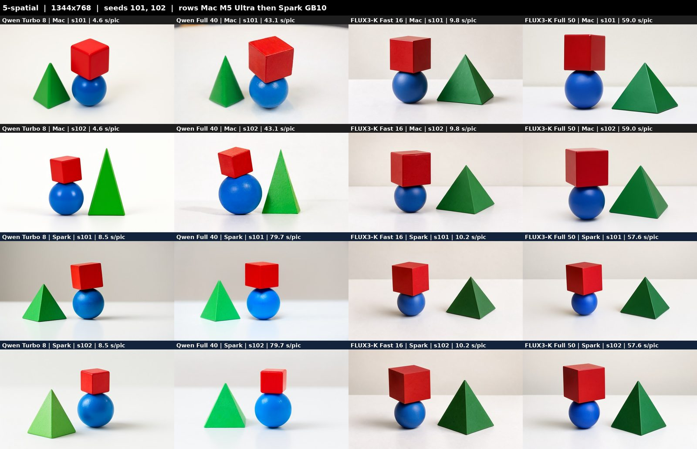
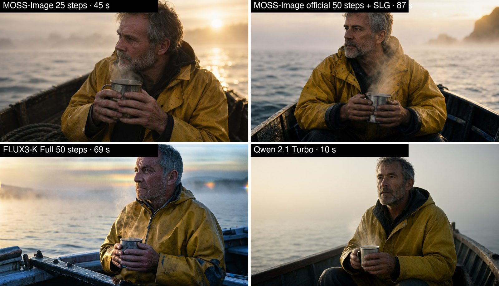
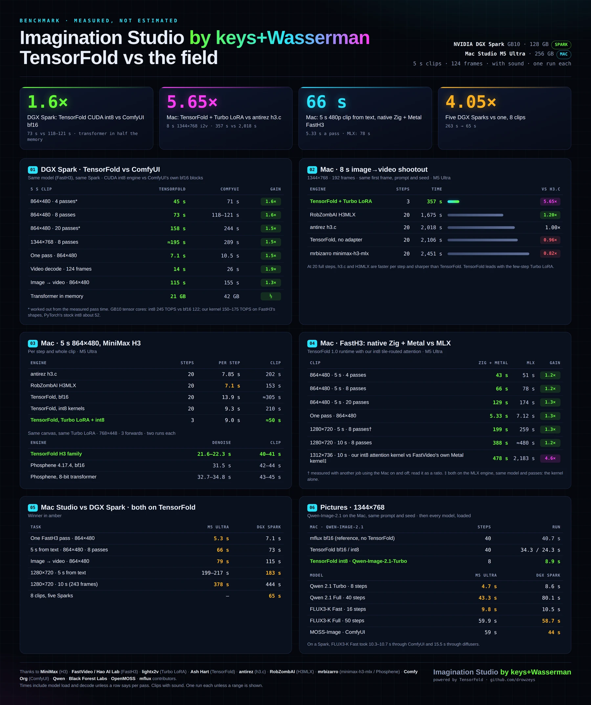

# Performance and picture-model evidence

[Back to the README](../README.md)

Dated runs on the stated hardware, not minimum-RAM guarantees or qualification for another machine. Compare with [picture shootout](picture-shootout.md) and the [Windows results](windows-rtx-spark-test-results.md).

## Which picture model to use: the evidence

**The test:** a shootout on 2026-10-16 with Studio 2.8.1, run on a Mac Studio M5 Ultra and one DGX Spark.
- **Pictures:** 8 prompts × 2 seeds × 4 models × 2 machines = **128 pictures at 1344x768, 0 failed jobs**.
- **Judging:** by eye, from the full-size pictures.
- **Full report:** every grid, the raw numbers and the method are in
  **[docs/picture-shootout.md](picture-shootout.md)**.

**Speed and memory**, per picture with the model loaded (median):

| Model | Mac M5 Ultra | DGX Spark | Peak memory (Mac / Spark) |
|---|---|---|---|
| Qwen 2.1 Turbo, 8 steps | **4.7 s** | 8.6 s | 33 / 31 GB |
| Qwen 2.1 Full, 40 steps at CFG 4 | 43.3 s | 80.1 s | 33 / 30 GB |
| FLUX3-K Fast, 16 steps | 9.8 s | 10.5 s | 38 / 37 GB |
| FLUX3-K Full, 50 steps | 59.9 s | 58.7 s | 40 / 37 GB |
| FLUX3-K prompt upsampler, once per prompt | 5.2 s | 12.5 s | |

- **Qwen:** runs about 2x faster a step on the M5 Ultra.
- **FLUX3-K:** runs at the same speed on both machines.

**Quality, the winner per prompt:**

| Prompt | Winner | The evidence |
|---|---|---|
| Poster with title and tagline | Qwen 2.1 Full | Most coherent scene. All 32 posters, every model, spelled both lines exactly |
| Photoreal portrait | Qwen 2.1 Full | Real skin and the whole face. FLUX3-K cropped off the mouth in 8 of 8 |
| Character turnaround | Qwen 2.1 Full, narrowly | Gear consistent across views. FLUX3-K wins for a labelled line-art sheet |
| Crowded night market | FLUX3-K Full | Lanterns, steam, mostly real words on signs. Qwen drew pseudo-script |
| "Red cube on a blue sphere, left of a green pyramid" | FLUX3-K Fast | Right in **8 of 8**; Qwen 2 of 8 |
| Food photography | FLUX3-K Fast | More professional styling. No model reliably drew the three pancakes asked for |
| Watercolor | FLUX3-K Full | Truest washes and paper texture |
| Hands at a piano | FLUX3-K Full | Five fingers on each hand in 8 of 8. Qwen drew a third hand 3 times |

*The spatial prompt. Every FLUX3-K picture (right two columns) has the pyramid on the right, as asked. Six of the
eight Qwen pictures put it on the left.*

**Conclusion: which to pick**
- **Drafts and scouts:** use **Qwen 2.1 Turbo**. It is the quickest, and its quality is visibly below the other three.
- **The everyday default:** use **FLUX3-K Fast**. It is right on layout and good on hands and crowded scenes, at about
  10 s on either machine.
- **Faces, portraits, posters and character sheets:** use **Qwen 2.1 Full**. It is twice as fast on a Mac.
- **Final frames of complex scenes, illustration and hands:** use **FLUX3-K Full**.
- **Machine:** for Qwen, the Mac when you have the choice. For FLUX3-K, the machine does not matter.

**Limits:** two seeds a prompt and one judge, by eye. These model times leave out the text encode, so they are lower
than the whole-run times in the table above.

### MOSS-Image on a DGX Spark

**MOSS-Image** is OpenMOSS's 5B text-to-image model (Apache 2.0: commercial use is allowed). On a DGX Spark it is a
fifth choice in the picture picker, for scouts, studio jobs and Nodes. It makes pictures from words only: it does not
edit pictures.
- **Install:** `bash oneshot-setup-spark.sh --moss` (30 GB: the SFT checkpoint and its Qwen3.5 9B text encoder in bf16,
  and the FLUX.2 small decoder, from Comfy-Org/MOSS-Image). It needs ComfyUI v0.42.0 or later, which this setup moves to.
- **Settings:** ComfyUI's own template: 25 steps of er_sde at CFG 2.5, with its negative prompt. The prompt goes to the
  model as written.
- **Mac:** `bash oneshot-setup.sh --moss` installs the same files (28 GB) on the Mac's own ComfyUI (the one of
  `--upscale` and `--remove`, PyTorch's Metal device, PyTorch's attention) and `scripts/image.sh` runs the Spark's graph
  there. Measured on 2026-10-20, 1344x768, seed 7, the same prompts on both machines: 71 s for the first picture with
  the model load and 59 s for the next on a Mac Studio M5 Ultra, 44 s each on a DGX Spark. The lettering came out exactly
  as written on both, and both are equally sharp; the compositions differ, because er_sde draws its noise during
  sampling on each machine's own device, so a seed does not give the same picture on a Mac and a Spark.

Tested on one DGX Spark on 2026-10-19 (bf16, one seed per prompt, judged by eye):

| | MOSS-Image | FLUX3-K Full | Qwen 2.1 Turbo |
|---|---|---|---|
| 1344x768, model loaded | 45 s | 69 s | 10 s |
| 1024x576 (a scout picture) | 26 s | | |
| Memory taken, from nothing loaded | 26 GB | | |
| Poster: title, tagline and date | All three lines exact, cleanest layout | Title cut off at the top | Exact |

- **Best at:** lettering. Posters, title cards, signs, menus with prices and labels came out exactly as written. A
  Japanese station sign was right too.
- **Also good:** a photoreal portrait at dawn (warm, filmic, the light as asked) and anime key art.
- **Not tested yet:** hands, the same character across pictures, and MOSS-Image's JSON layout prompts.
- **Use it for:** posters, title cards, signage and anything with words in the frame, and pictures meant for
  commercial use.

## Speed: the first version on each machine, and 2.3

*Every figure on the poster is a measurement from this README and the H3 shootout of
[keys-Mac-TensorFold-MiniMax-H3-MLX](https://github.com/drowzeys/keys-Mac-TensorFold-MiniMax-H3-MLX). Most are one run
each; the times include loading the model and decoding unless a row says per pass.*

One run each unless a range is given; 5 second clips are 124 frames. Mac: Mac Studio M5 Ultra, 256 GB. Spark: one
NVIDIA DGX Spark (GB10), models already loaded.

| 5 second clip, 864x480 | Mac, first version (1.0, 2026-10-04) | Mac, 2.3 | DGX Spark, first build (ComfyUI's own blocks, bf16) | DGX Spark, 2.3 |
|---|---|---|---|---|
| What makes the video | MiniMax H3 + Turbo adapter on MLX, 3 passes | FastH3, 8 passes, TensorFold's Zig + Metal engine | FastH3, 8 passes, ComfyUI | FastH3, 8 passes, TensorFold's CUDA engine in int8 |
| Image, then video from it | 74 s (103 s with the sound made again, the later default) | **79 s** (image 6 s, video 73 s) | 155 s | **115 s** (measured before the faster decoder below, which takes about 10 s more off) |
| Text straight to video | not offered | **66 s** | 118 to 121 s | **73 s** |
| One denoising pass | 9.5 s | **5.3 s** | 10.5 s | **7.1 s** |
| Video decode | not timed apart | 13 s | 26 s | **14 s** |

| Other sizes and lengths | Mac, first version | Mac, 2.3 | DGX Spark, first build | DGX Spark, 2.3 |
|---|---|---|---|---|
| 864x480, 4 passes, text to video | | 43 s | 71 s | 45 s (from the pass time) |
| 1280x720, 5 s, text to video | | 199 to 217 s | not measured | **183 s** |
| 1344x768, 5 s, text to video | | 175 s | 289 s | **about 195 s** |
| 1344x768, 8 s, image then video | 364 s (709 s with the later default) | not re-measured | | |
| 1280x720, 10 s (243 frames), text to video | | 378 s | not measured | 444 s |
| One 15 s part of a chained 864x480 clip | | about 249 s | not measured | about 304 s |
| One image, 1344x768 | 9.2 s (Viggle adapter, 6 steps) | **8.9 s** (Qwen-Image-2.1-Turbo, 8 steps; peak 15 GiB against 28) | 18 to 21 s with the model load | **9.5 s** |

- The Mac's first version and 2.3 use different video models, so the 74 s and 79 s rows are not the same work: the
  first is 3 passes of MiniMax H3 with its Turbo adapter, whose sound was judged poor by ear; 2.3 is 8 passes of
  FastH3 with its own sound. Per pass the Mac went from 9.5 s to 5.3 s.
- On the Spark the model is the same in both columns. The gain is the engine (10.5 s a pass to 7.1 s) and the 8-bit
  video decoder (26 s to 14 s).
- Both engines are TensorFold H3 families on the TensorFold 1.0.4 base, from one commit of one branch. 1.0.3 and 1.0.4
  are language-model releases, so the move changed nothing here: on each machine the same seed gives a bit-identical
  clip to the 1.0.2-based engine, at the same speed.

## Which Mac runs what

Every row's measurements are Studio **2.3**'s; the memory column is the setup's floor after 4.3.0. "Default" means
images (Qwen-Image-2.1-Turbo) and FastH3 video with sound, the web app and the one-click app. Only the M5 Ultra with 256 GB has actually run it; every other row follows from memory measured
on that machine and is marked untested.

| Chip | Memory | What runs | Install command | Video engine it uses | Peak memory | Status |
|---|---|---|---|---|---|---|
| M5 family | 96 GB | Default | `bash oneshot-setup.sh --app` | FastH3, native Zig engine | 32 GiB | Untested |
| M5 family | 128 GB | Default, and MiniMax H3 Turbo if wanted | `bash oneshot-setup.sh --turbo --app` | FastH3 native; Turbo on the MLX engine with int8 kernels | 32 GiB; 103 GiB for Turbo | Untested |
| M5 family | 256 GB or more | Everything | `bash oneshot-setup.sh --turbo --app` | The same | The same | **Tested** (M5 Ultra, 256 GB) |
| M1 to M4 | 96 GB | Default, slowly | `bash oneshot-setup.sh --app` (add `Q8_ONLY=1` in front to save 65 GB of disk) | FastH3, MLX engine, 8-bit weights | 37 GiB at 480p, 40 GiB at 720p | Untested; emulated on the M5 |
| M1 to M4 | 128 GB | Default, slowly. Turbo installs but is not recommended | `bash oneshot-setup.sh --app` | FastH3, MLX engine, 8-bit weights | 37 to 40 GiB | Untested; Turbo's memory without the int8 kernels is not measured |
| M1 to M4 | 256 GB or more | Default, slowly; Turbo should fit | `bash oneshot-setup.sh --turbo --app` | FastH3 MLX 8-bit; Turbo on the MLX engine in bfloat16 | 37 to 40 GiB; Turbo not measured | Untested |
| Any | 48 to 95 GB | Images only | `bash oneshot-setup.sh --image-only` | none | 28 GiB | Untested below 256 GB |

How to configure it:

- **Nothing to set on a normal install.** The setup reads the chip and the memory and picks the engine: the native
  engine on an M5, the 8-bit weights on an M1 to M4 (it converts them once, about 37 GB). It stops with a message if
  the Mac has too little memory for what was asked.
- **Disk:** 175 GB for the default on an M5; 212 GB on an M1 to M4 (147 GB with `Q8_ONLY=1`); 64 GB more with
  `--turbo`; 33 GB for `--image-only`.
- **Speed on an M1 to M4:** the 8-bit path took 31 s a pass at 864x480 on the M5 Ultra's GPU, against 5.3 s for
  the native engine there. An older GPU is slower again. Start with 480p, 5 seconds and 4 passes
  (`STEPS=4 bash scripts/fast.sh "a prompt" out.mp4`, or the 4 passes card in the app).
- **Overrides:** `FASTH3_Q8=0` runs an M1 to M4 with the uncompressed weights (64 GiB peak: a 96 GB Mac or larger;
  no faster). `FASTH3_ENGINE=mlx` forces the MLX engine on an M5. `ENGINE=h3` asks for Turbo where it is installed.

| Studio version | Smallest Mac for video |
|---|---|
| 2.0 and earlier | 128 GB (M5 for the fast path) |
| 2.1 | 64 GB on an M5; 96 GB on an M1 to M4 |
| 2.2 to 4.3.0 | 64 GB on any Apple silicon |
| After 4.3.0 | 96 GB on any Apple silicon (the default install: video, voice, music and the Bolt brain) |

Under 96 GB the setup stops before it downloads anything and offers `--image-only` (48 GB). An install made on a 64 GB
Mac before the change is not removed: `oneshot-setup.sh --upgrade` and `--verify` say that the minimum is now 96 GB,
keep and upgrade what is there (video keeps running) and add nothing that needs 96 GB; the Voice and Music tabs say
they need 96 GB on such a Mac.

On a **DGX Spark** the setup asks for 100 GB of memory for video (a Spark has 128 GB; about 70 GB was in use during a
clip). No NVIDIA machine with 64 GB has been tried.

Measured memory for each kind of job is under [Minimum requirements](installation.md#minimum-requirements).
## Measured (2026-10-04, Mac Studio M5 Ultra 256 GB, macOS 27.0.1, one run each)

**Notes and Regenerate.** Under every take, in Shots and in Deliver, there is a box for notes or feedback and a
"↻ Regenerate" button. With notes, the brain revises the shot's prompt to answer them (the old prompt goes to History)
and a new take is queued; with the box empty, the same prompt is rendered at the next seed. Earlier takes are kept.

### Text to image to video (`scripts/studio.sh`), 8 second clips unless noted

| Output | Video generated at | Standard: Turbo 5 + base-model sound | Earlier: Turbo 3, adapter sound |
|---|---|---:|---:|
| Six scout images, 1280x736 (`scripts/scout.sh`) | | 27 s | 27 s |
| 1344x768, 2x decoder (`X2=1`) | 672x384 | **108 s** | 67 s |
| **2048x1152, 2x decoder (`TWOK=1`)** | 1024x576 | **299 s** | 151 s |
| **2560x1440, 2x decoder (`QHD=1`)** | 1280x736 | **635 s** | 352 s |
| 1344x768, native decode | 1344x768 | 709 s | 364 s |
| 864x480, native decode | 864x480 | 174 s | 98 s |
| 864x480, 5 s (124 frames), native decode | 864x480 | 103 s | 74 s |

Totals include the image (9-12 s). Where the standard time goes, 2048x1152: five passes 185 s (37 s each), the sound
made again 60 s, decode 31 s, loading and text 12 s. At 2560x1440: passes 436 s, sound 119 s, decode 55 s. The audio
step costs about one and a third passes at every size: one full pass to store the picture's keys and values, then 20
light steps.

`QUALITY=high` (20 steps, no adapter) took 606 s for a 15 second clip generated at 672x384, against 219 s at the
standard setting; it has not been timed at the sizes above.

The earlier column was measured with `POINTS=4 REVOICE=0`, which still works.

**Resolution costs far more than length.** The video model works on one row per 32x32 pixels of every latent frame,
and attention compares every row with every other, so its cost grows with the square of the row count. 5 s at 864x480
is 16,500 rows (9.5 s per pass); 8 s at 864x480 is 24,826 rows (18.3 s per pass); 8 s at 1344x768 is 60,403 rows
(104.6 s per pass). Going from 864x480 to 1344x768 is 2.5 times the pixels and 4 times the time for the same length.

**What the 2x decoder is.** A replacement head for H3's own video decoder (speach1sdef178's MiniMax-H3-X2-Detail-VAE)
that turns the same latents into frames twice as large along each side, in the normal decode time. It is an upscale: a
1344x768 clip decoded from a 672x384 generation is softer than one generated at 1344x768, with stair-steps on
high-contrast edges ([comparison](../samples/x2_compare.jpg): native on top, 2x below). It earns its place twice: as a
6 times faster draft, and as the last step to 2K from a full-size generation, where the 2560x1440 clip costs no more
than the 1344x768 one. With `QHD=1` or `TWOK=1` the first frame is made at the size the video model starts from
(1280x736 or 1024x576), since a larger picture would only be shrunk again.

Wall time from the command to the finished files, both models loaded from disk each time, int8 kernels on. In every clip the baker lifts the loaf, speaks the scripted line
(checked by speech recognition) and smiles. The 864x480 run was the first after install, so its 14 s includes a cold
read of the text encoder.

### Qwen-Image-2.1 alone, 1344x768, same prompt and seed

| Path | Steps | Per step | Denoise | Whole run |
|---|---:|---:|---:|---:|
| mflux `add5164`, bfloat16 (the reference this port is checked against) | 40 | 0.73 s | 29 s | 40.7 s |
| TensorFold, bfloat16 | 40 | 0.78 s | 31.0 s | 34.3 s |
| TensorFold, int8 kernels | 40 | 0.48 s | 19.2 s | 24.3 s |
| TensorFold, int8 kernels + Viggle turbo adapter (the default up to 2.2) | 6 | 0.50 s | 3.0 s | 9.2 s |
| **TensorFold, int8 kernels, Qwen-Image-2.1-Turbo (2.3, measured 2026-10-09; peak 15 GiB against 28)** | **8** | 0.49 s | **3.9 s** | **8.9 s** |

Top: mflux, TensorFold bfloat16. Bottom: TensorFold int8, TensorFold int8 turbo. Against the mflux image the
TensorFold bfloat16 image is 32.7 dB and the int8 image 30.4 dB: the same picture with different fine detail. Turbo
gives the same scene with a different rendering.

- **Per step in bfloat16, mflux is slightly faster than this port** (0.73 s against 0.78 s). The gain comes from the
  int8 kernels (1.6x per step) and the 6-step adapter.
- **MiniMax H3 numbers**, the shootout against h3.c, H3MLX and minimax-h3-mlx, and what makes H3 fast are in the
  video-only pack: [keys-Mac-TensorFold-MiniMax-H3-MLX](https://github.com/drowzeys/keys-Mac-TensorFold-MiniMax-H3-MLX).
  At 20 steps the C engines are faster and sharper than TensorFold; TensorFold leads only with the Turbo adapter.
