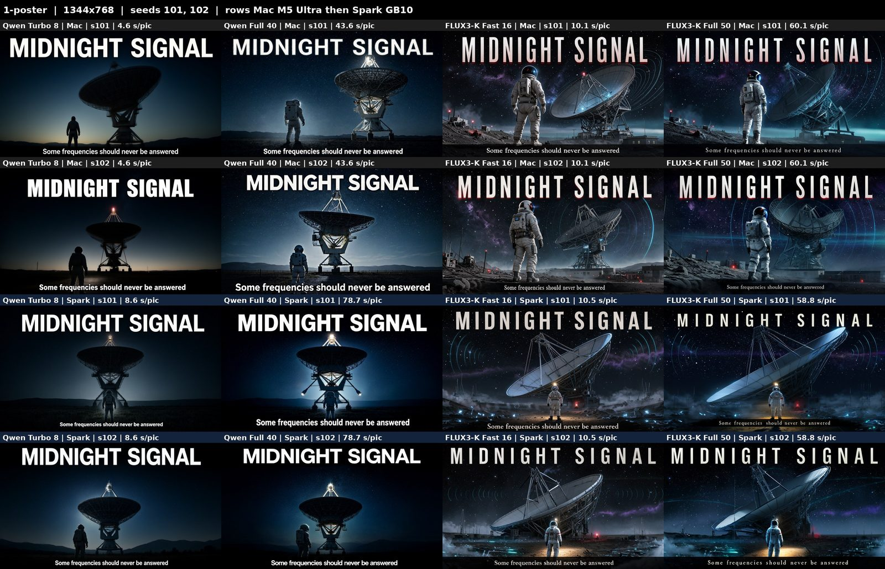
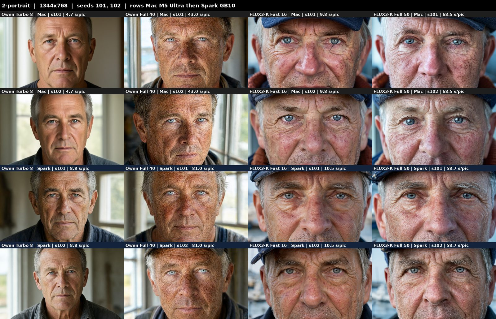
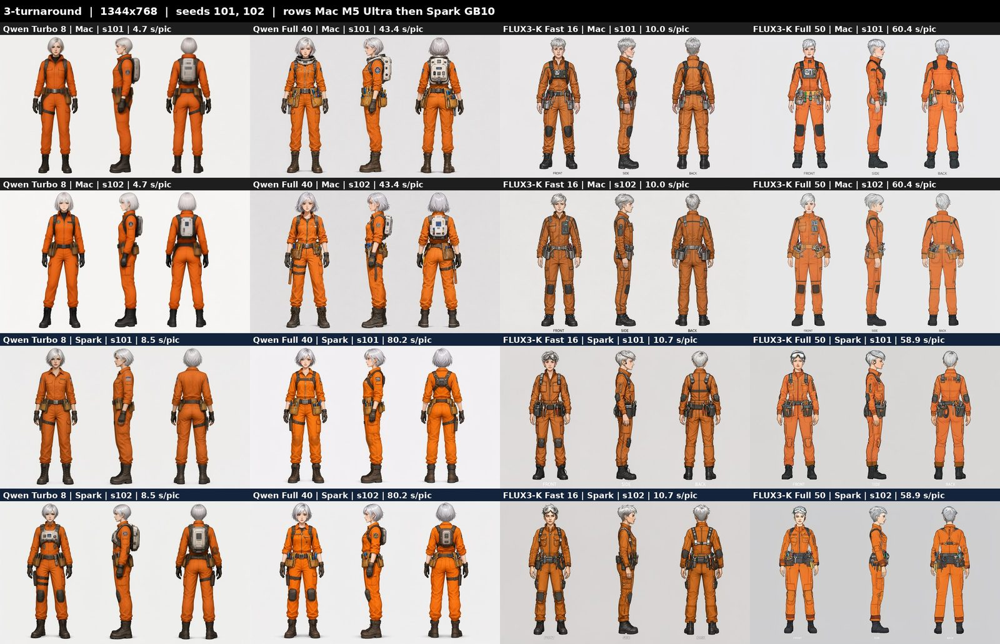
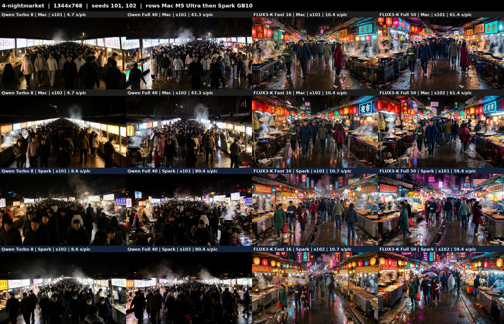
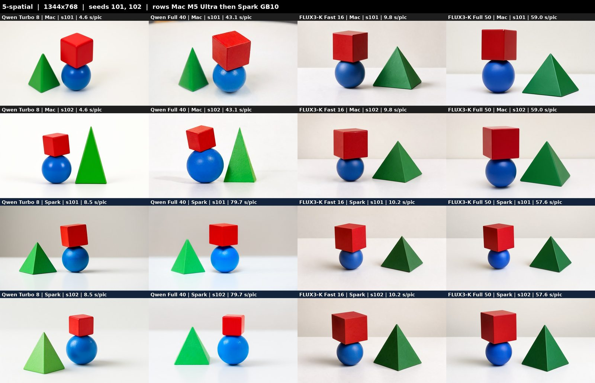
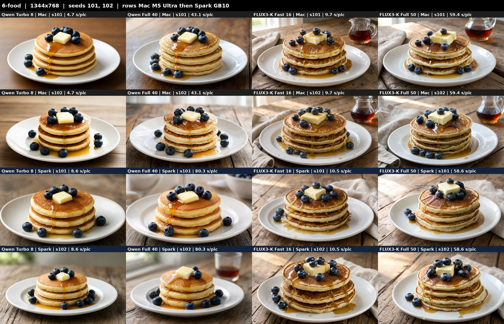
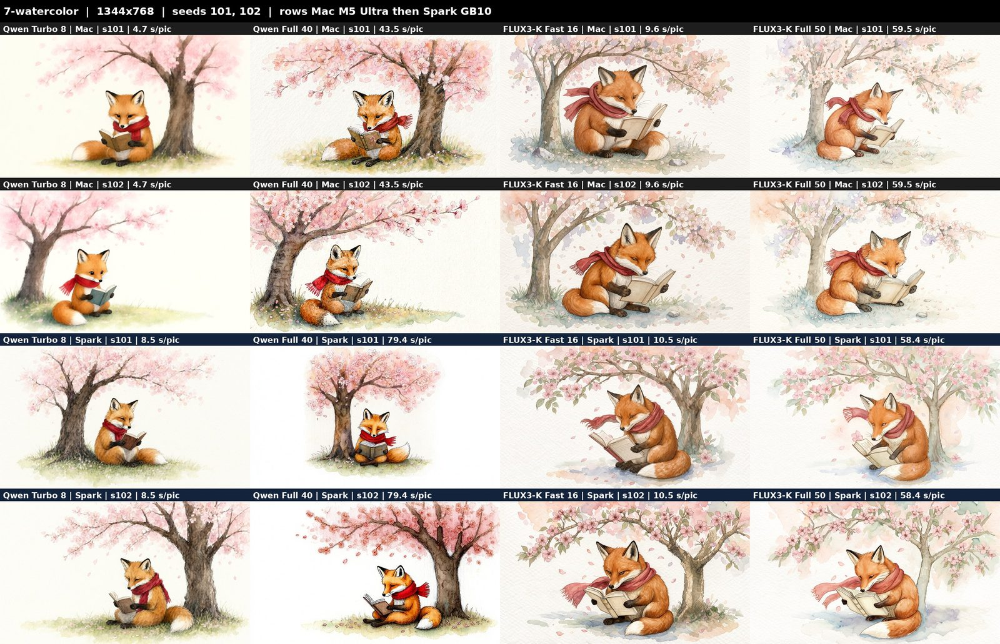
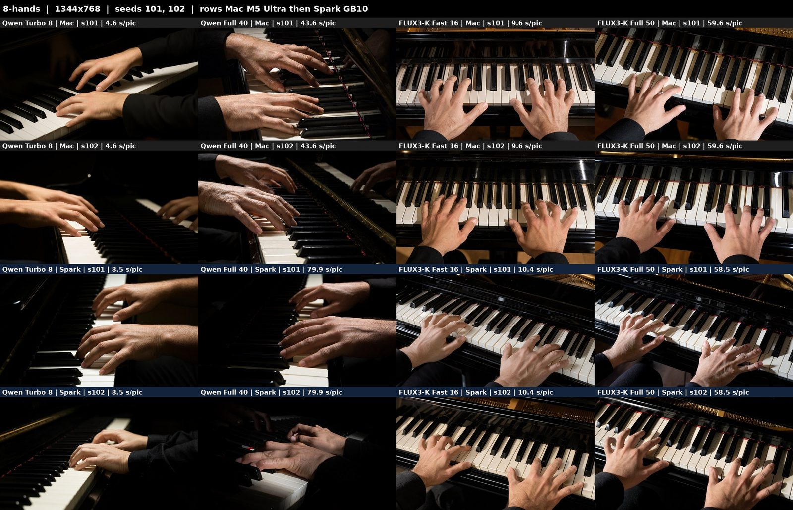

# Picture-model shootout: four models, Mac against DGX Spark

Measured on 2026-10-16 with Studio 2.8.1. The README's
[Which picture model to use](../README.md#which-picture-model-to-use-the-evidence) is the short version of this page.

## Setup

- **Machines:**
  - a Mac Studio M5 Ultra, 256 GB, running MLX;
  - one DGX Spark (GB10, 128 GB unified), running ComfyUI `5a665890` on CUDA 13.
- **Models:**
  - Qwen 2.1 Turbo, 8 steps;
  - Qwen 2.1 Full, 40 steps at true CFG 4;
  - FLUX3-K Fast, the distilled checkpoint, 16 steps;
  - FLUX3-K Full, the base checkpoint, 50 steps at CFG 3.5.
  - FLUX3-K runs BFL's prompt upsampler first, as the Studio always does.
- **Pictures:** 8 prompts ([prompts.json](shootout/prompts.json)) × 2 seeds (101, 102) × 4 models × 2 machines =
  **128 pictures, 0 failed jobs**. All are 1344x768 and bf16.
- **Runs:**
  - Each model got one warm-up job first, which is not counted.
  - Then each prompt was one job of two pictures.
  - ComfyUI was stopped between models, so each started from about 5.3 GB used.
- The same seed draws a different picture on MLX and on CUDA, so compare the Mac and Spark rows as two draws, not as a
  pixel match.

## Speed and memory

Per picture is the model's own time with the model loaded: the median, with min-max in brackets.

| Model | Mac M5 Ultra, per picture | DGX Spark, per picture | Mac s/step | Spark s/step | FLUX3-K upsampler, once a prompt (Mac / Spark) | Job of 2 pictures, hot (Mac / Spark) | Warm-up job (Mac / Spark) |
|---|---|---|---|---|---|---|---|
| Qwen 2.1 Turbo, 8 | **4.7 s** (4.6-4.65) | 8.6 s (8.5-8.8) | 0.50 | 1.00 | - | 14.3 / 18.5 s | 9.9 / 28.5 s |
| Qwen 2.1 Full, 40 | 43.3 s (43.0-43.6) | 80.1 s (78.7-81.0) | 1.00 | 2.01 | - | 92.5 / 160.9 s | 46.4 / 93.5 s |
| FLUX3-K Fast, 16 | 9.8 s (9.6-10.4) | 10.5 s (10.2-10.7) | 0.50 | 0.51 | 5.2 / 12.5 s | 25.5 / 33.6 s | 17.5 / 42.9 s |
| FLUX3-K Full, 50 | 59.9 s (59.0-68.5) | 58.7 s (57.6-59.4) | 1.00 | 1.01 | 5.2 / 12.0 s | 126.1 / 129.4 s | 64.7 / 83.4 s |

| Model | Mac peak memory (render process footprint, GPU included; MLX peak) | Spark peak memory (system used, idle about 5.3 GB) |
|---|---|---|
| Qwen 2.1 Turbo | 33.0 GB (15.3 GiB) | 30.7 GB (+25.5) |
| Qwen 2.1 Full | 33.0 GB (15.3 GiB) | 30.3 GB (+24.9) |
| FLUX3-K Fast | 38.0 GB (28.0 GiB) | 37.2 GB (+31.8) |
| FLUX3-K Full | 40.0 GB (28.0 GiB) | 37.2 GB (+31.9) |

**What the numbers say:**
- **Qwen runs about 2x faster a step on the M5 Ultra than on a GB10.**
- **FLUX3-K runs the same speed on both.**
- **The upsampler costs more on the Spark:** 12 s against 5 s, once per prompt.
- **Every model fits in 40 GB.** Each fits a 96 GB Mac (the default install's minimum), and fits beside nothing else heavy on a Spark.

The raw rows are in [results.csv](shootout/results.csv).

## Quality, prompt by prompt

The judging was by eye, from the full-size PNGs. In each grid the rows are Mac s101, Mac s102, Spark s101 and
Spark s102, and the columns are Qwen Turbo, Qwen Full, FLUX3-K Fast and FLUX3-K Full.

### 1. Poster with text: **Qwen 2.1 Full**

**Text:** all 32 posters spell "MIDNIGHT SIGNAL" and "Some frequencies should never be answered" exactly.

**How each model draws it:**
- **Qwen:** sets clean bold sans.
- **FLUX3-K:** sets a cinematic condensed title with a serif tagline. It draws the radio dish oddly: tilted, near flat
  or warped.
- **Qwen Turbo and Spark Qwen Full:** merge the astronaut into the base of the telescope.

**Qwen 2.1 Full on the Mac:** has the most coherent scene.

### 2. Photoreal portrait: **Qwen 2.1 Full**

**Qwen Turbo:** the skin is too smooth for "weathered".

**Qwen Full:** has real freckles and sun damage, clear pale blue eyes, and the whole face in frame.

**FLUX3-K:**
- It crops so tightly that the mouth is cut off in all 8 pictures.
- Two Mac pictures have a stray dark hair across the eye.

### 3. Character turnaround: **Qwen 2.1 Full**, narrowly

**Every model:** drew one consistent character in front, side and back views.

**Qwen Full:** has the most complete design. Its tool belt has tools in it, and its backpack and belt match across
the views.

**FLUX3-K:**
- It draws a line-art sheet with FRONT/SIDE/BACK labels.
- On the Spark it adds goggles.
- It wins if you want a labelled sheet.

### 4. Crowded night market: **FLUX3-K Full** (Fast nearly the same)

**FLUX3-K:**
- It draws lanterns, neon, steaming woks and wet reflections.
- Most of its signs are real words: 夜市, 餃子 and 海鮮 on the Mac, and NOODLES and FRESH SEAFOOD on the Spark.

**Qwen:** draws a dense, dark crowd with little neon and pseudo-script signs.

### 5. Spatial prompt: **FLUX3-K Fast**

The prompt is "a red cube on top of a blue sphere, to the left of a green pyramid".

**FLUX3-K:** right in **8 of 8** pictures, both checkpoints on both machines.

**Qwen:** right in **2 of 8**, both on Mac seed 102. Every other Qwen picture puts the pyramid on the left.

**All models:** put the cube on the sphere. Fast is as right as Full and 6x quicker.

### 6. Food photography: **FLUX3-K Fast**

**FLUX3-K:** adds a syrup jug and linen, glossier drips and a melting pat of butter. It reads as a professional shoot.

**Pancake count:** no model reliably drew the three pancakes asked for. They drew 3 to 5, and Qwen on the Spark kept
to three most often.

### 7. Watercolor: **FLUX3-K Full**

**FLUX3-K:** has the truest watercolor: soft pastel washes, paper texture and ink outlines.

**Qwen Full:** is crisper. Spark s101 left half the frame empty.

**Qwen Turbo:** looks flat and digital.

### 8. Hands at a piano: **FLUX3-K Full**

**FLUX3-K:** draws top-down, with two hands and five fingers each in all 8 pictures. That was checked at full size on
two of them.

**Qwen:**
- It draws a third or overlapping hand in 3 pictures.
- Qwen Full's keyboards are jumbled.

**Every model:** gets the black keys wrong. FLUX3-K spaces them evenly instead of in groups of 2 and 3.

## Conclusion

| Prompt | Winner |
|---|---|
| Poster with text | Qwen 2.1 Full |
| Photoreal portrait | Qwen 2.1 Full |
| Character turnaround | Qwen 2.1 Full (narrowly) |
| Crowded scene | FLUX3-K Full |
| Spatial layout | FLUX3-K Fast |
| Food | FLUX3-K Fast |
| Watercolor / illustration | FLUX3-K Full |
| Hands | FLUX3-K Full |

**FLUX3-K wins:** prompt following, crowded scenes, illustration and hands.

**Qwen 2.1 Full wins:** photoreal faces, the poster's composition and the character sheet.

**Spelling is a tie:** 32 of 32 correct.

**Qwen 2.1 Turbo is the speed pick:** its quality is visibly below the other three.

**What to choose:**
- **Drafts and scouting:** Qwen 2.1 Turbo, at 4.7 s on a Mac and 8.6 s on a Spark.
- **The everyday default:** FLUX3-K Fast. It is right on layout, good on hands and scenes, and about 10 s on either
  machine. Add 5 s on a Mac or 12 s on a Spark for the upsampler, once per prompt.
- **Faces and portraits, and posters where the layout matters:** Qwen 2.1 Full. It takes 43 s on a Mac and 80 s on a
  Spark; the Mac is the better machine for it.
- **Final frames of complex scenes, illustration and hands:** FLUX3-K Full, at about 60 s on either machine.
- **Machine:** for Qwen, use the Mac when you have the choice. For FLUX3-K, the machine does not matter.

## How it was measured

- **Mac, per picture:**
  - Qwen: (denoise + decode) / 2, from the engine's JSON.
  - FLUX3-K: the engine's `per_image_s`.
  - Neither includes the text encode or the upsampler. These are model times, which is why they are lower than the
    whole-run times elsewhere in the README.
- **Spark, per picture:**
  - The median `total_s` of the second picture of each job.
  - The first picture also carries the prompt's text encode, and for FLUX3-K the upsampler. The upsampler column is
    the first picture minus the second.
- **Memory:**
  - Mac: the render process's macOS footprint (GPU included), sampled every second.
  - Spark: MemTotal minus MemAvailable (unified memory), sampled every second.
- **Steps:** s/step is from one-second polling of job progress and is approximate.
- **Limits of this test:**
  - Two seeds a prompt and one judge.
  - The quality calls are by eye, with no metric.
