# Using Imagination Studio

[Back to the README](../README.md)

Feature reference and screenshots. Availability depends on the selected runtime, installed models and qualification scope; see [Windows](windows.md) for native restrictions.

## Screenshots

| | |
|---|---|
| 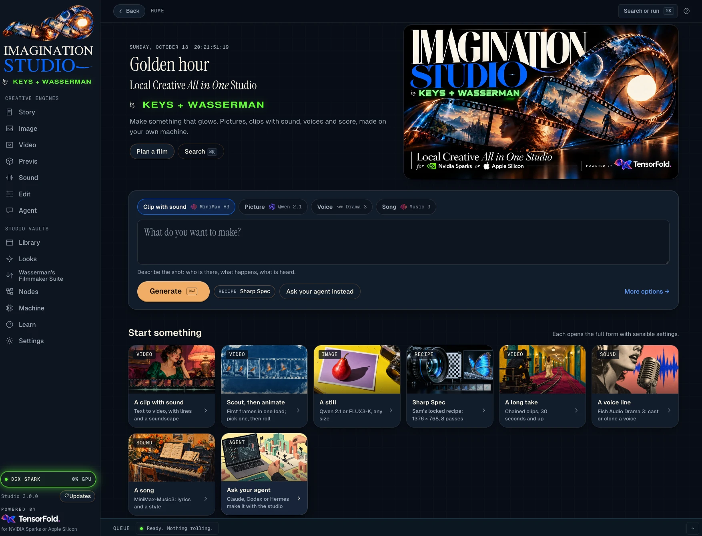 | 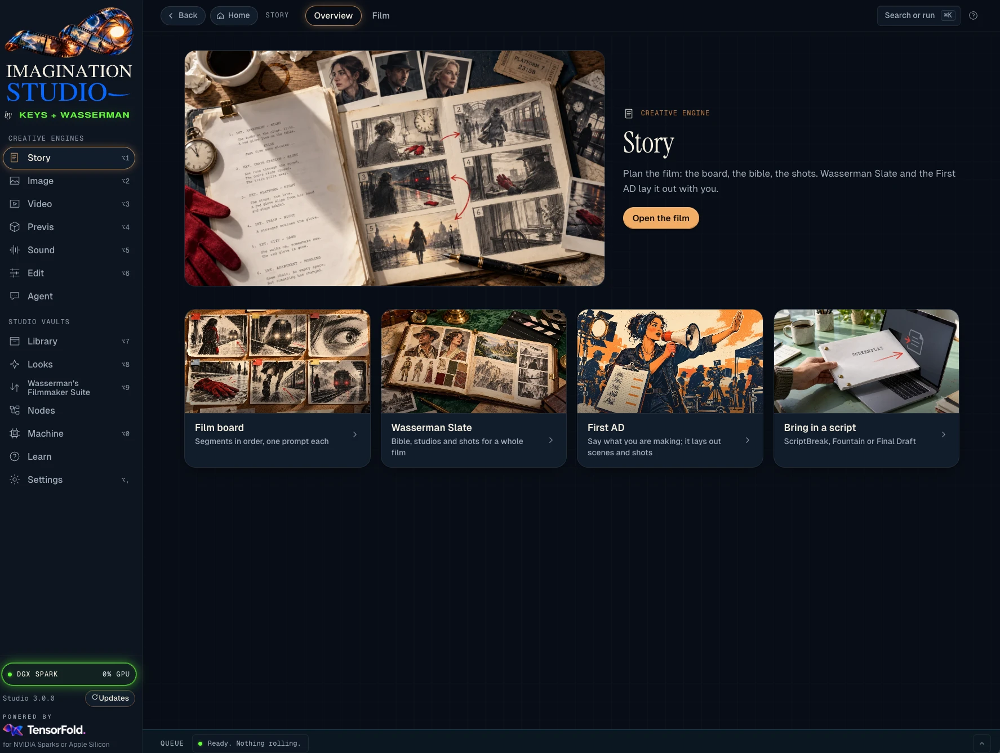 |
| **Home** | **Story** |
| 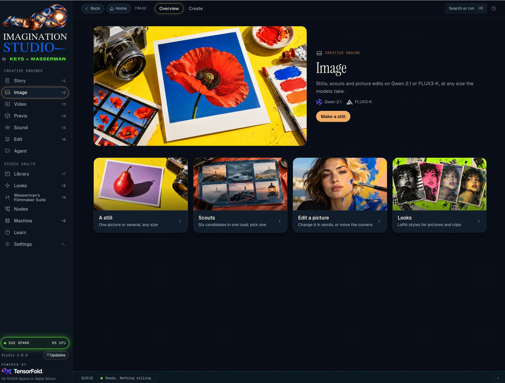 | 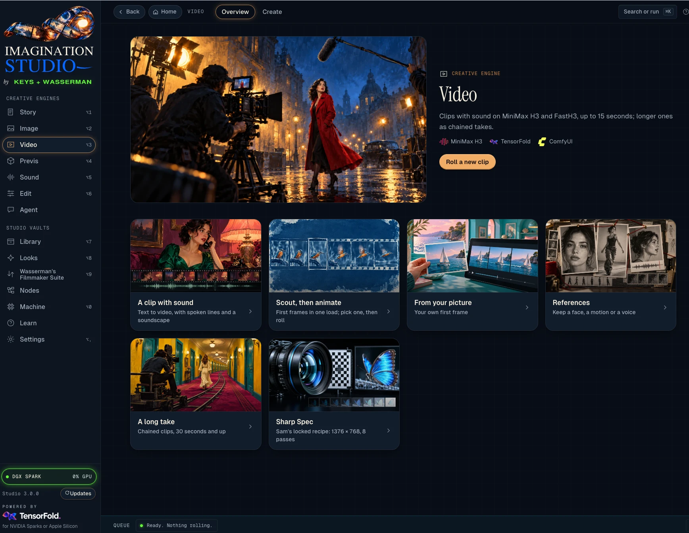 |
| **Image** | **Video** |
| 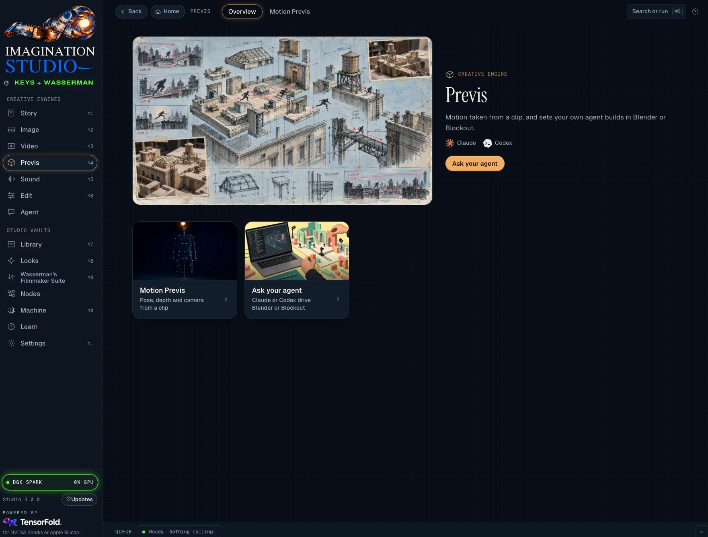 | 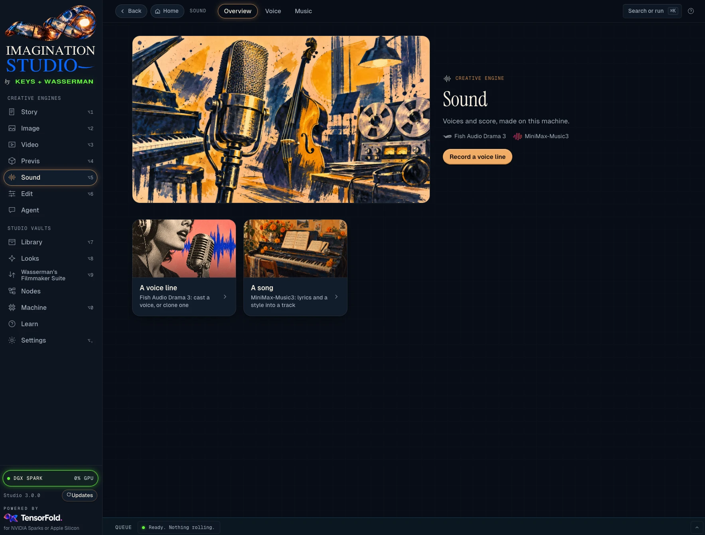 |
| **Previs** | **Sound** |
| 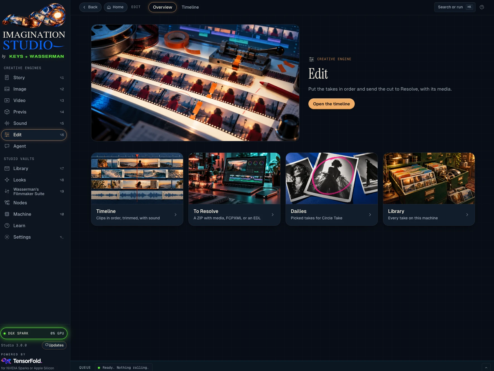 | 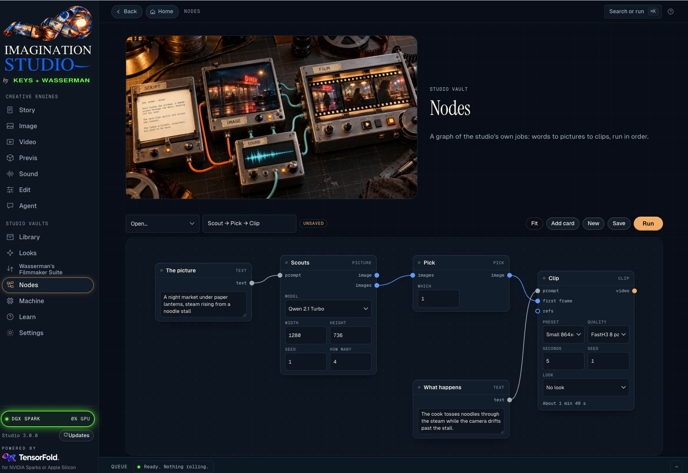 |
| **Edit** | **Nodes** |
| 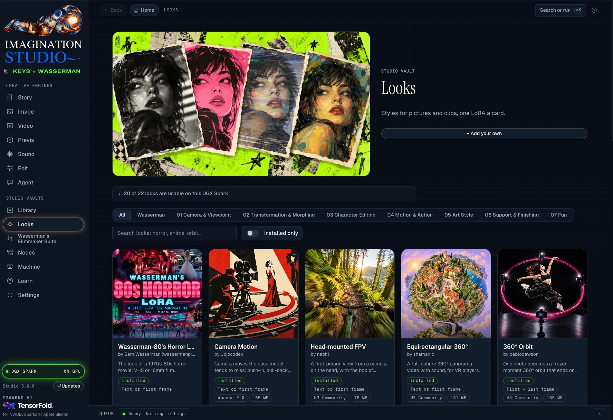 | 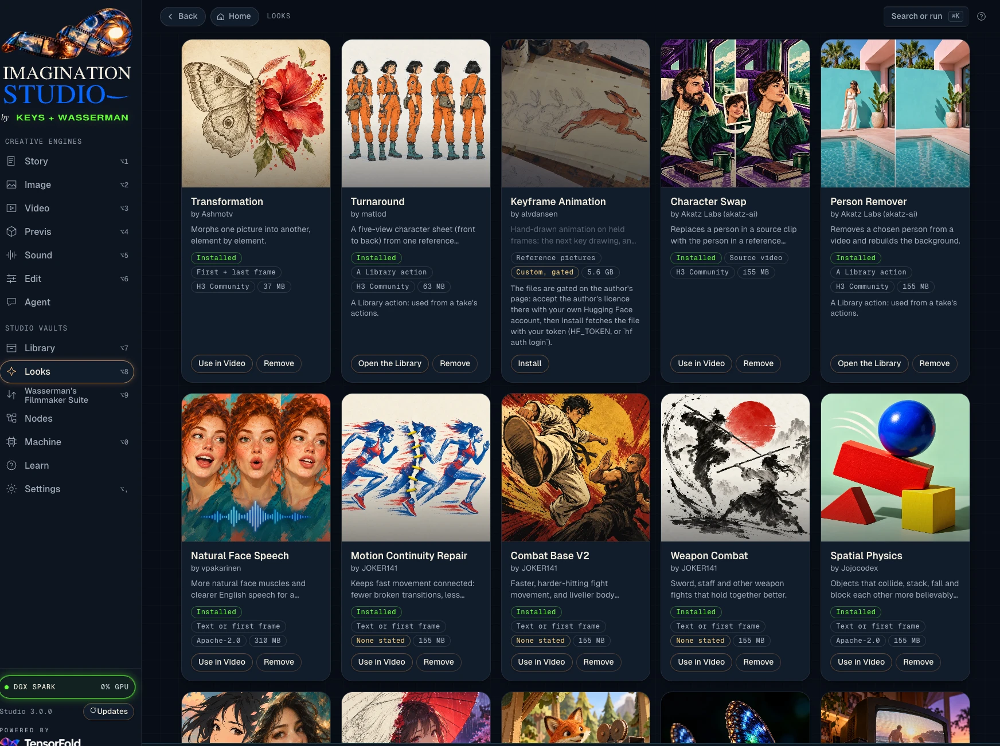 |
| **Looks** | **Looks, the cards** |
| 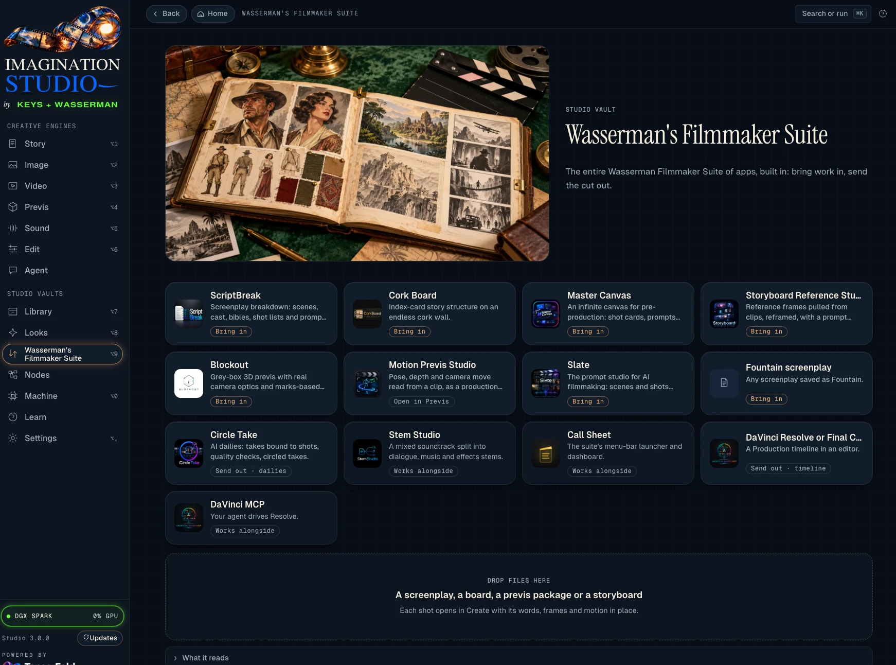 | 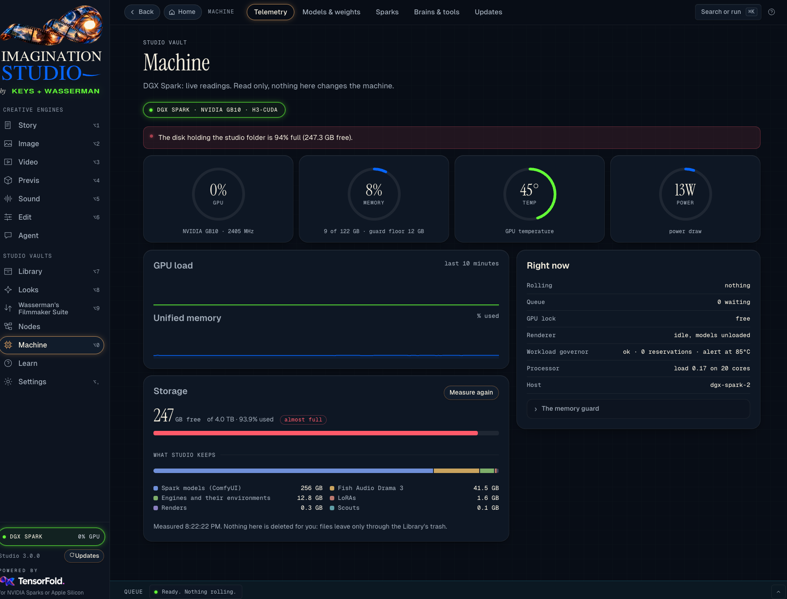 |
| **Wasserman's Filmmaker Suite** | **Machine** |

## Quick Edit

The Image room's **Quick Edit** tab offers a single picture-edit box. Paste or drop a picture, press **+**
to choose a file, or select one from the Library. Describe the change and press the arrow or Enter;
Shift+Enter adds a line. A pasted clip supplies its first frame.

The result offers **Edit this result**, **Download**, **Make a clip of it** and **Ask again**. The model
chooser uses installed Qwen Turbo or FLUX3-K variants with their production settings. Each turn keeps the
picture's size and draws a new seed. For LoRAs, camera angles, multiple pictures or custom sizing, use
**Create > Edit a picture** instead. Platform prerequisites and qualification still apply.

## Silent video

Choose **No sound** in step 3 of the Video wizard to silence the delivered clip. For a long video,
the joined output is silenced. This is post-render processing, not a promise that the model generates silence.

## Using it on your phone

The models run on your Mac or DGX Spark; the phone is only the screen and the remote. Everything works from it:
write a prompt, roll a clip, watch the queue, play takes from the Library, plan in Story, talk to your agent.

1. **Put the computer and the phone on the same [Tailscale](https://tailscale.com) network** (free for personal use):
   install Tailscale on both and sign in with the same account.
2. **Share the studio on that network**, once, on the computer running it:

   ```bash
   tailscale serve --bg 7870
   ```

   Tailscale prints the address, `https://<computer>.<your-tailnet>.ts.net`. Only devices on your own tailnet can
   open it, over HTTPS, and the studio accepts its Tailscale name by itself. (On a trusted home network,
   `HOST=0.0.0.0 bash scripts/app.sh` and `http://<computer's address>:7870` work too; the access key below still
   guards it, but keep that to a network you trust.)
3. **Sign the phone in, once:** on the computer, open **Settings → Access key** and scan its QR code with the phone's
   camera. It opens the studio on the phone, signed in. The phone keeps it. Then *Share → Add to Home Screen* (iPhone) or *⋮ → Add to Home screen*
   (Android): the studio opens full screen from its own icon.

**The access key.** On the computer running the studio nothing is asked: open `http://localhost:7870` (or the
computer's own network address or `.local` name, when it is opened to the network) and use it, updates included. Reaching it from another device (a phone over Tailscale, another computer on the network) takes the
studio's access key, once per device: on the computer, **Settings → Access key** shows a QR code that signs a phone in
with one scan, and the key itself to copy. The key is made once, kept in `access-key` in the studio folder (readable
by you only) and survives restarts and updates; *Make a new key* there signs every other device out.
`bash scripts/studio-key.sh` prints the same from a terminal. A clip read from another machine's app (Slate's
*Import a take*) needs that app's key beside its address.

On the phone:

- **Bottom bar**: Story, Image, Video, Previs, Sound and Edit, one tap each. **More** opens the Agent, the Library,
  Looks, Wasserman's Filmmaker Suite, Nodes, Machine, Learn, Settings, search and updates.
- **Home** keeps the composer on top: pick *Clip with sound*, *Picture*, *Voice* or *Song*, describe it, *Generate*.
- **The queue** is the line above the bar; tap the arrow to see what is rolling and what is next. Renders keep going
  on the computer when the phone sleeps or leaves.
- **Connect an agent from the phone**: *Connect* shows the sign-in code in large type with *Copy code* and *Copy
  link*, and a QR code; sign in on the phone itself, or scan the QR with another device.

| 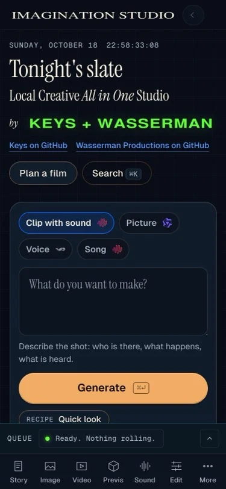 | 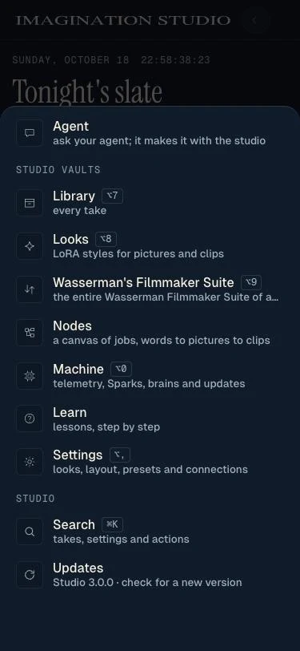 | 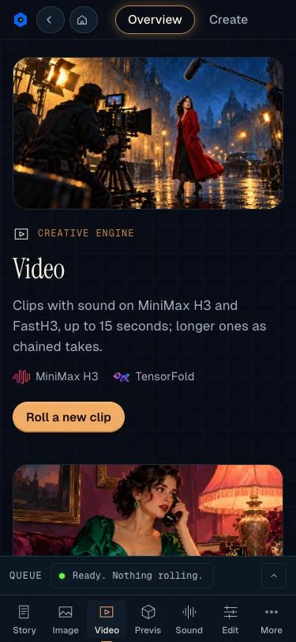 |
| :---: | :---: | :---: |
| **Home** | **More** | **An engine: Video** |
## Using the studio

### Apps

**Apps**, at the top of the sidebar, is every tool of the Studio as a one-click app, in nine kinds: Cinema,
Characters, Camera, Effects, Styles, Sound, Finish, Filmmaker Suite and Studio. Search by name or pick a kind. An app
opens the Studio's own form with its model, LoRA or start already chosen. A LoRA app that is not installed yet opens
Looks on that LoRA (Install, then open the app again); a Library action (Character Swap, Restyle, Fix, Extend, Remove
a person, Upscale, Captions, Turnaround) asks for the clip or picture first, from your newest takes. What this machine
cannot run says why on its card. Every app is also in ⌘K.


Step 1 of **Create** is where every choice lives. Pick one card in each row; the bar under them shows what will run
and roughly how long it takes.

| Choice | What it does |
|---|---|
| **The prompt goes to** | *Video with sound*; *Image only*: the picture model makes the pictures and stops there; or *Edit a picture*: it re-draws a picture you give it. |
| **Picture model** (where more than one is installed) | *Qwen 2.1 Turbo*, *Qwen 2.1 Full*, *FLUX3-K Fast* or *FLUX3-K Full*, for images, scouts, a last frame and edits: see [Which picture model to use](performance.md#which-picture-model-to-use-the-evidence). |
| **The clip starts from** | *Text only*; *a scout image* (step 2 makes several with the picture model, you pick one); *your own image* (step 2 uploads it); or, with `--ref2va` installed, *references* (step 2 takes up to nine pictures: who or what must look the same, in a scene the prompt describes; where the engine packs them, also up to three reference videos and three audio clips: see [Reference videos and reference audio](cli.md#reference-videos-and-reference-audio-ref2va)). |
| **Video engine** (shown only with `--turbo` installed) | *FastH3*: fastest; text to video runs on the native Zig engine, and the bar under the cards says which engine a clip will use. *MiniMax H3*: the Turbo adapter with the sound made again by the base model, or the full 20 steps. |
| **Passes** (FastH3) | 4 (fastest, a little softer), 8 (what it was trained for), 20 (for prompts with several actions; slowest). |
| **Quality** (MiniMax H3, with `--turbo`) | Turbo 5 + base sound (the standard), Turbo 3, 20 steps with the fast recipe, or plain 20 steps. |
| **Resolution** | 480p (864x480), 720p (1280x720), the fixed outputs Draft, 2K 2048x1152 (Mac) and Native 1344x768, Wasserman Sharp 1376x768, or Custom (your own width and height). |
| **2x upscale** | For 480p and 720p: the 2x decoder turns 480p into 1728x960 and 720p into 2560x1440, for about 10 s more. |
| **Length** | 5, 8, 10 or 15 s as one clip, or *Another length…* for any length the model takes (below); 30 s to 30 min as a chain of clips (further below). |
| **Seed** | Same seed and settings give the same clip. |

Then write the scene, what happens to the characters, and optionally the camera move. Steps 3 to 5: add spoken or sung lines and
the soundscape, review the exact prompt the model will receive (edit it freely), and queue the render. The **Queue**
on the right shows progress by pass, a time estimate, the log, and a cancel button.

### Clip lengths: any length the model takes

MiniMax H3 and FastH3 make clips of `17n + 5` frames at 24 frames a second and nothing in between. The four usual
lengths are four of those counts, and their names are rounded: "10 s" is 243 frames, 10.125 s. *Another length…*
in the Length box opens a slider over every count, and the page writes the frames and the exact seconds beside it.

| | Frames | Seconds |
|---|---|---|
| Shortest | 22 | 0.917 |
| The usual four | 124, 192, 243, 362 | 5.167, 8, 10.125, 15.083 |
| All 21 | 22, 39, 56, 73, 90, 107, 124, 141, 158, 175, 192, 209, 226, 243, 260, 277, 294, 311, 328, 345, 362 | frames / 24 |

Through the API a job carries `frames` (one of the counts; another number is refused with the two nearest) or
`seconds` (any number from 0.9 to 15.1, brought to the nearest count: `seconds: 6` is 141 frames, 5.875 s). The end
moment in a last-frame prompt is the clip's true length. Production segments and Slate shots take any length the
same way. The longest clip stays the model's 15 seconds on every size of both builds. On a DGX Spark that was
measured at the largest canvas, 1376x768 with a first and a last frame: 362 frames rendered with 29.7 GB of the
machine's 121 GB still free at the lowest point (one run, TensorFold's int8 engine, 4 passes; the memory does not
depend on the passes). A clip with a LoRA renders on the same engine with the LoRA merged into it (2.7.1) and is
taken up to 1376x768 at 243 frames, the largest it was measured at, and refused above that with the reason and what
fits (*The memory guard*, in the DGX Spark section). On the Mac
22, 141 and 345 frames were rendered at 864x480 through the app (26 s, 72 s and 226 s a job on an M5 Ultra, native
engine, 8 passes); its limits are the ones it had.

### What the app tells you about a prompt and a clip

**Words that forbid.** The video model is run without a negative prompt, so every word in a prompt is something to
show. In the production run that led to this check, a clip told "No photographs or portraits appear anywhere" hung
the wall with photographs, twice, and came out clean once every mention of photographs was gone. Step 4 and step 5 of
*Create* (and a Slate shot's preflight) now list what a prompt forbids by name ("no X", "without X", "not X",
"never X") with the reason, in the box it was written in. Nothing is taken out or rewritten: the prompt goes as you
wrote it, and the job in the queue repeats the list. The Studio's own sentences forbid nothing by name any more: a clip without spoken
lines used to be told "Nobody speaks." and "No voices, no speech.", and a locked camera in Slate "the camera does not
move". They now read "Mouths stay closed." (only where the shot has people: Slate's cast, or a person in the words),
"Only ambient sound is heard." and "Static shot on a locked, still camera.", and a prompt the app writes passes its
own check with nothing passed over. One comparison was made, not a study: the same two-person shot at 864x480, 5 s,
seeds 42 and 43, in the old words and the new; in all four clips the speech-to-text model found no speech, and the
mouths stayed closed in the frames looked at. A prompt that still carries the old sentences is not flagged for them.
No route of the app has a negative prompt field: FastH3, MiniMax H3 Turbo and Qwen-Image-2.1-Turbo all run one forward a pass.
`POST /api/prompt/check {"prompt": "..."}` gives the same list for a prompt written by hand.

`scripts/video.sh` does one further thing for a prompt that never went through the app. A prompt with no spoken line
(`<d>...</d>`) and no `overall_soundscape:` heading is given the Studio's own line under that heading before the model
sees it (`ensure_ambient` in `app/negation.py`): "Only ambient sound is heard." The sentences already in the prompt
stay, including anything they forbid by name. A prompt that asks for a spoken line, that already has the heading,
that names a reference (`<Picture>`, `<Video>` or `<Audio>`, or `REF_IMAGES` / `REF_VIDEOS` / `REF_AUDIOS`), that
sets `REF_PLAIN=1`, or that rides with `REF_VIDEO_SOUND=1` (the reference clip's own sound may hold speech) is sent
as written. A first-frame lead ("For the target video…") stays ahead of the new heading, as `compose()` writes it.
On Linux the same script hands over to `spark/video.sh`, which applies the same rule. A prompt the app composed
already has the heading, so that job is unchanged. A Nodes clip or Train's Try sends its own prompt and is left
alone when it carries a reference.

**The shot check.** After a single clip is rendered the app looks at its frames (`app/shot.py`) and writes the
verdict beside the clip in the queue:

- *First frame, last frame.* A keyframe is something the model reads, not a frame written into the clip, and
  almost always the clip opens and ends on it. In the same run 63 of 64 keyframes were held (a mean difference of
  1.4 to 3.9 grey levels of 255 between the frame and the picture); one clip opened on another picture (74.4), so its
  join with the clip before jumped. Rendered again on another Spark at the same seed it came out the same, frame for
  frame: it is what the model does at that seed. The check compares frame 0 with the first picture and the last frame
  with the last, and says "not held" over 12 grey levels.
- *A cut inside the shot.* FastH3 sometimes cuts to a close-up that is in neither keyframe: 12 cuts in 9 of that
  run's 32 clips. The check finds a frame that is unlike the one before it (a correlation under 0.70) and changes at
  least 1.75 times as much as the frames around it; it found all 12 and nothing else in the 7081 frame pairs. A
  prompt that writes a `[Shot 2]` asks for a cut and is not checked for one. A cross-fade is not a cut.
  No wording or setting we tried stops it. One of those clips (a couple dancing in a hall, small in a wide frame,
  8 seconds at 1280x736) was rendered again at its own seed eight ways: as it was; with a camera line in plain
  positive words ("one continuous wide shot from a locked-off camera…"); with the run's "No cut, no close-up" line;
  on ComfyUI's own bfloat16 blocks in place of TensorFold's int8 engine; with dense attention; at 20 passes; at 5
  seconds; and with the first frame alone. All eight left the wide shot for close-ups of the two faces. Five did it
  with a hard cut, which the check reports. Three (the "no close-up" line, the first frame alone, 20 passes) did it
  with a dissolve through a double exposure, **which the check does not see**: half a second of a dissolve measures
  like half a second of honest fast movement in the run's other clips, so there is no threshold to set. The plain
  positive camera line was also tried on the two other dining-hall clips at their seeds: both cut, twice each. So
  look at a clip yourself, whatever the check says: it reports hard cuts and nothing subtler.
- *The retake.* Tick "If the shot check fails, render it once more at the next seed" in step 5 (`retake: true` in a
  job), and a clip that fails is rendered a second time at seed + 1, like the Sharp Spec QA gate; the failed take is
  kept in the `qa` folder. Without the tick the verdict comes with a button, *Render it again at seed N*. The
  thresholds come from one run on one model at one size; `shot_check: false` in a job turns the check off.

- *Where to trim.* FastH3 also opens some clips on an establishing shot nobody asked for and then cuts to the shot (4
  of 36 clips in a later run, the cut at frames 10 to 28). The check's report carries `window`: the longest stretch of
  the clip without a cut, as frames (`start`, `end`) and as the timeline's `in` and `out` seconds. The job card says
  it and has *+ timeline, trimmed to it*; a job's result has it under `shot.takes[].window`, and
  `GET /api/shot/window?path=renders/x.mp4` gives it for any clip in the studio's folder. It knows hard cuts only.
  The other thing that run met, an action carried on past where the prompt stops, is not detected by anything here.

**The Sharp Spec's QA gate, where its tools are missing.** The gate needs ffmpeg (the contact sheet, the sound) and a
speech-to-text tool. On a machine without ffmpeg, a worker Spark as installed for one, the clip is made and the job's
result now says that the gate did not run and why (`qa.skipped`, `qa.note`); so does a job queued with `qa: false`.
`/api/state` has `qa.runs` and `qa.missing`. A machine that has the tools runs the gate on a clip from one that has
not: `POST /api/qa {"from": "http://worker:7870", "job": "<its job id>"}` (the clip, the prompt and the seed are read
from that job), or `{"from": ..., "path": "renders/x.mp4", "prompt": "..."}`, or `{"path": ...}` for a clip already
here. The answer is a job to poll, outside the render queue (no GPU); its `qa` is the gate's report, with the clip
kept under `qa/fetched`. Tried between two Sparks: the head fetched four clips from a worker's app and gave each a
sheet and an identity verdict in 8 to 28 s. The transcript half had been failing on the Spark build with every clip
(faster-whisper opening the sound through an older PyAV); it now runs, 12 s a clip on the CPU.

**Without ffmpeg.** The header shows a line when ffmpeg is missing, with what then does not work (long videos, the
timeline export, a frame taken from a clip, reference videos and audio), and such a job is refused when it is queued,
with the command that installs ffmpeg, not after its render. Single clips and pictures render without it.

### Image only


Choose *Image only*, describe the picture, pick a size and how many takes. Each image has **Download** and
**animate this**, which carries it into a video as the first frame. Where FLUX3-K is installed (`--flux3`), *Picture
model* chooses between **Qwen 2.1 Turbo** (the quickest), **FLUX3-K Fast** and **FLUX3-K Full**; the same choice is
offered for scouts and for a last frame made from a prompt. FLUX3-K writes a full scene description from your prompt
before the first picture (5 to 20 s, once per prompt), then about 10 to 15 s a picture for Fast and a minute for Full.

### Edit a picture


Choose *Edit a picture* and give the picture: an upload, one from the Library, or a frame of a Library clip. Then say
what changes. Qwen-Image-2.1 makes and edits pictures with one set of weights, so this step needs nothing more than
the image model the Studio already has: the picture goes to the text encoder's eyes and into the model's sequence as
latents, and the model draws the picture again as the prompt describes it.

- **Change it in words.** Describe the result ("The same statue at night under a full moon, wet paving stones, a
  lantern on the wall behind it"). What is not mentioned is meant to stay; small things still shift.
- **Move the camera.** With akhaliq's Multiple Angles LoRA (LoRA hub, *Fun*) the step shows a ring of 12 directions,
  30° apart with the front at the top, 4 heights (eye-level, elevated, high-angle, top-down) and a close-up of each.
  Pick angles one by one or take a set (*Five views around*, *Full orbit*, *Four heights*, *Wide and close*): each
  angle is one picture from one load of the model, up to 12 a job. The ring writes the author's captions, such as
  `<mva> right side view, high-angle shot close-up`.
- **Picture model.** Where FLUX3-K is installed, *Picture model* above the picture offers **Qwen 2.1 Turbo**,
  **FLUX3-K Fast** and **FLUX3-K Full**. FLUX3-K edits from words, with further pictures too; BFL's upsampler looks
  at the pictures and writes the caption of the result first, so a short request is enough. It follows "switch the
  neon off" where Qwen left the signs lit, and is slower: an edit took 24 s with Qwen, 37 s with Fast and 139 s with
  Full on a DGX Spark, and 10, 37 and 240 s on an M5 Ultra, where Full is too slow for edits (427 s with two pictures). The LoRAs, the camera ring and the 40-step choice are Qwen's and are hidden for FLUX3-K.
- **Several pictures.** The model takes several pictures at once, so two references need no side-by-side montage
  made elsewhere. Under the picture, *Further pictures* adds up to nine more. The first picture is the one that is
  edited and is image 1 to the model; the others are image 2, image 3, … in the order listed. Name them that way:
  "The man of image 2 stands beside the bed in the bedroom of image 1". Each further picture adds its rows to every
  step: at 1280x736 with Turbo's 8 steps, one picture took 9 s on the Mac (M5 Ultra) and 15 s on the DGX Spark, two
  13 and 22 s, three 15 and 30 s, ten 36 and 230 s (the Mac's peak was 41 GiB up to three pictures and 55 GiB with
  ten; the Spark had 40.7 GB of 121 free at its lowest with ten). One set of pictures and one seed each. Give the
  pictures that are needed: with ten, several of them showing the same two people, the two were drawn twice.
- **The size of the result** is the picture's own: a 1280x736 picture comes back 1280x736 (2.6.5 returned 1344x768,
  the model's own "about 1024x1024, in the picture's shape"). A side that is not a multiple of 32 is edited on the
  model's grid and brought back (1280x720 is made at 1280x704). A picture under 512x512 or over 1536x1536 pixels in
  all is edited at the nearest of the two in its own shape and comes back at that size, and the log says so
  (2560x1472 came back 2016x1152); nothing is enlarged afterwards. *Size of the result* also offers the model's own
  sizes, and a job may carry `width` and `height`.
- **The seed.** The noise an edit starts from is drawn for the seed and the pictures together. Before, it was drawn
  for the seed alone, and an edit made with the seed its picture had been made with started from that picture's own
  noise: it came back as the same picture, over-sharpened (12 of 71 edits in one production run). Any seed now
  gives an edit. The same seed, pictures and prompt still give the same result; a seed gives another picture than
  it did in 2.6.5.
- **Results** go to the Library. Under each: *first frame* opens a clip on it, *last frame* ends a clip on it, *edit
  again* feeds it back in. A front and a back view of one subject are a first and a last frame for a turn.


Measured through the app's own queue, a generated picture of a statue at 1024x1024, seed 7, Turbo's 8 steps
(below). What we saw, one subject and one seed each:

| | Mac (M5 Ultra, MLX, bfloat16) | DGX Spark (ComfyUI, bfloat16) |
|---|---|---|
| One picture, model loaded | 10 s | 15 s |
| Five views around, one job | 55 s | 86 s (25 s for the first, with the load) |
| An edit in words, one job | 14 s | 16 s |
| Base model, 40 steps, one picture | not run (the base transformer is not on this Mac) | 49 to 54 s |
| Memory | 43 GiB at its peak | 82 GB of 121 left at the lowest |


- The picture input works without any LoRA: the edit in words kept the statue and its plinth and changed the light.
- Without the LoRA the model already turns the subject for a side or a back view and keeps the scene. With it the
  height and the close-up are followed too (an *elevated* view is from above, a *close-up* fills the frame), and a
  side view often comes back on a plain studio background: its author trained it on single objects and characters.
- *Left side* and *right side* both came out facing the same way, on both machines. Check a set before you build
  on it.
- On the DGX Spark every view with the LoRA came back on the plain background, the front view too; on the Mac the
  front, front-right and back views kept the scene.

Scripts: `bash scripts/edit.sh photo.png "what changes" out.png`; `SET_FILE=edits.json` makes several from one load;
`LORA=path:0.9` adds an image LoRA. `BASE=1` runs the 40-step base model, which is what image LoRAs are trained on:
`oneshot-setup.sh --image-edit` (13 GB more on a Mac) or `oneshot-setup-spark.sh --image-edit` (14 GB) fetches it.
It is optional: the LoRA works on Turbo as shipped. Both checkpoints are under the **Qwen Research License
Agreement: non-commercial use only**; the LoRA's own file is Apache-2.0.

On a Mac the step runs mflux's Qwen-Image-2.1 edit pipeline in bfloat16 (43 GiB at its peak); under 96 GB of memory
the app asks for 8-bit weights (30 GiB at its peak in one run on a 256 GB Mac; not run on a smaller Mac). On a DGX
Spark it is one more ComfyUI graph, with the LoRA merged at run time on the bfloat16 file.

### A scout image, then video


Choose *A scout image*. Step 2 makes as many candidates as you ask for, at the size the video model starts from, with
the picture model you pick: Qwen 2.1 Turbo (six take about half a minute), Qwen 2.1 Full, FLUX3-K Fast or FLUX3-K Full. Click the
one you want. Either engine animates it. With FastH3 this is an
untrained use that worked in our one test (see [FastH3](engine-notes.md#fasth3-new-in-18)).

### Long videos, up to 30 minutes


The model makes at most 15 s at a time, so anything longer is a **chain**: each 15 s clip opens on the last frame
of the one before, and the clips are joined into one file (the repeated frame at each join is dropped). Pick a
length from 30 s to 30 min. **Story beats** are optional, one line per clip, saying what happens in that part;
without them every clip gets the same prompt. Finished clips can be watched from the queue while the rest render.

- Checked: an 18 s chain of two clips (FastH3, 4 passes, 480p) in 183 s; the join is not visible in stills and the
  second clip followed its own beat. **Nothing longer has been rendered.** The times shown for long lengths are
  extrapolated from 5 s clips: about 7 hours for 30 minutes at 480p with 4 passes, about 11 hours with 8.
- Expect drift: each clip only sees one frame of the last, so faces, clothes and light can wander over many clips,
  and sound does not carry across a join. For a planned story with different shots, use Production instead.

### Production, Editor, Library, Tutorial


**Production** is for a video planned shot by shot: a project of segments, each with its own scene, action, line and
length. A segment can open on the last frame of the one before; one button renders every segment not yet done.


**Editor** is a single-track timeline: order the clips, set in and out points, preview the sequence, export one file.
Once the Music tab has a song, *Song under the export* lays it under the whole export.


**Library** lists every render, scout and export. Under a picture: *use* makes it the first frame of a new clip,
*last frame* ends a clip on it, *edit* opens Edit a picture, and *Turnaround* makes five views. Under a clip: *continue*
starts a new clip on its last frame, *+ timeline* sends it to the editor, *Upscale* and *Remove a person*. 🗑 moves a
file to `~/ImaginationStudio/trash`.


**Tutorial** teaches the rest of the app in short lessons, one step on screen at a time, with an example and a tip
where they help. They are grouped in eight parts, one per tab: Create, Production, Motion Previs, Voice, Music,
Editor, Library and Sparks. A full install shows 22 lessons on a Mac and 23 on a DGX Spark (the memory guard has a
lesson of its own there); lessons for parts that are not installed, such as Ref2VA or the Sharp Spec, are left out.
Every feature through 2.9 has one: the picture models, Edit a picture, references and a last frame, long videos,
the LoRA hub, the Sharp Spec, Voice, Music, the Library actions and the Sparks setting. *Show me in the app* opens
the tab a step is about and outlines the control; a bar at the bottom then carries the lesson forward from inside
the app. Finished lessons are remembered in the browser.

### Search your library by what is in it

The Library describes your clips and pictures by itself. Whenever nothing is rendering or waiting, the studio's local
vision model looks at up to five new or changed files a minute (a clip by three frames of it, a picture as it is) and
writes one sentence and a few tags for each. Type what you remember into **Search what is in your clips…** at the top of
the Library, such as "dog chasing a kite", and the matching tiles appear with their description under the name; clear the
box to get the whole Library back. A tile that has no description yet has a **Describe now** button, and hovering a tile
shows its description. The words of the prompt a clip was made from are searched too, and the Agent room can search the
same way (`search_library`).

It needs the local model (Settings → Brains & tools) and nothing else: no account, and nothing leaves this computer.
If a render is using the memory the model waits and tries again. **Settings → Presets & preferences → Describe new clips
automatically** turns it off. The descriptions are kept in `library/captions.json` in the studio folder.

### Library actions: Turnaround sheet, Upscale, Remove a person

Three LoRAs of the hub each do one job that is not "make a clip", through a workflow their authors built. The Library
has a button for each, under the file it works on, and queues it like any render. On a DGX Spark each runs its
author's own ComfyUI nodes, cloned at a pinned commit by `spark/setup-workflows.sh` (`oneshot-setup-spark.sh --ref2va`
runs it: three node packs, SAM 3.1 and the H3 latent upscaler, 2.5 GB); all three render on MiniMax H3 Ref2VA in
bfloat16. Credit and licences: [CREDITS.md](../CREDITS.md), [THIRD_PARTY_NOTICES.md](../THIRD_PARTY_NOTICES.md).

| Action | On | Does | With | Mac | DGX Spark |
|---|---|---|---|---|---|
| **Turnaround** | a picture | Five views of the picture's subject, turning from where it faces now, made together so they agree. Each is a picture of its own: a first frame, or reference pictures of one character. | Turnaround LoRA by matlod; contact-sheet nodes by MATLOWAI | yes: the MLX engine packs and decodes the five views itself (`h3_generate.py --sheet`) | yes |
| **keys-HDR LORA** (HDR finish) | a clip | The clip graded very bright and contrasty and written as real HDR (BT.2020, HLG, 10-bit HEVC) with an SDR copy; its own sound stays. A grade on the processor with no model: it adds no detail. Finish a joined film as one clip. | ITU-R BT.2100 / ARIB STD-B67 (the HLG curve), FFmpeg and x265 |
| **Upscale** | a clip | The clip made larger and sharper: a latent upscale, then one light re-draw in tiles that the clip itself guides. Motion, mouths and the clip's own sound stay. | Video Upscaler LoRA and H3 Video Upsampler by dntpi; latent upscaler by LBH-123-AI | yes: the same nodes on the Mac's ComfyUI (`oneshot-setup.sh --upscale`) | yes |
| **Remove a person** | a clip | One person taken out and the background drawn again. The person is found from a few words and followed through the clip; "1. Find the person" shows the mask alone first. | Person Remover LoRA and H3 Relay by Akatz Labs; SAM 3.1 by Meta | yes: SAM 3.1 and the H3 Relay nodes on the Mac's ComfyUI (`oneshot-setup.sh --remove`) | yes |

**Turnaround.** The LoRA's own instruction, "the camera orbits the subject of `<Picture 1>` ninety degrees
clockwise", was read as a roll of the picture on some seeds, on both engines (the model without the LoRA always reads
it so). The Studio's default says the orbit is level and the subject stays upright, which held on every subject and
seed tried; the instruction box takes other wording. How far the subject turns varies: a toy robot went from front to
back, a person in a fighting stance turned about a quarter. Sizes 512 (what the LoRA was trained at), 1024 and 2048.

**Remove a person.** The graph and settings are those of the authors' example workflow (strength 1.0, windows of 22
frames with 18 frames of history, 12 passes, mask grown by 5 points), on the bfloat16 weights. Their workflow asks for
a first frame with the person already edited out. With "Build it for me" the Studio makes one: every masked point of
the first frame takes the median of the frames where it is not masked (when the camera is still), the rest is filled
in from its edges, and one window of the remover itself then draws that rough plate sharp. The clip is lengthened by
eight copies of its last frame and the result cut back, because the last frames of the last window kept patches of
green. The whole picture is drawn again, so details outside the person can change; the clip's own sound is put back,
with the removed person's voice still in it unless "No sound" is ticked.
After the windows, green that came back for a frame or two is painted over from the clean frames beside it (at most
four frames away), and so is a frame that is a different picture altogether; what is left is counted and said on the
job. The upscaler's and the remover's node packs each
replace the layout of H3's packed sequence when they first run and do not share a server: after one of the two
actions the other starts ComfyUI again, which costs the model load.


What was measured (2026-10-12, one run each unless said; Mac Studio M5 Ultra 256 GB; DGX Spark GB10 with the models
already loaded unless said; the test pictures and the clip are generated ones):

| Action | Input | Mac | DGX Spark | Lowest free memory (Spark) | By eye |
|---|---|---|---|---|---|
| Turnaround, 512 | a toy robot, a person in a stance, an animated knight | 42 to 51 s (28 passes at 1.1 s) | 45 s; 77 to 81 s with the model load | 35 GB | upright in all, same subject in all five; robot front to back, person about a quarter turn |
| Turnaround, 1024 | the same | 150 to 162 s | 188 s | 36 GB | as at 512, sharper |
| Upscale to 2 megapixels | 5 s at 864x480 | not available | 303 s, to 1984x1088 | 32 GB | wood grain, rope and lettering sharper; framing, motion and sound unchanged |
| Upscale to 1 megapixel | the same | not available | 190 s through the app's queue | 31 GB | not looked at closely |
| Find the person | 5 s at 864x480, "man in a blue shirt" | not available | 40 s | 38 GB | the whole man in every frame, hands included |
| Remove a person, clean frame built | the same clip: the camera pushes in until the man fills a third of the frame | not available | 663 s in all: mask 40 s, clean frame 94 s, six windows 525 s | 28 GB | the man gone from every frame and the rooftop drawn again behind him, the push-in kept; green had flashed back on 22 of the 121 frames where his hand moved fast and was painted over from the frames beside them, which leaves a faint green tint on a few; the last three frames keep a dim green patch on the wall |
| The same through the app's queue | the same | not available | 775 s | 13 GB (another agent's render was loaded beside it; 28 to 30 GB alone) | as above; the clip's very last frame came out as another picture altogether, which the repair now replaces from the frame before (checked on the saved clip, not by a new render) |

Not tested: 2048 views, clips longer than 5 seconds, a clip with two people where one is removed, windows of 39 and
56 frames, and any of it on a machine other than these two.

#### On a Mac: the same graphs on PyTorch's Metal device

`bash oneshot-setup.sh --upscale` and `--remove` (after `--ref2va`) install a ComfyUI of the Mac's own
(`scripts/setup-comfy.sh`): ComfyUI at the Spark's commit in `$PREFIX/comfy-venv`, the authors' node packs at the
Spark's pins, SAM 3.1, the latent upscaler and H3's audio decoder in `$PREFIX/comfy-models` (2.4 GB, and 1.6 GB for the
environment). The Library actions then run `spark/spark_workflows.py` there, the same graphs and settings as on a
Spark. MiniMax H3 is not downloaded again: `mac/studio_files` reads the Mac's own Ref2VA transformer, text encoder and
video decoder, put into the form ComfyUI's model expects (the q/k/v rows regrouped, the text encoder cut after layer 50,
the adaLN projections on the same 8-curve basis as Comfy-Org's pruned file; without the first two the pictures were
noise). The server starts for each job and stops after it (`mac/comfy.sh`), so its memory is back for the MLX jobs;
the model load is part of every action's time. Turnaround stays on the MLX engine.

Measured on the Mac Studio M5 Ultra (2026-10-20) on the DGX Spark's own test clip (the 5 s wooden-dummy rooftop clip,
864x480) with the same settings and seeds, compared with the Spark's results of 2026-10-13:

| Action | Mac | DGX Spark | Mac against Spark |
|---|---|---|---|
| Upscale to 2 megapixels | 480 s with the model load (two tiles: 73 s and 44 s) | 303 s | 40.5 dB PSNR over the clip, sharpness (Laplacian variance) 73.6 against 73.5 (the source enlarged: 27.8); same size, frames and sound |
| Upscale to 1 megapixel, through the app's queue | 286 s | 190 s | 39.4 dB, sharpness 164.8 against 165.2 |
| Find the person ("man in a blue shirt") | 38 s; 50 s through the app's queue | 40 s | mask overlap (IoU) 0.998 on average, 0.990 at worst; the same share of every frame (16.5 %) |
| Remove a person, clean frame built, second look | 1179 s with the model loads (mask 36 s, clean frame 277 s, second look 276 s) | 1051 s through the app | the man gone from all 121 frames on both, no frame left with the mask's green on either; greenish tint 7.2 % of the pixels against 7.8 %, the same change outside the mask (12.2 of 255 on average on both); the two results differ by 4.5 of 255 |
| Turnaround through ComfyUI (a check of the H3 files, not the Mac's route) | 105 s with the load (28 passes, 33 s) | 77 to 81 s with the load | the same robot, upright, turning the same way in all five views |

Memory: ComfyUI held 68 GB during the removal windows and up to 155 GB at an Upscale's decode. Each Mac-only change in
`mac/studio_files` was measured as the reason a run failed: see AGENTS.md. Two runs were killed by macOS when other
programs on the same Mac loaded 70 to 140 GB beside them; on a Mac that runs nothing else beside the Studio there is
room. The ComfyUI of a Mac has the kill-guard of `mac/comfy.sh` (16 GB available, `MAC_COMFY_GUARD_GB`), not the
Spark's memory guard.

### Work on a clip you already have: Restyle, Extend, Fix

Every clip in the Library has three more buttons. Each opens a panel under the Library with the clip beside its
settings and queues ordinary jobs, so the queue, the Sparks and the QA gate treat the results like any other clip.

| Button | Does | Settings | Needs |
|---|---|---|---|
| **Restyle** | The clip made again in a new look, in three steps. 1: the clip's first frame is redrawn in that look by the picture model. 2: Motion Previs reads the clip's motion as a depth layer. 3: the clip is made again from the depth layer and the redrawn frame, so its action, camera and timing stay and the look and the setting are the new frame's. The new clip has the clip's size (the preset of that size, else the nearest size of your own). | the new look (required), picture model, seconds (2 to 15, default the whole clip), keep the clip's sound (default on), seed | MiniMax H3 Ref2VA, Motion Previs and a picture model |
| **Extend** | The clip carried on: a new clip opens on its last frame, then the two are joined into one file, `renders/<job>-extended.mp4`, with the repeated frame at the join dropped. Over 15 seconds the new part is a long take (a chain of clips). | how much longer (5 to 30 s), what happens next (default: the clip's own prompt while the studio remembers it, else "continue the shot"), join (default on), seed | ffmpeg |
| **Fix** | One thing changed from a sentence ("change the sky to a stormy sunset"), in the same three steps: the first frame is redrawn from the instruction, Motion Previs reads the clip's motion, and the clip is made again from its depth layer and the redrawn frame, so the motion and camera are the clip's and the look the new frame's. | what to change (required), picture model (Qwen 2.1 Turbo or Full, FLUX3-K Fast or Full), keep the clip's sound, seed | MiniMax H3 Ref2VA, Motion Previs and a picture model |

Restyle and Fix go the way the create wizard goes for a control layer
([Motion Previs](production-guide.md#motion-previs-a-shot-into-control-layers-and-a-camera-move)): the clip's depth map is `<Video 1>`,
declared as the structure of the shot and not its look, and the redrawn first frame is `<Picture 1>`, the first-frame
anchor the look and the setting come from. The clip itself as the reference video is
not used: the model follows it so closely that the new clip comes back almost unchanged. What the depth layer keeps
is chosen from the analysis: a person's body motion and the camera when the clip has someone in it, the main object's
path and the camera when it has nobody. The clip's own sound goes with the depth layer as a reference (or, where it
cannot, is laid under the new clip afterwards). The Queue shows the steps as they come: the frame, the analysis
(Motion Previs, on the processor, under a minute), then the clip. A clip worked on twice uses its analysis again.

A reference video is at most 15 seconds: a longer clip is cut to its first 15 for Restyle and Fix, and the panel says
so. There is no mask: the whole first frame is redrawn, so small details elsewhere can change too, and the new clip
follows the redrawn frame's look wherever it differs from the clip. A clip without sound of its own gets sound made
for it.

Restyle and Fix need the Ref2VA model (`--ref2va` on a DGX Spark, a Mac with 128 GB or more) and Motion Previs
(`--motion`; its depth layer needs only ffmpeg, its AI depth and pose the full install); Extend needs only ffmpeg.

Agents have the same three as `restyle_clip`, `extend_clip` and `fix_clip`; over the API they are
`POST /api/revise {kind: "restyle" | "extend" | "fix", params}` (or `POST /api/jobs` with the same kind), which
returns the first job and `revise`, the steps so far; `GET /api/revise/<id>` follows them.

### Character Swap

*Swap the character* under a clip in the Library replaces the person in a part of the clip with the character in one
picture. The scene, the performance and the clip's own sound stay: the person's moves, gaze and timing carry over, the
room and the other people are the clip's own, and the part keeps its soundtrack. It is Comfy Org's
[Openjutsu](https://github.com/Comfy-Org/comfy-openjutsu) (MIT) made inside the studio, on ComfyUI's own nodes and
fully local: FLUX3-K draws the first frame where Openjutsu used a paid picture service. In Apps it is
**Character Swap · Openjutsu**.


1. Press **Swap the character** under a clip. The panel opens with the clip beside its settings.
2. Choose **the character**: upload a picture or pick one from the Library. Head to toe if you can: the face, the hair
   and the whole outfit come from it.
3. Choose **the part**: where it starts and how long it is (5 to 15 seconds).
4. Choose **Fast** (480p, the default) or **High** (768p), and leave **Put the character in the first frame first** on: the
   picture model draws the character into the part's first frame and the swap starts from that frame (FLUX3-K Fast,
   or Qwen-Image-2.1 where FLUX3-K is not installed). A **direction** (optional) adds your own words.
5. Press **Swap the character**. The job card shows the stages: the part, finding the person, following them, the
   first frame, each window, and the assembly. The result is in the Library (`renders/<job>.mp4`), beside the part
   with the swapped person tinted green, so you can see who was swapped, and the first frame it started from.

How it works: SAM 3.1 finds the people in the part's first frame and the largest one is swapped; it follows them
through the part, and the mask is grown by 64 pixels so hair, hands and the outfit's edges are inside it. Only that
person is drawn again: the rest of each frame is the clip's own. MiniMax H3 Ref2VA with Akatz Labs' Character Swap
LoRA and LightX2V's 8-step Turbo LoRA draws the person, 8 passes a window, in windows of at most 124 frames (5.2 s),
each starting with the last 18 frames of the window before so the joins hold: 106 new frames a window after the first.
It all runs on this machine on the studio's own engine: no ComfyUI to open, no account, no cloud.

How long it takes on a DGX Spark with the GPU to itself, from the measured stages, as the panel shows it for the part
you chose (High takes a little over twice as long as Fast; another job on the GPU at the same time makes it slower:
9.7 min for the 5 s Fast swap beside a language model):

| Part | Fast (480p) | High (768p) |
|---|---|---|
| 5 s, one window | about 6 min | about 12 min |
| 8 s, two windows | about 9 min | about 20 min |
| 10 s, three windows | about 11 min | about 26 min |
| 15 s, four windows | about 16 min | about 39 min |

Where the time goes, 5 s at 480p: cutting the part 1 s, finding the person 5 s, following them 37 s, the first frame 40 s,
then the window: the prompt and the references read 25 s, the frames encoded 21 s, eight passes of 21 to 23 s, the
frames decoded 16 s, and the assembly 1 s. The passes are most of it. To keep them short, `<Video 1>` (the part as the
model reads the performance) goes in at half the canvas: at 768p a pass took 146 s with it at full size and 65 s at
half, the moves and timing followed as closely. The largest memory use measured was about 45 GB at 480p and 57 GB at
768p.

TensorFold's int8 engine (the one FastH3 runs on) can run these blocks too, with
`SWAP_ENGINE=tensorfold`, but it needs an engine build that takes a checkpoint without FastH3's gate weights
(`spark/patches/tensorfold-h3-gateless.patch`, not part of the install). Measured, it is no faster here: FastH3's speed
is its sparse attention, which those weights drive, and on 54,500 rows a dense pass took 72 s against ComfyUI's 67 s.

Limits:

- **One continuous shot.** A part with a hard cut in it is refused (choose a part before or after the cut).
- **A person in the first frame.** A part that opens on nobody (a title, a fade from black) is refused before
  anything is drawn.
- **The largest person is swapped** when several are in the first frame.
- A clip without sound gives a result without sound. Lip sync and identity can still drift on long parts: the model
  is an experimental one.

Needs: a DGX Spark (or another CUDA machine) with MiniMax H3 Ref2VA, and `bash oneshot-setup-spark.sh --swap` (it adds
Ref2VA when it is not there, Akatz Labs' Character Swap LoRA v1.5, LightX2V's 8-step Turbo LoRA and SAM 3.1, about
2.1 GB beside Ref2VA; ticked in the installer's checklist). Not on a Mac. MiniMax H3 and the LoRA are under the
MiniMax H3 Community License, which does not cover use in the EU, the UK, South Korea or the US; the panel says so
beside the button. Agents have it as `swap_character` (clip, picture, start, seconds, quality, direction); over the
API it is `POST /api/jobs {kind: "swap", params: {video, image, start, seconds, quality, anchor, direction, seed}}`.

### Clearing prompts and deleting clips

From 2.6. Nothing below erases a file except *Empty trash*.

| Where | Control | What it does |
|---|---|---|
| Create wizard | *Clear this step* | Empties the text fields of the step on screen. *Music* goes back to `N/A`; a line's language stays. |
| Create wizard | *Clear all* | Empties every prompt field of the clip: scene, action, camera, lines, soundscape, music, the notes on references and the composed prompt. Pictures, clips and settings stay. |
| Production board | *Clear* on a segment, *Clear every segment's text* | Empties scene, action, voice, line and soundscape. Titles, lengths, seeds and rendered clips stay. |
| Slate | *Clear* above a shot's prompt | Empties that shot's prompt. |
| Queue | 🗑 on a finished job | The job leaves the list; its clip or stills, its QA sheets and takes, and uploads no other job in the list uses go to the trash. |
| Queue | *Delete selected*, *Clear failed*, *Delete all finished* | The same for the ticked jobs, the failed ones, or every finished and cancelled one. A clip that is in a film (a project's timeline, a Slate take) stays. |
| Library | 🗑, or tick files and *Delete selected* | The files go to the trash. |
| Library | *Restore last deletion* | The files of the last deletion return to where they were, and its job cards to the queue. |
| Library | *Empty trash* | Shows the number of files and their size, asks, then erases them. This cannot be undone. |

A cleared form is put back by *Undo* in the message or by *Undo clear* beside the button, until the page is closed
or reloaded. A queued or running job cannot be deleted (cancel it first), and a file such a job reads or writes
stays. Deleting never touches a project file, a LoRA or a model: only pictures, clips and sound in `renders`,
`exports`, `scouts`, `uploads` and `qa`, and clips in `projects` and `slate`, can be moved. The trash is
`~/ImaginationStudio/trash`; a LoRA removed in the hub goes there too, so *Empty trash* erases that as well.
`tests/test_clear.py` holds the path checks. Driven in a headless Chromium on both machines' builds, against a
studio folder of test clips: each Clear and Undo, one job deleted and put back, two ticked jobs, the failed ones,
all finished, restore, two ticked Library files, and the trash emptied (25 checks). Not driven in a browser: the
*Clear* above a Slate shot's prompt (it is the same control as a segment's).

#### Wasserman Sharp Spec

A **Wasserman Sharp Spec** button sits in Create (step 1), on the Production board and in the Slate film settings. One
click sets Sam Wasserman's locked recipe, so every clip is made the same way: 1376x768 generated in one pass with no
upscale and no crop, FastH3 at 8 passes (sparse attention 0.8), seed 42, and 8 or 10 seconds (192 or 243 frames at
24 fps). The file is H.264 High yuv420p with 32 kHz stereo AAC, as for every clip here. A retake is the next seed. The
button shows a tick while every setting still matches; changing one of them turns it off.

Each clip made to the spec then goes through his **QA gate** (`app/qa.py`), about a quarter of a minute:

- **Speech.** The clip's sound is transcribed (faster-whisper if it is installed, else the `whisper` command) and has
  to hold the line the prompt asked for. A prompt with no spoken line passes.
- **Identity.** Three frames (1 s, the middle, 1 s before the end) go side by side on one contact sheet, and a vision
  model checks that face, hair and wardrobe are the same in all three with no smeared faces. The model is the film's
  brain, or Claude Code, Codex or a local vision model, under your own sign-in: the sheet is sent to that model.
- **Retake.** A clip that fails either gate is rendered once more at the next seed; the failed take and every contact
  sheet are kept in `~/ImaginationStudio/qa/`. The job card shows what each gate found, and the sharpness figure of
  the three frames as a diagnosis.

A gate whose tool is missing on the machine is shown as skipped and does not fail the clip.
#### Wasserman Slate AI Studio

At the top of **Production** there are two ways to plan a film: the board of segments above, or **Wasserman Slate AI
Studio**. The second is a port of the workflow of Slate, the prompt studio for AI filmmaking by Sam Wasserman
(wassermanproductions.com), wired to this Studio's render queue, so a shot goes from its prompt to a clip without
copying anything anywhere.

| Part | What it does |
|---|---|
| **First AD** | Say what you are making. It creates scenes and shots, writes their prompts, casts characters, scouts locations, sets spoken lines and sound, and lists what it did. It changes or replaces a character, place, prop, cue or voice that is already there (the sheet keeps its id, so every shot that casts it follows), sets the song, a shot's slot in bars and a shot's LoRA. |
| **Bible** | Logline, world and tone, defaults, the song (tempo, beats in a bar, first beat), how the film renders (resolution tier, quality), and which brain to use. |
| **Studios** | Casting, Art Department, Locations, Lookbook: sheets filled from one line by ✦ Fill. A still pinned to a character or a place is its reference picture; a character gets a turnaround sheet, a place a plate, and either a LoRA. |
| **Shots** | Specs (seconds, aspect, size, angle, lens, movement) and the six-section prompt; ✦ Structure, Tighten, Enrich, Distill, Shot, Angle, Beats, Variants; Director's notes; Slate's setups; picture-lock and mute; history. ✦ Coverage lays out a scene from one of Slate's twelve coverage plans. |
| **Roll camera** | What the shot opens on (text, the last frame of the shot before, an image, the cast's stills), who is in it and where, spoken lines, soundscape, cue. The shot compiles to MiniMax H3's prompt form with a preflight list; one button queues it. Clips come back as takes: circle the one that works. A LoRA from the hub can be put on one shot in place of the film's. *Import a take rendered on another machine* logs a clip another app made into the shot, with its seed and settings. |
| **Sound** | Voice sheets (the voice of a spoken line) and music cues (the score line of a shot). **Cast voice** speaks a sheet's sample line with Fish Audio Drama 3 in the voice it describes; ticked, the take is that speaker's reference audio in shots whose dialogue is voiced by Drama 3. A voice can also be kept from a take. |
| **Deliver** | Render a whole scene in order, a continuity check, the shot list as Markdown or CSV, and the film's takes to the Editor's timeline. |

The brain is Slate's: your own Claude Code or Codex sign-in on the machine that runs the app, or a local
OpenAI-compatible server (Ollama, LM Studio, vLLM, llama.cpp). Everything without a ✦ works with no brain. A new film
starts from the brain chosen in Brains & tools; an install with nothing chosen there yet takes `STUDIO_DEFAULT_BRAIN`
(`local`, `claude`, `codex`, ...), `STUDIO_LOCAL_ENDPOINT` and `STUDIO_LOCAL_MODEL` from its environment. When nobody
chose a brain (in Brains & tools or `STUDIO_DEFAULT_BRAIN`) and the local server set there (or in `STUDIO_LOCAL_ENDPOINT`)
answers, that server is the default for prompt and scene help, the Agent room's first choice included; otherwise Claude
Code. Only the address that was set is asked, once a minute. A local server that takes OpenAI tool calls (llama.cpp
with `--jinja` says so in `/props`; any other is offered one tool in a small call) drives the Studio's tools in the
Agent room like Claude Code and Codex: the Studio runs the loop itself (`drive` in `app/agents.py`) with the same MCP
servers, at most 40 answers and two hours a turn, no shell and no file tools, and a path a call names held to the
conversation's folder and the Library. Around the model the loop keeps it to the brief: rules (one call per thing asked,
the count asked, the fastest models unless named, nothing unasked, which tool makes what), hints in the tools' settings,
compact tool answers, greedy sampling, a failing call never sent twice unchanged, and the Studio's own records of what
was made under its answer; on the agent benchmark (`scripts/agent-bench`, 38 briefs) this took NVIDIA Nemotron 3.5 Bolt
from 37-39% to 97-100% of briefs done exactly as asked (on the Mac and on the head), and cut its time on the Mac
from 56 to 14 s a brief. `STUDIO_LOCAL_AGENT` turns the parts off or on for measuring. One without tool calls stays a conversation. `STUDIO_LOCAL_TOOLS=0|1` overrides
the check. The local brain is always shown by the model the server
runs (NVIDIA Nemotron 3.5 Bolt by that name, any other by the name the server lists), and that is the model asked for:
a model set in Settings that the server no longer runs is replaced by the one it does, and Settings says so. When a film's
brain is the local model, its frames are only ever shown to that model: the QA look is skipped rather than sent to a
cloud CLI when the local server is not set. Films are
Slate's own `project.json` under `~/ImaginationStudio/slate/`: a project made in Slate opens here, and one made here
downloads from the Bible and opens in Slate (what this port adds sits under `tf` keys). Shots render at any length
the model takes (their seconds, or their slot in bars) and the aspect ratios 16:9, 9:16, 1:1, 4:3, 3:4 and 21:9.

**What a shot sends to the model.** A shot's *intent* is a note for people and stays out of the prompt (it used to
stand in as the action when a shot had no beat sheet, which put a run's timecodes into its prompts): what happens is
the Subject section's, or the beat sheet's.

**A music video.** Give the song's tempo in the Bible (the Studio does not listen to the song: the tempo and the
first beat are yours, from the score or a beat tracker) and each shot a slot in bars. The shots are laid end to end
from bar 1, and a shot's clip is rendered at the shortest length the model takes that covers its slot, so the cut
can sit on the bar line: at 117.45 BPM a 2-bar slot is 98 frames and renders as 107, a 4-bar slot is 196 and renders
as 209 (with the four fixed lengths it needed a 10 s clip, 243). Roll camera shows the slot, where it starts in the
song and how many frames there are to trim. The cut itself is still made in the Editor or outside: nothing here lays
the song under the timeline.

**A LoRA on one shot.** *LoRA for this shot* in Roll camera puts one installed LoRA on that shot in place of the
film's. It goes through the hub (strength, look, what it needs) and, on a DGX Spark, through the memory guard when
the shot is queued; the shot's preflight says beforehand when it will be refused and what fits. On a Spark a clip
with a LoRA is taken up to 1376x768 at 243 frames (2.7.1; before that 1280x736 at 124, and the Sharp Spec tier took
none).

**Takes from other machines.** A film's project is on one machine and its clips are often rendered by others, each
by its own app. *Import a take* takes that app's address and one of its job ids (the clip, prompt, seed, settings and
what its checks said are read from the job), or a path in its folder, or an uploaded file, and logs the take in the
shot. `POST /api/slate/takes {"projectId", "shot", "from", "job"}` does the same for a script (`"log": true` writes
it into the project file). An app forgets its jobs when it restarts; the clip's path still works.

##### The bible keeps faces, places and voices consistent

With *The bible in shots* on (the Bible tab, on by default),
every shot that opens on text or on cast stills takes the bible's pictures as references: up to two pinned pictures of
each person in it (the first is their reference, the second another look) and, beside them, two of its place, nine in
all with the cast first. A shot that opens on the shot before or on an image cannot take references; it keeps the
bible's descriptions in words. On a character sheet, *Make a turnaround* turns the reference still into five views
(the Library's turnaround action, which needs Turnaround installed in the LoRA hub) and pins them; on a location
sheet, *Make a plate* makes one still of the place from its description and pins it. A *LoRA* on either sheet goes on
every shot with that person or place, after the shot's own, four at most. On the take of a shot with lines, *Keep this
voice for* a speaker keeps the take's sound (its first 15 s; at least 2 s) as that character's voice: it is written to
the Voice folder and set as their voice sheet's cast voice (a sheet named after them is made when they have none).
Reference pictures need the Ref2VA model; without it shots render from text as before.

##### Dialogue: by the video model or by Drama 3

In the Bible tab, *Dialogue spoken by the video model* (the default)
writes the lines into the prompt and MiniMax H3 speaks them with the picture, in the voice the voice sheet describes.
*Dialogue voiced by Drama 3 and matched* also gives each speaker's cast voice (made on the Sound tab, or kept from a
take) to the model as the timbre reference of their lines; this needs a shot on reference pictures, and the preflight
says so otherwise. A shot can choose otherwise next to its spoken lines.

##### The Director: from a logline to a checked cut

In the **Director** room of the sidebar (or at the bottom of the First AD tab), *Direct the whole film* takes
the film's logline and a few numbers (scenes, shots a scene, seconds a shot, quality, how many retakes a failed take
gets, whether to cut it and a song from the Music tab under the cut) and runs the whole production while you watch.
The film's brain writes what the film lacks: characters with their voices and places when it has none, then the
scenes, then each scene's shots with their sectioned prompts, cast, place and short spoken lines. A shot that names a
character in its prompt has them in its cast, and what anyone says is in its lines, or the brain is asked again. A new
size or angle is a cut, on the cast's stills where Ref2VA is installed (the same pictures in the same order, no first
frame); a beat carried on in the same size and angle opens on the shot before. Each character without a pinned
picture gets a reference still (from the knees up when the clothing names a hat, a coat or a uniform) and a turnaround
of it, each place a plate, pinned to their sheets. Then every shot is rendered in order, one in the queue for each
machine that renders (at most three), and each take is checked by the QA gate; a take that fails is rendered again at
the next seed. The take that passes is rated *good* and a failed one *no good*: it stays among the shot's takes and in
the Library, marked *failed check*, and out of the cut unless you circle it. A render the workload limits stopped is
queued once more at the same seed; a shot the queue refused (the memory guard) is left out, with the reason. Last, the
take of every shot that passed (or was not checked, or is circled) is cut: with a song, by the rough cut on the song's beats (each shot near its own length) with the
song under it, its FCPXML, EDL and Resolve zip in exports/; without one, on an Editor timeline that is exported, with
the timeline's FCPXML, EDL and package beside it. The panel shows the stage, the counts (*7 of 9 shots rendered, 6 passed the check,
1 refused by the queue, 2 retakes*), the job at work and the run's log, and at the end each shot left out of the cut
with its reason; the log's last line says the same (*cut without 1 shot*). *Stop* takes the jobs still waiting out of the queue, and *Direct it again* carries on: what
is written, cast and rendered is kept, and so are shots that had a take before the Director came to them. A restart
of the app picks a run up where it was. For scripts and agents: `POST /api/slate/direct {"project", "logline",
"scenes", "shotsPerScene", "seconds", "quality", "retakes", "cut", "song"}`, `GET /api/slate/direct/{project}`,
`POST /api/slate/direct/{project}/stop`, and the agents' `direct_film` and `director_status` tools. It needs the
film's brain (Bible tab); cast stills need the Ref2VA model (`--ref2va`); the turnarounds need Turnaround in the LoRA hub and the check needs ffmpeg, and without them
the run carries on without the turnaround, or with the take counted as not checked.

Not ported from Slate: sequence chunks, alt takes, punch-ups, the tone dial, pickups on a selected span, reference
and audio analysis, the stills library, compiles for other generators, and its MCP server. The app has no sign-in of
its own: anyone who can open it can use the brain, so keep it on a network you trust.

The app drives the same scripts as the command line, one job at a time on each machine, and keeps projects, uploads
and renders under `~/ImaginationStudio`. What it is not: the editor has one video track with trims and ordering only
(no transforms, text or transitions; its only audio step is a song laid under the export), and outside Slate's ✦
buttons there is no assisted prompt writing. The workflow is modelled
on rookiestar28's ComfyUI-MiniMaxH3-Studio, which does far more; no code is shared with it.
